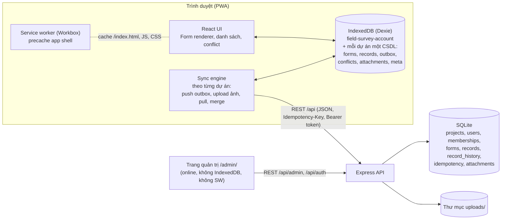
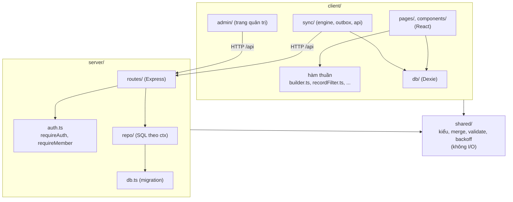
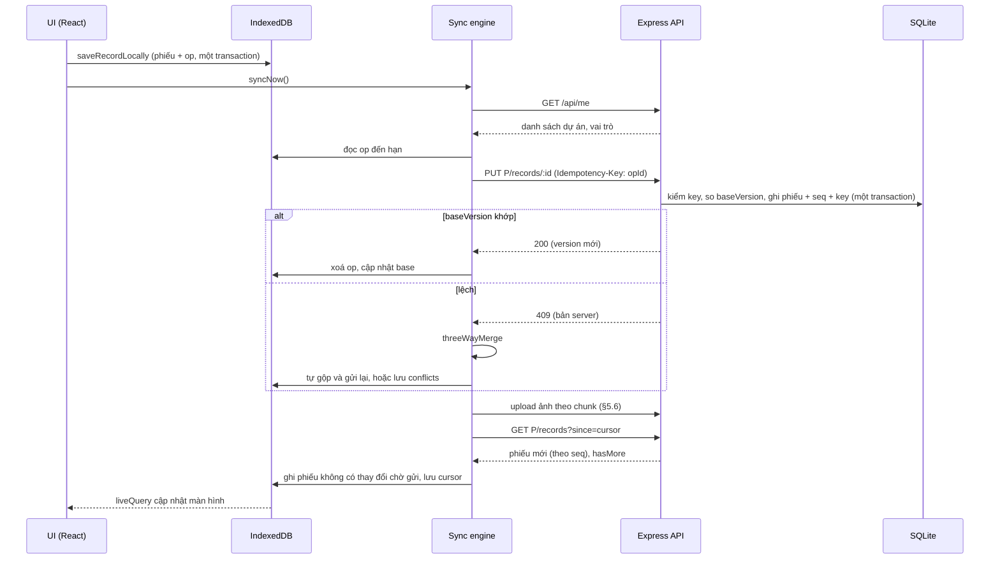
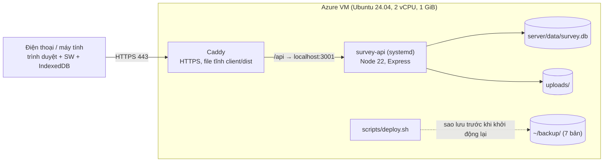
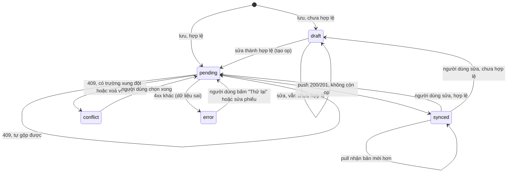

# Tài liệu thiết kế: Offline-first Field Survey PWA

- **Phiên bản:** 0.5.45 (2026-10-23)
- **Nhóm:** 3 sinh viên, 8 tuần. Phân công ở [team-plan.md](team-plan.md).
- **Quyết định kiến trúc (đã chấp nhận):** [ADR 0001 – Mô hình nhất quán](adr/0001-consistency-model.md), [ADR 0002 – Nhiều tổ chức](adr/0002-multi-tenancy.md), [ADR 0003 – Tài khoản, Owner, trang quản trị](adr/0003-accounts-and-owner-role.md) (thay một phần ADR 0002)
- **Quy ước:** "Code chưa làm" nghĩa là spec đã chốt nhưng khung mã hiện tại chưa theo.
- **Quy ước bản cũ / bản mới (từ 0.5):** chỗ nào ADR 0003 đổi so với code đang chạy thì ghi hai nhãn:
  - **🆕 Bản mới (ADR 0003, chưa có code):** spec đích, làm theo các ticket nhóm "Theo ADR 0003" trong [plan/](plan/README.md).
  - **🕘 Bản cũ (đang chạy, ADR 0002):** cách code hiện tại đang làm; giữ để đối chiếu, sẽ bỏ khi ticket tương ứng xong.

  Mục không có nhãn thì không bị ADR 0003 ảnh hưởng. Khi ticket xong, xoá đoạn 🕘 và bỏ nhãn 🆕 trong cùng PR. Từ 0.5.37 chỉ còn 🆕 ở màn hình A3 và API của nó (TV2-17, cắt được); không còn đoạn 🕘.
- **Phác thảo giao diện:** [ui.md](ui.md)

## Lịch sử thay đổi

| Phiên bản | Ngày | Thay đổi |
|---|---|---|
| 0.1 | 2026-10-07 | Bản đầu |
| 0.2 | 2026-10-07 | Thêm trạng thái nháp, sơ đồ trạng thái đầy đủ, khoá sửa khi đang xung đột, đồng bộ ảnh (§5.6), nhiều tab, phạm vi pull và vai trò, ràng buộc idempotency key, trình duyệt hỗ trợ, yêu cầu phi chức năng, triển khai, mã lỗi API, tiêu chí chấp nhận, thuật ngữ |
| 0.3 | 2026-10-07 | Chốt ADR 0001; phục vụ nhiều tổ chức theo ADR 0002: dự án, thành viên, vai trò `admin`, API theo dự án, mỗi dự án một IndexedDB, màn hình Dự án/Thành viên (§4.7); cắt builder kéo thả, so sánh ảnh, ZIP |
| 0.3.1 | 2026-10-09 | §9: route tiêm lỗi chuyển sang bật bằng `ENABLE_TEST_ROUTES=1` (TV3-01); §10: thêm unit test phía client |
| 0.4 | 2026-10-09 | Lấp chỗ hở trong spec: `createdBy` và tên người sửa trong `ServerRecord`/lịch sử (§6.2, §7), định dạng `GET /api/me` (§7), phân trang pull `hasMore` (§7), validate theo từng loại trường (§4.1), danh sách phiếu và bộ lọc (§4.8), đăng nhập mã khác khi còn dữ liệu (§4.7), xoá phiếu (§5.7), API tiêm lỗi đầy đủ (§10.1), cập nhật cấu trúc mã nguồn (§3); thêm [ui.md](ui.md). Các đề xuất chờ chốt liệt kê ở §14 |
| 0.4.1 | 2026-10-10 | Nhóm chốt P1, P2, P3, P5, P6, P8 (§14); bỏ nhãn "chờ chốt" ở §4.7, §5.7, §6.2, §7, §10.1 |
| 0.4.2 | 2026-10-10 | Thêm ca kiểm thử O7, O8 cho xoá phiếu (§10.1); P6 giao cho ticket TV2-13, TV1-13 (§14) |
| 0.4.3 | 2026-10-08 | TV2-01: chốt schema server sau migration 2 (§6.1): `record_history` có `project_id` (khớp ADR 0002), thêm index `memberships(user_id)`, `idempotency(created_at)`, khoá ngoại và `CHECK` vai trò; `attachments` để TV3-05 thêm ở migration 3 |
| 0.4.4 | 2026-10-11 | TV2-03: `P/forms`, `P/records` (pull, history, PUT) chạy theo dự án và có xác thực (§7); `PullResponse.scope` thêm, `PushRecordRequest` bỏ `updatedBy` (§6.2); server dev/E2E nạp tài khoản demo khi `SEED_DEMO=1` |
| 0.4.5 | 2026-10-11 | TV3-02: `seed:demo` từ chối chạy khi `NODE_ENV=production` (§12); `user:add` sinh `userId` dạng `u_` + 8 ký tự a-z0-9 |
| 0.4.6 | 2026-10-10 | `FieldDef.hidden` và `validateRecord` đã có code (§4.1, §6.2; TV1-05 phần thuần) |
| 0.4.7 | 2026-10-12 | TV2-04: `GET /me` và `/admin/projects` có code (§7); chốt định dạng API admin (id dự án do admin đặt, `PUT .../members/:userId` không có thân); thêm kiểu `AdminProject`, `CreateProjectRequest`, `UpdateProjectRequest` (§6.2) và mã `409 project_exists` (§7.1) |
| 0.4.8 | 2026-10-12 | TV2-05: client tách `field-survey-account` và `field-survey-p-<projectId>` (§4.2); `ProjectDb` version 1 gồm `draft`, `validationErrors`, `attachments.nextAttemptAt`; CSDL `field-survey` cũ bị xoá khi khởi động; `api.ts` nhận `projectId` bắt buộc |
| 0.4.9 | 2026-10-12 | TV2-06: vòng đồng bộ chạy trong Web Lock `field-survey-sync`, gọi `/me`, đồng bộ mọi dự án `active` (đang chọn trước), ghi số đếm "cần xử lý" (`conflict` + `error`) và "chưa đồng bộ" (`pending` + `draft`) vào `field-survey-account` (§4.2, §5.3); O6 có E2E (§10.1) |
| 0.4.10 | 2026-10-12 | TV2-07: `meta.pull = { cursor, scope }` và quy tắc phạm vi rộng/hẹp (§5.5); dự án bị rút hoặc hạ vai trò chỉ bị xoá dữ liệu khi không còn gì chưa gửi; `403 not_member` dừng dự án; route kiểm thử `/api/__test/memberships` (§10.1) |
| 0.4.11 | 2026-10-12 | TV2-08: `request_hash` = SHA-256 của JSON chuẩn hoá (khoá sắp xếp) gồm `projectId`, `recordId` và các trường `PushRecordRequest`; khác hash thì `422`; dọn key quá 30 ngày khi khởi động và mỗi 24 giờ; fault `drop` cắt kết nối sau khi ghi, thêm `drop-before` (§10.1); R2, R3, R6 có test |
| 0.4.12 | 2026-10-12 | TV2-09: op `failed` (4xx tính một lần gửi), sửa phiếu lỗi tạo op mới thay vì sửa op đã gửi, "Thử lại" giữ `opId` và `attempts` (§5.1); `createdAt` của op và quy tắc cảnh báo tồn lâu (§5.2); fault mode `"400"` và R5 có test (§10.1) |
| 0.4.13 | 2026-10-12 | Thêm đề xuất P9 ([ADR 0003](adr/0003-accounts-and-owner-role.md), chưa chốt): tự tạo tài khoản bằng tên + mật khẩu, tổ chức công khai (chỉ hiện tên), vai trò `owner` của tổ chức, yêu cầu mở tổ chức do admin duyệt, trang quản trị riêng. Các mục spec khác chưa đổi (§14) |
| 0.5 | 2026-10-12 | Chấp nhận ADR 0003 (PR #21, P9 chuyển sang "Đã chốt"). Spec đổi theo, **chưa có code**, đánh dấu 🆕/🕘: tài khoản tên + mật khẩu và bảng `sessions` (§4.7, §6.1, §9), vai trò `owner` (§2, §6.2), yêu cầu mở tổ chức do admin duyệt, tổ chức công khai chỉ hiện tên (§4.7), trang quản trị `/admin/` tách khỏi PWA (§2, §3, §4.3, §4.9), API và mã lỗi mới (§7, §7.1), ca kiểm thử U, Q, D, M, A5–A8 (§10.1), CLI (§12) |
| 0.5.1 | 2026-10-12 | TV1-05 client: phiếu không hợp lệ lưu thành `draft` kèm `validationErrors`, không tạo, sửa hay xoá op; op chưa gửi và op `failed` có sẵn được giữ; push xong op cũ vẫn giữ `draft`; pull bỏ qua `draft` (§4.1, §5.1, ADR 0001 quy tắc 8). O5 có test (§10.1) |
| 0.5.2 | 2026-10-12 | TV1-07 phần 1: trang Cài đặt (tên, `userId`, dung lượng) và Đăng xuất có code (§4.7); `account.user` ghi sau mỗi lần gọi `/me` (§4.2). 🆕 Spec mới (tên đăng nhập, `/auth/logout`) làm sau TV2-14/TV2-16 |
| 0.5.3 | 2026-10-12 | TV1-03: `POST P/forms` có code (§7): thân `SaveFormRequest` (§6.2), `version` do server đặt, `invalid_body`/`invalid_form`; luật lưu form thêm: `id` form cùng mẫu id trường, `title` không trống, option không trống, `options` ở trường không phải select bỏ qua (§4.1); `validateFormSchema` trong `shared/`; A3 phần forms và A5 phần supervisor/surveyor có test (§10.1); Owner chờ TV2-14 |
| 0.5.4 | 2026-10-13 | TV1-06: bộ chọn dự án có code (§4.7): chưa chọn lần nào hoặc dự án đã chọn đã rời thì vào dự án active đầu tiên theo thứ tự `/me`, bỏ mặc định `demo-yte` (§4.2); dự án "Đã rời" không chọn được; banner bị rút ở trang chủ, N đếm phiếu nháp/chờ/lỗi/xung đột, "Xoá khỏi máy" hỏi xác nhận; màn hình chưa có dự án. T7 đủ phần banner (§10.1). 🆕 Owner, "Tổ chức khác…" chờ TV2-16, TV1-15 |
| 0.5.5 | 2026-10-13 | TV1-04: form builder có code (§4.1): mã form/trường gợi ý từ nhãn và khoá sau khi lưu, chỉ xoá được trường chưa lưu, xem trước khoá ô nhập, lưu xong ghi form vào IndexedDB, builder báo trường thiếu nhãn; offline "Cần kết nối để lưu form"; hai người cùng sửa: bản lưu sau thành version mới (§13) |
| 0.5.6 | 2026-10-13 | Sửa lỗi TV1-03: `id` form được có dấu `-` (`^[a-zA-Z][a-zA-Z0-9_-]*$`), vì form mẫu `household-survey` không lưu được bản mới; `id` trường giữ mẫu cũ (§4.1) |
| 0.5.7 | 2026-10-14 | TV1-07 phần 2a: SW `registerType: 'prompt'` có code, dải "Có phiên bản mới" + [Tải lại], hỏi xác nhận khi đang nhập phiếu, kiểm bản mới mỗi 60 phút, `clientsClaim` ở lần cài đầu; runtime cache sửa theo đường dẫn theo dự án; `/admin/` không qua SW; icon PNG 192/512 (maskable) và `apple-touch-icon` (§4.3) |
| 0.5.8 | 2026-10-14 | TV1-07 phần 2b: kiểm tra API bắt buộc khi mở app và màn hình "Trình duyệt không được hỗ trợ" có code (§11.1); `storage.persist()` gọi sau mỗi lần lưu phiếu kể cả nháp, bỏ qua nếu đã được cấp (§4.2); hướng dẫn cài lên màn hình chính ở trang Cài đặt (§4.3); Đăng xuất xoá cache runtime `me`, `forms` của SW, giữ precache (§4.7) |
| 0.5.9 | 2026-10-15 | TV3-05: `P/attachments/*` có code (§7): dạng response của `status`, `chunks`, `complete`; bảng `attachments` là migration 3, file ở `uploads/<projectId>/<id>/` (§6.1). Bước ADR 0003 (TV2-14) lấy số migration kế tiếp |
| 0.5.10 | 2026-10-15 | TV3-03: nén ảnh có code (§4.4): JPEG 0.8, vượt 600 KB thì 0.7, 0.6, vẫn vượt thì vẫn lưu; §8 thêm dòng ảnh không đọc được; §11.2 kích thước ảnh sau nén đo bằng E2E `photo.spec.ts` |
| 0.5.11 | 2026-10-16 | TV1-10 phần 1: trường ẩn có code: phiếu mới không hiện, phiếu đã có giá trị thì hiện chỉ đọc kèm "(đã ẩn)", có lỗi định dạng thì mở cho sửa (§4.1); vòng đồng bộ tải bản form mà phiếu trên máy đang dùng nếu máy chưa có (§5.3 bước 5); trang điền phiếu thiếu bản form thì gọi đồng bộ, offline hoặc tải không được thì "Cần kết nối để mở phiếu này" (§8). Xuất/nhập form làm ở phần 2 |
| 0.5.14 | 2026-10-16 | TV2-13: `deleteRecordLocally` có code (§5.7): xoá hẳn khi phiếu chưa thể tới server, xoá mềm và op xoá khi có thể đã tới; op xoá của phiếu nháp mang bản hợp lệ cuối cùng (op chưa gửi nếu còn, không thì `baseData`) và phiếu nhận luôn bản đó; op xoá được xác nhận thì xoá phiếu và ảnh khỏi máy; pull bỏ qua tombstone của phiếu máy không có. Nút "Xoá phiếu" hiện có gọi hàm này sau `confirm()` của trình duyệt với đúng câu chữ (TV1-13 thay bằng hộp thoại của app). O7, O8 có E2E (§10.1) |
| 0.5.13 | 2026-10-16 | TV2-10: phiếu `conflict` không lưu, không xoá được ở tầng dữ liệu (`saveRecordLocally` ném `RecordInConflictError`), trang điền phiếu báo "Phiếu này cần xử lý xung đột trước" kèm link (§4.5); bỏ op `blocked` (§5.2); 409 tự gộp được thì gửi lại ngay trong cùng vòng, tối đa 3 lần mỗi phiếu (§5.3). C1, C6, C8 và pull bỏ qua nháp có E2E (§10.1) |
| 0.5.15 | 2026-10-16 | TV2-14: migration 4 có code (§6.1): `users.username`, `users.password_hash`, bảng `sessions` (chép token cũ thành phiên), `projects.public`, `memberships` tạo lại có `owner` và `added_by`; admin là thành viên thì migration dừng. `POST /auth/register`, `/login`, `/logout` có code, `requireAuth` tra `sessions`, `/me` trả `username`, vai trò `owner` trong `requireMember` và phạm vi pull (§7); trust proxy loopback để giới hạn tần suất đếm đúng IP sau Caddy (§9); tài khoản tự đăng ký ghi `users.token_hash` giữ chỗ (§6.1); kiểu `Role`, `MeResponse`, `RegisterRequest`, `LoginRequest`, `AuthResponse` và `parseRegisterRequest`/`parseLoginRequest` trong `shared/` (§6.2). U1–U6, MG1, MG2, A5 phần Owner có test (§10.1). CLI và `seed:demo` ghi token thành phiên làm cầu nối tới TV3-12 (§12) |
| 0.5.16 | 2026-10-16 | TV3-12: CLI theo tài khoản có code (§12): `user:add --username`, `user:reset-password`, `user:revoke-sessions`, `user:disable` (khoá và thu hồi phiên), bỏ `user:rotate-token`; `seed:demo` có mật khẩu demo và Owner `chu`, giữ token demo tới TV1-14/TV2-16 |
| 0.5.17 | 2026-10-16 | TV3-06: hàng đợi ảnh có code (§5.6): chỉ ảnh còn trong phiếu chưa xoá mới upload và mới tính là dữ liệu chưa gửi; `409 missing_chunks` gửi bù, `422` lần đầu gửi lại từ đầu; thứ tự nhãn khi phiếu chưa đồng bộ; nhãn trên ảnh thu nhỏ; O3 có E2E (§10.1) |
| 0.5.12 | 2026-10-16 | TV1-10 phần 2: Xuất/Nhập form trong builder có code (§4.1): xuất `<id>-v<version>.json`, nhập nạp vào builder thành form mới; form mới trùng mã form đã có báo "Mã biểu mẫu đã có trong dự án"; kiểm kiểu thân lưu form chuyển sang `shared/` (`parseSaveFormRequest`), server dùng chung; §8 thêm dòng file nhập không hợp lệ |
| 0.5.18 | 2026-10-17 | TV1-08 phần 1: API thành viên có code (§7): `GET/POST P/members`, `PUT/DELETE P/members/:userId`, `PATCH P/settings`; thứ tự kiểm lỗi, supervisor không tự rút mình, đổi vai trò giữ `added_at` và ghi `added_by`; kiểm và ghi trong một transaction để không mất Owner cuối cùng. Kiểu `Member`, `ProjectSettings` và luật thân request, `canAssignRole` ở `shared/` (§6.2). `last_owner`, `already_member`, `admin_account` có code (§7.1). M1, M2, A6, A7, Q9, D2 (trừ vế D1) có test (§10.1). Màn hình Thành viên (phần 2) chưa có |
| 0.5.19 | 2026-10-17 | TV1-08 phần 2: màn hình Thành viên có code (§4.7, ui.md màn hình 6); supervisor và Owner thấy Sửa form, Thành viên; thêm `GET P/settings` (owner) để màn hình đọc trạng thái công khai (§7, Dương chốt); thao tác làm mình mất quyền chạy một vòng đồng bộ mới sau vòng đang chạy (`syncAfterChange`) để `/me` cập nhật ngay |
| 0.5.20 | 2026-10-17 | TV3-10: API kiểm thử `match`, `chunkIndex`, `stats` có code (§10.1), request bị cắt kết nối ghi `status: 0`; R4 có E2E, O3 kiểm 2 ảnh và trạng thái "Đang tải ảnh (2)" |
| 0.5.21 | 2026-10-17 | TV3-07: màn hình xung đột có code (§4.5): thẻ mỗi trường, nhãn theo form, "Gộp cả hai", mục "Đã gộp tự động"; xoá vs sửa khoá Áp dụng tới TV3-08; phiếu `conflict` mở ra chỉ đọc; bộ lọc trạng thái và số "Cần xử lý" (§4.8), phiếu đã xoá mà đang xung đột vẫn hiện; C7 có E2E (§10.1) |
| 0.5.22 | 2026-10-17 | TV1-13: hộp xác nhận xoá phiếu là hộp trong app (`ConfirmDialog`), O7 kiểm câu chữ, Huỷ và Esc (§10.1). Ẩn nút xoá với surveyor theo người tạo chưa có code (thiếu `createdBy`, §6.2) |
| 0.5.23 | 2026-10-17 | TV1-11: O2, O4 có E2E (`offline-install.spec.ts`); T6, T10 có E2E (`projects.spec.ts`) (§10.1) |
| 0.5.24 | 2026-10-17 | TV1-17 phần 1: `ServerRecord.createdBy`, `createdByName`, `updatedByName` và `RecordHistoryEntry.updatedByName` có code (§6.2): server ghép tên lúc đọc ở pull, PUT, 409, history; không tìm thấy tài khoản thì tên rỗng. Client chưa dùng (phần 2) |
| 0.5.25 | 2026-10-17 | TV1-17 phần 2: client lưu `createdBy`, `createdByName` theo phiếu, màn hình xung đột hiện tên người sửa (§6.2); surveyor không thấy "Xoá phiếu" ở phiếu người khác tạo (§5.7) |
| 0.5.26 | 2026-10-17 | Sửa vòng đồng bộ (§5.3): gọi `syncNow()` lúc đang có vòng chạy thì chạy thêm đúng một vòng sau đó, thay cho gộp vào vòng đang chạy (phiếu lưu lúc vòng đã qua bước push phải chờ tới 30 s); bỏ `syncAfterChange` |
| 0.5.27 | 2026-10-18 | TV3-08: hộp thoại xoá vs sửa có code (§4.5): khung hai lựa chọn ngay trong màn hình xung đột, không chọn sẵn; chỉ hỏi giữ hay xoá, không kèm thẻ từng trường; "Bỏ" cũng gửi op xoá; C4, C5 có E2E (§10.1) |
| 0.5.28 | 2026-10-18 | TV3-09: export có code (§4.6, §7): thêm cột `updatedByName`; chống CSV injection chỉ với ô chữ (số giữ nguyên), thêm tab và CR; `format` mặc định `csv`, lạ thì `400`, form không có thì `404`; route cũ `/api/export` bỏ; nút "Xuất CSV"/"Xuất JSON" ở trang chủ; A3 phần export có test (§10.1) |
| 0.5.29 | 2026-10-18 | TV2-15: migration 5 `project_requests` có code (§6.1). `/directory`, `/project-requests`, `/admin/project-requests`, `PUT /admin/projects/:projectId/owners/:username` có code (§7): duyệt tạo tổ chức và Owner trong một transaction, giới hạn 3 tổ chức kiểm lại lúc duyệt, `?status=` mặc định `pending`, huỷ chỉ đổi trạng thái. `GET /admin/projects` thêm `ownerUsernames`, `memberCount`; `PATCH` chỉ còn `{ archived }`; **bỏ** `POST /admin/projects`, `PUT …/members/:userId` và mã `project_exists` (§7.1). Kiểu `DirectoryEntry`, `ProjectRequest`, `AdminProjectRequest`, `CreateProjectRequestBody`, `DecideProjectRequest` và luật thân request ở `shared/` (§6.2). Route kiểm thử `PUT /api/__test/projects/:projectId` thay `POST /admin/projects` cho E2E (§10.1). Q1–Q7, D1, D2 (vế D1), A8 có test, T4 viết lại (§10.1) |
| 0.5.30 | 2026-10-18 | TV2-16: client đăng nhập bằng phiên có code (§4.2, §4.7): `register`, `login`, `logoutSession`, `fetchMeWithToken` ở `api.ts`; `signIn.ts` biết người dùng là ai rồi mới lưu token, trong Web Lock `field-survey-sync` (tài khoản admin → `AdminAccountError`, cùng người → thay token, khác người mà máy trống → xoá dữ liệu người cũ, khác người mà còn dữ liệu chưa gửi → từ chối, không xoá gì); phiên bị từ chối được huỷ trên server; màn hình nhập mã kiểm mã trước khi lưu ("Mã không đúng"); vòng đồng bộ bỏ token admin đã lưu từ trước; Đăng xuất gọi `POST /auth/logout` khi online. Q11 có E2E (§10.1) |
| 0.5.31 | 2026-10-19 | TV1-14: màn hình Đăng nhập / Tạo tài khoản có code (§4.7), bỏ màn hình nhập mã (`signInWithToken`, `fetchMeWithToken`, mã lỗi client `invalid_token`); câu lỗi phía client, tab Đăng nhập không kiểm mẫu tên; câu từ chối đổi tài khoản và nút Xuất JSON; tạm khi chưa thuộc tổ chức nào hiện tên đăng nhập (tới TV1-15); xoá đoạn 🕘 "Lần đầu mở app". U7 có test, Q11 qua màn hình mới (§10.1) |
| 0.5.32 | 2026-10-19 | TV1-15: màn hình Tổ chức có code (§4.7): danh bạ, mở tổ chức mới, yêu cầu của mình kèm trạng thái và Huỷ; chưa thuộc tổ chức nào thì trang chủ là màn hình này (thay câu tạm của TV1-14); bộ chọn dự án có "Tổ chức khác…" (phần 🆕 còn lại của TV1-06). Q8, M3 có test (§10.1) |
| 0.5.33 | 2026-10-19 | TV1-16 phần 1: khung trang quản trị `/admin/` có code (§4.3, §4.9): Vite build hai trang, đăng nhập admin (token + thông tin admin trong `sessionStorage`, không gọi `/api/me`; tài khoản thường bị từ chối và phiên vừa cấp bị huỷ), Đăng xuất, thanh trên A1/A2 (A3 ẩn tới TV2-17); precache PWA và manifest không có trang admin; Q10 một phần (§10.1); §12 cách kiểm `/admin/` trên Caddy. A1, A2 chưa có (phần 2) |
| 0.5.34 | 2026-10-19 | TV1-16 phần 2: A1 (duyệt, từ chối bắt buộc lý do) và A2 (khoá có xác nhận/mở, Đổi Owner = thêm Owner, Owner cũ giữ quyền) có code (§4.9); số yêu cầu đang chờ trên thanh trên; lỗi API admin: 401/403 về form đăng nhập, 5xx "Máy chủ đang lỗi, thử lại sau", mất mạng "Cần kết nối mạng"; `navigateFallbackDenylist` khớp cả `/admin` không có `/` (§4.3). Q10 có E2E đủ (§10.1). §12: sửa nhận định sai về `try_files` (Caddy 2.11 đưa `/admin/` về trang PWA), Caddyfile có khối `/admin/*` riêng |
| 0.5.35 | 2026-10-19 | TV1-07 (cập nhật theo ADR 0003): trang Cài đặt hiện **tên đăng nhập** thay mã người dùng (§4.7); `account.user` lưu từ bản cũ chưa có `username` thì hiện `userId` (tài khoản cũ có username = id), cùng luật với màn hình Tổ chức (`client/src/accountDisplay.ts`) |
| 0.5.36 | 2026-10-19 | TV1-12 phần a1: mọi hộp hỏi xác nhận trong PWA là hộp trong app `ConfirmDialog` (Đăng xuất, đổi vai trò/rút thành viên, Tải lại khi đang nhập phiếu, Xoá khỏi máy ở banner dự án đã rời; trước đây `window.confirm`), nút xác nhận đỏ chỉ cho việc mất dữ liệu/quyền (§4.3, §4.7); hộp Xoá phiếu đóng hẳn khi phiếu thành xung đột (§5.7); chữ "Chỉ giám sát viên và Owner…" ở builder, lưu form, xuất; nút Xuất JSON khi bị từ chối đổi tài khoản báo kết quả (§4.7); bỏ dòng 🕘 Màn hình Thành viên "thêm bằng `userId`" (đã thay ở TV1-08) |
| 0.5.37 | 2026-10-22 | Ghi lại spec cho đúng code: bỏ đoạn 🕘 và nhãn 🆕 của phần ADR 0003 đã có code (§1, §2, §3, §4.6, §4.7, §5.5, §6.1, §7, §7.1 bỏ `last_supervisor`, §9, §10.1, §13–§15; chỉ còn 🆕 ở A3/TV2-17); §3 cấu trúc mã nguồn hết "Chưa có"; §8 cảnh báo sau 5 lần retry đã có code, `401` ghi đúng hành vi hiện tại; §10.1 T5 đã có test (`isolation.test.ts`); §12 token demo. Thêm [tech-debt.md](tech-debt.md) (sổ nợ kỹ thuật, Lecture 05), trỏ từ §3, §8, §12, §13; [deploy.md](deploy.md) thêm "Quay lại bản trước" và tín hiệu sau deploy |
| 0.5.38 | 2026-10-22 | Bổ sung phần yêu cầu theo Lecture 03, không đổi hành vi: §1 thêm vấn đề, kết quả mong muốn K1–K4, giả định, cột MoSCoW cho bảng phạm vi; §2 thêm bên liên quan không dùng app, bảng mâu thuẫn giữa các bên, nhánh phụ của kịch bản; §11.2 ghi nguồn chỉ tiêu; thêm §11.3 khả năng tiếp cận, §11.4 kịch bản chất lượng 6 phần. Thêm [requirements.md](requirements.md): 12 user story có Given/When/Then và bảng truy vết story → test → ticket/PR |
| 0.5.39 | 2026-10-22 | Bổ sung phần kiến trúc theo Lecture 04, không đổi hành vi: §3.1 kiểu kiến trúc (modular monolith, local-first) và phương án đã loại; §3.2 góc nhìn module và quy tắc phụ thuộc; §3.3 góc nhìn chạy (vòng đồng bộ); §3.4 góc nhìn triển khai; §6.3 ai sở hữu dữ liệu nào; §12 log và theo dõi. team-plan: quy trình theo cách nhóm đang làm (tự merge, không demo hằng tuần) và 3 vai (gộp 4 vai của Lecture 02 cho nhóm 3 người); vibe-coding: bằng chứng dùng AI ghi trong PR thay `Assisted-by:`, thêm 2 câu checklist |
| 0.5.40 | 2026-10-22 | Trả nợ N7: `seed:demo` không tạo phiên token cố định nữa và xoá phiên token demo cũ trong DB dev (§12); E2E lấy token bằng đăng nhập trong `client/e2e/global-setup.ts` |
| 0.5.41 | 2026-10-22 | Chia việc chưa ai nhận theo MVP, không đổi hành vi: §1 bảng phạm vi thêm Danh sách phiếu (§4.8), Khả năng tiếp cận (§11.3), Log (§12), Vận hành staging kèm mức MoSCoW và ticket mới (TV1-19, TV2-18, TV2-19, TV3-13…TV3-16 ở [plan/](plan/README.md)); §4.8 trỏ phần chưa có code sang TV2-18 |
| 0.5.42 | 2026-10-22 | TV1-12 a2: `401` hiện "Phiên đăng nhập hết hạn, đăng nhập lại" ở màn hình Đăng nhập (khoá `sessionExpired` trong `account`, §4.2; trả nợ N5); màn hình cần online (Thành viên, Tổ chức, builder lưu form, Xuất) gặp `5xx` hoặc mã lạ báo "Máy chủ đang lỗi, thử lại sau", không tự thử lại (§8); thêm thành viên bằng tài khoản bị khoá trả `404 not_found` như tên không có (§7) |
| 0.5.43 | 2026-10-22 | TV1-19 phần 2: diễn tập quay lại bản trước trên staging lần đầu, QS5 có số đo (quay lại 19 s, quay về `main` 21 s), mục tiêu ≤ 5 phút cho nhánh 2a (Dương chốt) (§11.4); `deploy.md` sửa theo lúc chạy thật; trả nợ N3 |
| 0.5.44 | 2026-10-22 | TV3-13: sao lưu hằng ngày bằng `scripts/backup-daily.mjs` (systemd timer), mỗi bản là một thư mục gồm `survey.db` và ảnh, kiểm đủ ảnh trước khi tính là một bản; trên staging `UPLOAD_DIR` để ngoài repo (§12). Thêm nợ N9 (bản sao lưu cùng ổ đĩa) |
| 0.5.45 | 2026-10-23 | TV1-12 b1: danh sách phiếu rỗng hiện "Chưa có phiếu nào." (§4.8); bảng §8 thêm dòng không lấy được vị trí GPS (từ chối quyền, không lấy được, quá 30 s, trình duyệt không có geolocation) và "Đang lấy vị trí…" lúc chờ |
| b2 | 2026-10-23 | TV1-12 b2 p1, chỉ đổi giao diện: token và kiểu nền theo bản thiết kế (ui.md "Hệ thống thiết kế"); nút đang gửi chỉ có vòng xoay, chữ phụ chỉ cho trình đọc màn hình trừ Lấy vị trí; nút trong trang mở hộp xác nhận có viền đỏ, đỏ đặc chỉ ở nút xác nhận (§4.7). p2: trang chủ có nút [Xuất ▾] mở hai lựa chọn Xuất CSV, Xuất JSON (§4.6); chưa có phiếu nào thì ẩn bộ lọc (§4.8). p3: câu giải thích ở màn hình xung đột bỏ "N trường đã được gộp tự động." khi không có trường nào gộp hoặc là xoá vs sửa (§4.5); mất mạng lúc đang mở [Xuất ▾] thì đóng hẳn (§4.6). p4: builder tự cuộn tới khung xem trước (kèm dải báo đang xem trước) và tới khung lỗi khi lưu lỗi (§4.1). p5: màn hình Thành viên, Tổ chức theo thiết kế; dòng thành viên và dòng yêu cầu bỏ " · "; Tổ chức chưa tải được danh sách công khai thì ẩn khối đó (ui.md màn hình 6, 9). p6: màn hình Đăng nhập, Cài đặt theo thiết kế; "Cần kết nối mạng" ở Đăng nhập nền vàng như hết phiên, lỗi người dùng chữ đỏ (ui.md màn hình 1, 8). Số phiên bản đặt ở PR nhánh gom → main |

## Mục lục

1. Mục tiêu và phạm vi
2. Người dùng và kịch bản chính
3. Kiến trúc tổng quan
4. Thành phần
5. Đồng bộ
6. Mô hình dữ liệu
7. REST API
8. Xử lý lỗi
9. Bảo mật và quyền riêng tư
10. Kiểm thử
11. Yêu cầu phi chức năng
12. Triển khai
13. Rủi ro và hạn chế
14. Câu hỏi mở
15. Thuật ngữ

---

## 1. Mục tiêu và phạm vi

**Vấn đề** (nói không kèm công nghệ): các nhóm khảo sát thực địa (y tế, nông nghiệp, giáo dục, ...) thu thập phiếu ở nơi sóng yếu hoặc không có mạng. Ghi giấy hay bảng tính rời thì phải nhập lại, dễ thất lạc hoặc trùng phiếu; khi người giám sát sửa một phiếu mà người đi thu thập cũng đang sửa thì không ai biết bản nào đúng. Hậu quả: chậm có dữ liệu, mất phiếu, số liệu sai mà không ai hay.

**Kết quả mong muốn** (story và test tương ứng ở [requirements.md](requirements.md)):

| Mã | Kết quả | Đo bằng |
|---|---|---|
| K1 | Không mất phiếu: mọi phiếu đã lưu trên máy lên server đúng một lần, kể cả khi mạng hoặc server lỗi | Số phiếu trên server bằng số phiếu đã lưu, không trùng (O2, R1–R4) |
| K2 | Không ghi đè âm thầm: hai nơi cùng sửa một trường thì người dùng thấy và tự chọn | Không trường nào bị thay mà người dùng không được hỏi (C2, C4, C5, C8) |
| K3 | Không phải nhập lại: giám sát viên lấy được dữ liệu dạng bảng ngay từ app | Xuất CSV mở được bằng Excel, đủ phiếu (§4.6) |
| K4 | Không lẫn dữ liệu giữa các tổ chức, kể cả với người vận hành app | Không route nào trả dữ liệu cho người ngoài tổ chức (T1–T5, Q7) |

**Giả định** (chưa có bằng chứng; Lecture 03 yêu cầu ghi rõ):
- Chưa phỏng vấn hay thử với nhóm khảo sát thật (§14 câu 1). Người dùng, nhu cầu và mâu thuẫn ở §2 là giả định của nhóm; `demo-yte`, `demo-nongnghiep` là dự án mẫu tự đặt.
- Chưa có số liệu quy trình hiện tại (thời gian nhập lại, tỉ lệ mất phiếu) nên K1–K4 đo bằng test chứ chưa so được với trước.
- Chỉ tiêu §11.2 là mục tiêu nhóm tự đặt theo thiết bị tham chiếu, chưa đo (TV2-11).
- **Giả định rủi ro nhất:** điện thoại giữ được dữ liệu trong trình duyệt nhiều ngày khi offline (iOS có thể xoá, §13) và điều tra viên chịu dùng PWA thay app native. Bằng chứng đã có: 3 thành viên cài và chạy offline trên Android và iPhone thật (TV1-01). Bằng chứng còn thiếu: một đợt thử thật nhiều ngày.

**Mục tiêu:** một hệ thống dùng chung cho **nhiều nhóm thuộc các tổ chức khác nhau** (y tế, nông nghiệp, giáo dục, ...). Mỗi nhóm tự tạo form cho lĩnh vực của mình; điều tra viên thu thập phiếu ở nơi không có mạng, dữ liệu tự đồng bộ khi có kết nối, và khi hai nơi cùng sửa một phiếu thì hệ thống giải thích rõ chuyện gì xảy ra để người dùng tự quyết. Dữ liệu của các nhóm tách biệt hoàn toàn (ADR 0002).

**Trong phạm vi (MVP)**

Mức theo MoSCoW: **Must** thiếu thì không đạt tiêu chí thành công dưới đây; **Should** giá trị cao nhưng có cách làm thay; **Could** cắt được nếu trễ (theo thứ tự cắt trong [team-plan](team-plan.md#lộ-trình)); **Won't** là "Ngoài phạm vi".

| Nhóm chức năng | Nội dung | Mức |
|---|---|---|
| Dự án và thành viên | Mỗi nhóm là một dự án (tổ chức) có form, phiếu, ảnh và thành viên riêng. Một người thuộc được nhiều dự án với vai trò khác nhau; đổi dự án ngay trong app, kể cả khi offline. | Must |
| Tài khoản và tổ chức | Tự tạo tài khoản (tên + mật khẩu); gửi yêu cầu mở tổ chức, admin duyệt, người gửi thành Owner; tổ chức công khai hiện tên trong danh sách; trang quản trị riêng cho admin (ADR 0003). | Must; màn hình A3 Tài khoản: Could (CLI làm thay) |
| Form builder | Tạo/sửa form với 7 loại trường: text, number, select, multiselect, date, photo, gps. Form có phiên bản, thuộc một dự án. | Must; xuất/nhập form JSON: Could |
| Offline storage | Form, phiếu, ảnh, hàng đợi đồng bộ trong IndexedDB (Dexie). App shell được service worker precache. | Must |
| Sync queue | Outbox bền vững, retry với exponential backoff, idempotency key. | Must |
| Attachments | Nén ảnh ở client, upload theo chunk, tiếp tục khi mất mạng giữa chừng. | Must |
| Conflict UI | Merge theo trường, hiển thị ai sửa, lúc nào, giá trị gốc/của bạn/trên máy chủ. | Must; "Gộp cả hai" cho multiselect: Could |
| Export | CSV (UTF-8 có BOM) và JSON theo từng dự án; ảnh xuất dạng URL. | Must (CSV), Should (JSON) |
| Đo hiệu năng (§11.2) | Đo các chỉ tiêu trên bộ dữ liệu mẫu. | Should (pull 2.000 phiếu); đo đầy đủ: Could |
| Danh sách phiếu (§4.8) | Nhóm theo form, nhãn trạng thái, lọc theo trạng thái; tìm theo tiêu đề, lọc theo người tạo, 2.000 phiếu cuộn mượt. | Must (lọc theo trạng thái); tìm kiếm, lọc người tạo, 2.000 phiếu: Could (TV2-18) |
| Khả năng tiếp cận (§11.3) | Rà nhãn ô nhập, trạng thái không chỉ bằng màu, tương phản, bàn phím. | Could (TV3-15) |
| Log và theo dõi (§12) | Một dòng log mỗi request, không ghi token. | Could (TV2-19) |
| Vận hành staging (§12, [deploy.md](deploy.md)) | Sao lưu hằng ngày CSDL và ảnh; quay lại bản trước có diễn tập. | Must (sao lưu hằng ngày, TV3-13); Should (quay lại bản trước, TV1-19) |

**Ngoài phạm vi (Won't trong MVP):** đăng nhập SSO, email (xác nhận tài khoản, quên mật khẩu, mời qua email), xin tham gia tổ chức trong app, tìm kiếm và mô tả tổ chức, tổ chức nhiều cấp, phân quyền chi tiết hơn các vai trò ở §2, logic điều kiện trong form, nhóm lặp (danh sách dòng trong phiếu), báo cáo/biểu đồ, cộng tác thời gian thực, ứng dụng native, nhiều tài khoản trên một máy, builder kéo thả (dùng nút lên/xuống), so sánh ảnh trong màn hình xung đột, xoá hoặc ngừng dùng form (form cũ vẫn hiện trong danh sách).

**Tiêu chí thành công (dùng để demo tuần 8)**
- Hai dự án mẫu (`demo-yte`, `demo-nongnghiep`) với form khác nhau; một người là điều tra viên ở dự án này và giám sát viên ở dự án kia, đổi qua lại khi offline, không thấy lẫn dữ liệu.
- Trên điện thoại thật qua HTTPS: tắt mạng hoàn toàn, mở app từ màn hình chính, tạo 10 phiếu có ảnh và GPS; bật mạng, tất cả phiếu **và ảnh** lên server, không trùng.
- Hai máy cùng sửa một phiếu khi offline: khác trường thì tự gộp; cùng trường thì hiện màn hình conflict dễ hiểu.
- Server lỗi 500 / timeout / mất mạng giữa lúc upload: dữ liệu vẫn lên đủ, đúng một lần.
- Đạt các chỉ tiêu hiệu năng ở §11 trên bộ dữ liệu mẫu 2.000 phiếu.

## 2. Người dùng và kịch bản chính

| Vai trò | Là ai | Phạm vi | Nhu cầu / quyền |
|---|---|---|---|
| **Điều tra viên** (`surveyor`; dùng điện thoại, thường offline) | Người đi thu thập | Theo tổ chức | Nhập nhanh, không mất dữ liệu, biết phiếu nào đã lên server; chỉ thấy phiếu mình tạo |
| **Giám sát viên** (`supervisor`; thường online, máy tính hoặc điện thoại) | Người giám sát của khách hàng | Theo tổ chức | Sửa phiếu sai, tạo/sửa form, xuất dữ liệu, thêm/rút điều tra viên |
| **Owner** (`owner`) | Khách hàng, người đứng ra mở tổ chức và **sở hữu dữ liệu** | Theo tổ chức | Mọi quyền của giám sát viên; thêm/đổi/rút giám sát viên và Owner; đổi tên tổ chức, bật/tắt công khai |
| **Admin** (cờ `is_admin`) | Người kiểm soát app (nhóm phát triển) | Toàn hệ thống | Duyệt yêu cầu mở tổ chức, khoá tổ chức/tài khoản vi phạm, hỗ trợ khi mất tài khoản Owner. **Không có quyền xem** form, phiếu, ảnh; không là thành viên tổ chức nào |

Thứ hạng trong tổ chức: `surveyor < supervisor < owner`. Một tài khoản thuộc được nhiều tổ chức với vai trò khác nhau. Surveyor, supervisor, Owner dùng PWA khảo sát; **admin dùng trang quản trị riêng `/admin/`** (§4.9), không đăng nhập được vào PWA.

**Bên liên quan không dùng app:** người được khảo sát (hộ dân, bệnh nhân, ...) có tên, vị trí GPS, ảnh nằm trong phiếu nhưng không có tài khoản; nhóm phát triển vận hành staging và giữ bản sao lưu.

**Mâu thuẫn giữa các bên** (giả định, §1) và cách spec giải quyết. Mâu thuẫn là thông tin yêu cầu, không phải chuyện để AI hay một người tự chọn:

| Mâu thuẫn | Giữa | Cách giải quyết |
|---|---|---|
| Lưu nhanh dù phiếu chưa đủ ↔ chỉ nhận phiếu đủ trường | Điều tra viên ↔ giám sát viên | Phiếu chưa hợp lệ lưu thành nháp, không lên server (§4.1, §5.1) |
| Ai sửa sau thì thắng ↔ không mất phần mình đã sửa | Điều tra viên ↔ giám sát viên | Khác trường tự gộp, cùng trường hỏi người dùng; máy không tự chọn (ADR 0001) |
| Giám sát viên muốn mọi phiếu trên điện thoại ↔ riêng tư của người được khảo sát, dung lượng máy | Giám sát viên ↔ người được khảo sát, điều tra viên | Điều tra viên chỉ tải phiếu mình tạo (§5.5) |
| Sửa form giữa đợt khảo sát ↔ phiếu cũ phải mở được | Giám sát viên ↔ điều tra viên | Form có phiên bản, chỉ được thêm hoặc ẩn trường (§4.1) |
| Owner sở hữu và giữ kín dữ liệu ↔ người vận hành cần hỗ trợ khi mất tài khoản | Owner ↔ admin | Admin không là thành viên, không xem dữ liệu; chỉ duyệt, khoá, chỉ định Owner (ADR 0003) |
| Đăng xuất hoặc đổi người dùng ngay ↔ không mất phiếu chưa gửi | Người dùng chung máy | Chặn khi còn dữ liệu chưa gửi, cho Xuất JSON (§4.7) |

**Kịch bản**
0. *Mở tổ chức mới:* khách hàng tự tạo tài khoản trên app, gửi yêu cầu mở tổ chức; admin duyệt ở trang quản trị; khách hàng thành Owner, thêm giám sát viên và điều tra viên bằng tên đăng nhập của họ (họ cũng tự tạo tài khoản).
1. *Chuẩn bị:* giám sát viên tạo form. Điều tra viên đăng nhập bằng tên + mật khẩu, mở app khi có Wi-Fi, app tải danh sách tổ chức và form, cài lên màn hình chính.
2. *Thực địa:* mất mạng; điều tra viên tạo phiếu, chụp ảnh, lấy GPS. Mỗi phiếu hiện nhãn "Chờ đồng bộ" (hoặc "Nháp" nếu thiếu trường bắt buộc).
3. *Về vùng có mạng:* app tự đồng bộ; nhãn đổi thành "Đã đồng bộ" khi cả phiếu và ảnh đã lên. Nếu giám sát viên đã sửa cùng phiếu, phiếu hiện "Cần xử lý xung đột".
4. *Xử lý xung đột:* màn hình liệt kê trường bị sửa ở cả hai nơi, người sửa và thời điểm; điều tra viên chọn giá trị giữ lại.
5. *Tổng hợp:* giám sát viên xuất CSV.

**Nhánh phụ** (chi tiết ở §8 và các mục được trỏ):
- 2a. Phiếu thiếu trường bắt buộc: lưu thành "Nháp", không đồng bộ, hiện lỗi khi mở lại (§4.1).
- 2b. Ảnh không đọc được (vd. HEIC trên Chrome Android): báo, không lưu ảnh (§8).
- 2c. Bộ nhớ máy đầy: không lưu ảnh mới, nhắc đồng bộ rồi dọn ảnh đã tải lên (§8).
- 3a. Mất mạng, timeout hoặc server lỗi giữa chừng: thử lại theo backoff, không gửi trùng (§5.3, §5.4).
- 3b. Mất mạng giữa lúc tải ảnh: lần sau chỉ gửi phần thiếu (§5.6).
- 3c. Server từ chối phiếu (`4xx`): phiếu "Lỗi", nút "Thử lại" và "Xuất JSON phiếu này" (§8).
- 3d. Điều tra viên đã bị rút khỏi tổ chức: banner, phiếu chưa gửi giữ trên máy, Xuất JSON (§4.7).
- 3e. Phiên bị thu hồi (`401`): về màn hình Đăng nhập, dữ liệu trên máy giữ nguyên (§8).
- 4a. Một bên xoá, một bên sửa: hỏi giữ hay xoá, không chọn sẵn (§4.5).
- 4b. Máy chủ đổi tiếp trong lúc đang chọn: khác trường tự gộp, cùng trường hiện xung đột mới (§4.5).
- 4c. Phiếu đang xung đột: chỉ đọc tới khi xử lý xong (§4.5).
- 5a. Không có mạng: nút Xuất khoá kèm "Cần kết nối mạng để xuất" (§4.6).

## 3. Kiến trúc tổng quan



**Nguyên tắc**
- **Local-first:** UI chỉ đọc/ghi IndexedDB, không bao giờ chờ mạng. Mạng là việc của sync engine chạy nền.
- **Một nguồn sự thật cho mỗi việc:** server quyết định thứ tự phiên bản; client giữ dữ liệu người dùng cho tới khi server xác nhận.
- **Cách ly theo dự án:** server lấy `projectId` chỉ từ đường dẫn đã qua kiểm tra thành viên; client mở riêng một CSDL cho mỗi dự án (ADR 0002).
- **Code dùng chung** (`shared/`): kiểu dữ liệu, thuật toán merge, backoff, để client và server không lệch nhau.

**Cấu trúc mã nguồn**

```
field-survey-pwa/
  shared/   kiểu dữ liệu, threeWayMerge, nextRetryDelay, validate form/phiếu (+ unit test)
  server/   Express + node:sqlite
            src/db.ts (migration), src/auth.ts (token, requireMember),
            src/repo/ (truy cập dữ liệu theo ctx), src/routes/ (me, admin, members, forms,
            records, attachments, export, faults), src/cli/ (user:*, seed:*); test/
  client/   React + Vite + Dexie + vite-plugin-pwa
            src/db (accountDb, projectDb), src/sync (api, engine, outbox, attachments),
            src/pages, src/components, src/media; e2e/
            admin/index.html + src/admin/ (trang quản trị, không dùng Dexie/sync)
  docs/     design.md, requirements.md, ui.md, team-plan.md, vibe-coding.md, tech-debt.md,
            adr/, plan/, deploy.md, worklog/
```

Mọi thư mục trên đã có code. Việc chưa làm của spec ghi ở [tech-debt.md](tech-debt.md) và chỗ đánh dấu 🆕.

### 3.1 Kiểu kiến trúc

**Modular monolith, client local-first.** Server là một tiến trình Node, chia module theo route và lớp `repo/`, dùng một file SQLite. Client là PWA làm việc trên IndexedDB, đồng bộ nền.

| Phương án | Vì sao không chọn |
|---|---|
| Một app không chia lớp (route gọi SQL trực tiếp, UI gọi API trực tiếp) | Không có chỗ bắt buộc lọc `project_id` (ADR 0002), UI phải chờ mạng nên không chạy offline |
| Microservices (sync, ảnh, tài khoản tách dịch vụ) | 3 người, 8 tuần, một máy 1 GiB RAM; tách mạng làm transaction "ghi phiếu + `seq` + idempotency" thành giao dịch phân tán |

Hệ quả: deploy một đơn vị, một lệnh (`deploy.sh`); ranh giới module chỉ giữ được nhờ quy ước và review (bảng phụ thuộc dưới đây, checklist [vibe-coding.md](vibe-coding.md) §4). Bước tiếp theo nếu phải lớn lên: đổi SQLite sang Postgres (§6.1 "Nếu đổi sang Postgres"), chưa cần tách dịch vụ.

### 3.2 Góc nhìn module (code tổ chức thế nào)



| Quy tắc phụ thuộc | Vì sao | Giữ bằng |
|---|---|---|
| `shared/` không import gì của client/server, không I/O | Client và server dùng chung một bản merge/validate, test được bằng unit | CLAUDE.md "Cấu trúc"; review |
| UI chỉ đọc/ghi IndexedDB, không gọi API (trừ màn hình cần online) | Local-first: UI không chờ mạng | CLAUDE.md bất biến 7; review |
| Route không viết SQL dữ liệu dự án, đi qua `repo/` với `ctx` | Không truy vấn nào quên `project_id` | CLAUDE.md bất biến 5; T5 tự duyệt mọi route |
| `admin/` không dùng `db/`, `sync/` | Trang quản trị không giữ dữ liệu trên máy (§4.9) | Q10 kiểm không có IndexedDB |

Ai sở hữu dữ liệu nào: §6.3.

### 3.3 Góc nhìn chạy (một vòng đồng bộ)

Chi tiết các nhánh ở §5.3; sơ đồ dưới là đường chính khi có một phiếu chờ gửi.



### 3.4 Góc nhìn triển khai (staging)



Một máy, một tiến trình API, cổng 3001 không mở ra ngoài. Cài đặt, deploy, sao lưu và quay lại bản trước: [deploy.md](deploy.md).

## 4. Thành phần

### 4.1 Form builder và schema

Form là JSON (`FormSchema` trong `shared/src/types.ts`):

```json
{
  "id": "household-survey",
  "version": 1,
  "title": "Khảo sát hộ gia đình",
  "fields": [
    { "id": "householdName", "type": "text", "label": "Tên chủ hộ", "required": true },
    { "id": "waterSource", "type": "select", "label": "Nguồn nước", "options": ["Máy", "Giếng"] },
    { "id": "oldField", "type": "text", "label": "Trường cũ", "hidden": true }
  ]
}
```

- **Phiên bản hoá:** mỗi lần lưu form, server tạo dòng mới `(id, version+1)`, không sửa bản cũ. Bản ghi lưu `formVersion` và luôn hiển thị bằng đúng phiên bản đó.
- **Quy tắc đổi form an toàn:** được thêm trường, đổi nhãn, thêm option. Không đổi `id` hay `type` của trường đã có (tạo trường mới thay vì sửa). Không xoá trường khỏi mảng `fields`; muốn bỏ thì đặt `hidden: true` (`FieldDef.hidden`). Trường ẩn không hiện khi tạo phiếu mới nhưng vẫn có cột khi export. Phiếu đã có giá trị ở trường ẩn (của chính `formVersion` của phiếu) thì trường vẫn hiện, chỉ đọc, nhãn kèm "(đã ẩn)", để không giấu dữ liệu đã nhập; lưu lại phiếu vẫn giữ giá trị đó. Giá trị đó sai định dạng (phiếu thành nháp và báo lỗi ở trường này) thì trường mở cho sửa, để phiếu không kẹt ở nháp (có code, `client/src/formDisplay.ts`).
- **Form thuộc một dự án;** `id` form chỉ cần duy nhất trong dự án. Muốn dùng lại form của dự án khác: xuất form ra JSON rồi nhập vào (nút "Xuất form"/"Nhập form" trong builder). Có code (`client/src/formFile.ts`):
  - **Xuất form** (khi sửa form đã lưu): tải file `<id>-v<version>.json` chứa `FormSchema` của bản mới nhất trên máy, không gồm phần đang sửa chưa lưu. Chạy được khi offline.
  - **Nhập form** (ở "Biểu mẫu mới"): đọc file bằng cùng hàm kiểm kiểu với thân `POST P/forms` (`parseSaveFormRequest` trong `shared/`, `version` trong file bị bỏ qua) rồi `validateFormSchema` như form mới. Lỗi: "File không phải JSON", "File không đúng định dạng biểu mẫu" hoặc lỗi luật lưu form; builder giữ nguyên. Hợp lệ thì **nạp vào builder** thành form mới chưa lưu (mã form, mã trường sửa được, trường xoá được); người dùng xem, sửa rồi bấm "Lưu bản mới" như form tạo tay.
  - **Mã form trùng:** form mới (tạo tay hoặc nhập) có mã trùng form đã có trên máy trong dự án thì builder báo "Mã biểu mẫu đã có trong dự án" và không gửi; đổi mã rồi lưu. Không lưu thành bản mới của form cũ.
- **Validate ở server khi lưu form** (`POST /api/projects/:projectId/forms`, trả `400 invalid_form` kèm danh sách lỗi):
  - `id` trường duy nhất và khớp `^[a-zA-Z][a-zA-Z0-9_]*$` (là tên cột khi export); `id` form khớp `^[a-zA-Z][a-zA-Z0-9_-]*$` (thêm `-`, vd. `household-survey`), `title` không để trống.
  - select/multiselect phải có ít nhất 1 option, option không trùng, không để trống. `options` ở trường loại khác thì bỏ qua.
  - So với phiên bản trước: mọi trường cũ vẫn còn (có thể `hidden`), không đổi `type`, không bỏ option (option bỏ đi thì giữ lại, dữ liệu cũ vẫn hiển thị được).
- **Builder UI:** danh sách trường có nút lên/xuống để đổi thứ tự (không làm kéo thả), panel thuộc tính cho trường đang chọn, nút xem trước dùng chính `FormRenderer`. Có code (`client/src/pages/BuilderPage.tsx`, hàm thuần ở `client/src/builder.ts`), chỉ hiện với `supervisor` và `owner`:
  - **Mã** form và trường gợi ý từ tiêu đề/nhãn (bỏ dấu, camelCase, "Tên chủ hộ" → `tenChuHo`), sửa được tới khi lưu lần đầu, sau đó khoá.
  - Trường **chưa lưu** lần nào có nút "Xoá trường"; trường đã lưu chỉ có "Ẩn".
  - **Lựa chọn** của select/multiselect nhập trong ô văn bản, mỗi dòng một lựa chọn.
  - **Xem trước** chỉ để nhìn, mọi ô nhập bị khoá (để trường ảnh không ghi ảnh rác vào máy). Bật xem trước thì trang tự cuộn tới khung xem trước (người dùng chọn giảm chuyển động thì nhảy thẳng, không cuộn mượt); đầu khung có dải "Đang xem trước, chưa sửa được. Bấm lại Xem trước để sửa tiếp." (`role="status"`). Lưu lỗi thì trang cuộn tới khung lỗi, khung nằm ngay trên hàng nút [Xem trước] [Lưu bản mới] dính đáy màn hình (TV1-12 b2).
  - **Lưu bản mới:** kiểm trước ở máy bằng `validateFormSchema` (so với bản mới nhất trên máy) cộng luật riêng của builder "trường phải có nhãn"; lỗi thì không gửi. Offline: "Cần kết nối để lưu form". Lưu được thì ghi form server trả về vào IndexedDB và về trang chủ (thấy form ngay; máy khác thấy sau vòng đồng bộ).
- **Validate phiếu:** chạy ở client khi bấm Lưu (required, kiểu số, định dạng ngày). Phiếu không hợp lệ vẫn lưu được, ở trạng thái **nháp** (`draft`, xem §5.1): không tạo op trong outbox, không đồng bộ, hiện nhãn "Nháp" và danh sách lỗi khi mở lại. Lần lưu hợp lệ tiếp theo chuyển sang `pending` và tạo op.
- **Luật validate theo loại trường** (`validateRecord` trong `shared/`, chạy được cả ở server nếu cần). Trường `hidden` bỏ qua khi kiểm tra `required`.

  | Loại | Giá trị | "Có giá trị" (cho `required`) | Lỗi định dạng |
  |---|---|---|---|
  | `text` | `string` | sau khi bỏ khoảng trắng hai đầu còn ít nhất 1 ký tự | – |
  | `number` | `number` | khác `null` | không phải số hữu hạn (`NaN`, `Infinity`) |
  | `select` | `string` | khác `null` và `""` | không nằm trong `options` của đúng `formVersion` |
  | `multiselect` | `string[]` | mảng có ít nhất 1 phần tử | có phần tử không nằm trong `options` |
  | `date` | `string` `YYYY-MM-DD` | khác `null` và `""` | sai định dạng hoặc ngày không tồn tại (vd. `2026-02-30`) |
  | `gps` | `GpsValue` | khác `null` | `lat` ngoài `[-90, 90]` hoặc `lng` ngoài `[-180, 180]` |
  | `photo` | `string[]` (id ảnh) | mảng có ít nhất 1 id | – |

  Với `photo` bắt buộc: chỉ cần ảnh đã lưu trên máy là hợp lệ; ảnh chưa upload xong **không** làm phiếu thành nháp (việc upload là của §5.6). Option bị bỏ khỏi form ở phiên bản mới không làm phiếu cũ thành lỗi, vì phiếu luôn validate theo `formVersion` của chính nó.
- Phiếu đã từng lên server mà bị sửa thành không hợp lệ cũng thành `draft`: bản trên server giữ nguyên, thay đổi cục bộ được giữ và không bị pull ghi đè (ADR quy tắc 8).

**Tiêu chí chấp nhận**
- Giám sát viên tạo form 7 loại trường, lưu, điều tra viên thấy form sau lần đồng bộ kế tiếp.
- Sửa form (thêm trường, ẩn trường) tạo version mới; phiếu cũ vẫn mở bằng version cũ.
- Server từ chối form đổi `type` trường cũ hoặc thiếu trường cũ, trả `400 invalid_form`.
- Phiếu thiếu trường bắt buộc lưu được dạng nháp, không lên server.

### 4.2 Lưu trữ offline (IndexedDB)

Dexie, định nghĩa trong `client/src/db/accountDb.ts` và `client/src/db/projectDb.ts`; mở CSDL của dự án đang chọn qua `client/src/db/current.ts` (`openProjectDb`, `useCurrentProjectDb`, `setCurrentProject`). Theo ADR 0002 có hai loại CSDL:

**`field-survey-account`** (một CSDL cho cả thiết bị)

| Bảng | Khoá | Nội dung |
|---|---|---|
| `account` | `key` | `token`; `user` = `{ id, name, isAdmin }` (bản sao `MeResponse.user`, ghi sau mỗi lần gọi `/me`); `currentProjectId` (dự án đang chọn); `sessionExpired` (server vừa từ chối token bằng `401`: ghi cùng transaction với lúc xoá token, xoá khi lưu token mới). Token là token **phiên** của máy này (ADR 0003 §1); `user` có thêm `username`; tài khoản `isAdmin` không được lưu (bị chặn khi đăng nhập, §4.9). Có code (TV2-16): token chỉ được ghi sau khi `client/src/signIn.ts` kiểm xong người dùng, ghi `user` trước rồi `token` sau cùng |
| `projects` | `id` | Bản sao `GET /api/me`: tên dự án, vai trò, trạng thái (`active` / `removed`), số phiếu cần xử lý (`needsAttention`: `conflict` + `error`) và chưa đồng bộ (`unsynced`: `pending` + `draft`), cập nhật sau mỗi vòng đồng bộ |

**`field-survey-p-<projectId>`** (mỗi dự án một CSDL, cùng schema)

| Bảng | Khoá / index | Nội dung |
|---|---|---|
| `forms` | `key` = `id@version`, index `id` | Mọi phiên bản form đã tải |
| `records` | `id`, index `formId`, `syncState`, `updatedAt` | `data`, `deleted`, `baseData`, `baseVersion`, `syncState`, `validationErrors` |
| `outbox` | `++seq`, unique `opId`, index `recordId`, `nextAttemptAt` | Thao tác chờ gửi (§5.2) |
| `conflicts` | `recordId` | Bản server, lịch sử, kết quả merge chờ người dùng |
| `attachments` | `id`, index `recordId`, `uploadState`, `nextAttemptAt` | Blob ảnh, chunk đã upload, trạng thái retry (§5.6) |
| `meta` | `key` | `pull: { cursor, scope }` (§5.5), ... |

- **Dự án đang chọn:** lưu trong `account` (`currentProjectId`). Chưa chọn lần nào, hoặc dự án đã chọn không còn active (đã rời), thì dùng dự án active đầu tiên trong `projects` (thứ tự `/me`); không có dự án active nào thì không mở CSDL dự án nào (`client/src/projects.ts`, `resolveCurrentProjectId`).
- **Đổi dự án:** UI đóng CSDL cũ, mở CSDL của dự án mới; mọi `liveQuery` chỉ chạy trên CSDL đang mở, nên không thể hiển thị lẫn dữ liệu hai dự án.
- **Rút khỏi dự án:** xoá cả CSDL bằng `Dexie.delete`, chỉ khi không còn dữ liệu chưa gửi (ADR 0002 §6).

- **ID phía client:** `crypto.randomUUID()` cho phiếu và ảnh, nên tạo được khi offline và không đụng nhau.
- **Ghi nguyên tử:** lưu phiếu và thêm op vào outbox trong cùng một transaction Dexie (`saveRecordLocally`), không bao giờ có phiếu đã sửa mà thiếu op (trừ phiếu nháp, vốn không có op).
- **Nâng cấp schema:** thêm `this.version(n+1).stores(...).upgrade(...)`, không sửa version cũ. Mọi CSDL dự án dùng chung một lớp `ProjectDb` nên được nâng cấp giống nhau khi mở. CSDL `field-survey` của khung hiện tại không chuyển dữ liệu sang (chưa có người dùng thật), chỉ xoá.
- **Chống bị xoá dữ liệu:** gọi `navigator.storage.persist()` sau lần lưu phiếu đầu tiên, kể cả phiếu nháp (`client/src/persistStorage.ts`: gọi sau mỗi lần lưu nhưng bỏ qua khi `persisted()` đã là `true`, nên trình duyệt từ chối thì lần lưu sau xin lại; không có API thì bỏ qua); hiển thị dung lượng đã dùng qua `navigator.storage.estimate()` ở trang Cài đặt.

### 4.3 Service worker và cài đặt PWA

- `vite-plugin-pwa` chế độ `generateSW`.
- **Precache** toàn bộ app shell (HTML, JS, CSS, icon). Điều hướng bất kỳ (trừ `/api/`) trả `index.html` khi offline.
- **Runtime cache** `GET /api/projects/*/forms` và `GET /api/me` theo NetworkFirst (timeout 3s). Dữ liệu phiếu **không** cache qua SW vì nguồn là IndexedDB.
- **Không đụng tới trang quản trị:** `/admin/` nằm trong `navigateFallbackDenylist` (regex `/^\/admin(\/|$)/`, khớp cả `/admin` không có `/`; thiếu thì SW trả `index.html` của PWA trước khi request tới Caddy) và không có trong precache, để trang quản trị luôn lấy bản mới từ server và không chạy offline (§4.9). Có code (TV1-16): `globIgnores` loại `admin/**` và entry `assets/admin-*`; chunk dùng chung cho cả hai trang (`assets/shared-*`: React, `shared/`…) vẫn precache vì app khảo sát cần. vite-plugin-pwa chèn `<link rel="manifest">` vào mọi trang nên `vite.config.ts` có plugin nhỏ bỏ thẻ này khỏi `admin/index.html`.
- **Cập nhật phiên bản app:** dùng `registerType: 'prompt'`: khi có SW mới, hiện dải "Có phiên bản mới" với nút [Tải lại] (`client/src/components/UpdatePrompt.tsx`); không tự reload. Đang ở trang nhập phiếu thì hỏi "Phiếu đang nhập chưa lưu sẽ mất. Tải lại?" trước. Trình duyệt kiểm bản mới khi mở trang; app kiểm thêm mỗi 60 phút vì app đã cài thường mở cả ngày.
- **Lần cài đầu:** `clientsClaim` để SW nắm luôn trang đang mở (rời mạng ngay sau lần mở đầu vẫn tải lại được). Không có `skipWaiting`, nên bản cập nhật vẫn chờ người dùng bấm Tải lại. Lần deploy đầu tiên sau khi đổi từ `autoUpdate` thì SW cũ vẫn tự thay như trước.
- **Đồng bộ nền:** sync engine chạy trong trang (§5.3). Background Sync API chỉ có trên Chromium nên là tuỳ chọn nâng cao, không phải yêu cầu.
- **Hướng dẫn cài:** trang Cài đặt có mục "Cài lên màn hình chính" cho Android (Chrome) và iPhone (Safari); app đang chạy ở chế độ đã cài (`display-mode: standalone` hoặc `navigator.standalone` trên iOS) thì chỉ ghi "Đã cài lên màn hình chính." (ui.md màn hình 8).
- **Manifest:** tên "Khảo sát thực địa", `display: standalone`, icon SVG và icon PNG 192/512 (cần cho Android cũ và iOS); PNG 512 dùng thêm làm `maskable`. iOS không đọc icon trong manifest nên `index.html` có `apple-touch-icon` 180×180. PNG nền vuông kín (hệ điều hành tự bo góc), sinh từ `icon.svg` bằng `client/scripts/make-icons.mjs`.

### 4.4 Attachments (ảnh)

**Ở client**
1. Chọn/chụp ảnh qua `<input type="file" accept="image/*" capture="environment">`.
2. **Nén** bằng canvas: cạnh dài tối đa 1600px, JPEG chất lượng 0.8 (ảnh 4–6 MB còn khoảng 300–500 KB). Bỏ EXIF trừ hướng xoay. Ảnh nhiều chi tiết vượt 600 KB thì nén lại ở 0.7, rồi 0.6; vẫn vượt thì vẫn lưu (không làm mất ảnh). Ảnh nhỏ vẫn đi qua canvas để bỏ EXIF.
3. Lưu Blob vào bảng `attachments`; giá trị trường photo là danh sách `attachmentId`.

**Upload theo chunk (resumable)**
- Mọi đường dẫn dưới đây có tiền tố `/api/projects/:projectId` (§7); ảnh thuộc dự án của phiếu chứa nó.
- Chunk 256 KB. Trước khi upload, `GET .../attachments/:id/status` để biết chunk nào server đã có, chỉ gửi phần thiếu.
- `PUT .../attachments/:id/chunks/:index` idempotent: gửi lại chunk đã có thì server trả 200, không ghi lại.
- Sau chunk cuối: `POST .../attachments/:id/complete { recordId, totalChunks, mimeType, sha256 }`; server ghép file, kiểm tra SHA-256 và magic bytes, trả `409 missing_chunks` nếu thiếu chunk, `422 checksum_mismatch` nếu sai hash.
- Thứ tự với bản ghi và cách retry: xem §5.6.
- Ảnh đã upload xong được giữ lại ở client cho tới khi người dùng dọn bộ nhớ, để xem offline.

### 4.5 Conflict UI

Khi sync engine nhận `409` và merge còn xung đột trường hoặc xung đột xoá/sửa, phiếu chuyển `conflict` và một dòng `conflicts` được lưu với: bản server, lịch sử các phiên bản sau `baseVersion`, kết quả merge.

**Màn hình xung đột** (`client/src/pages/ConflictPage.tsx`):
- Câu giải thích bằng ngôn ngữ thường: *"Trong lúc bạn ngoại tuyến, **Lan** đã sửa phiếu này (lần cuối 14:32 07/10). 2 trường đã được gộp tự động. Các trường dưới đây cả hai bên cùng sửa, hãy chọn giá trị giữ lại."*
- **Mỗi trường một thẻ** (ui.md màn hình 3, không dùng bảng 4 cột vì không vừa điện thoại): tên trường (nhãn trong form đúng `formVersion` của phiếu; form chưa có trên máy thì dùng `id`), giá trị trước đó, của bạn, trên máy chủ; mỗi thẻ chọn một bên, không chọn sẵn. Nút "Áp dụng và đồng bộ" khoá tới khi chọn hết. Logic thuần ở `client/src/conflictView.ts`.
- Mục "Đã gộp tự động" thu gọn, mở ra thấy trường nào lấy từ đâu.
- Câu "N trường đã được gộp tự động." chỉ có khi N > 0 và không phải xoá vs sửa (TV1-12 b2): xoá vs sửa không hiện danh sách gộp và kết quả áp dụng không dùng bản gộp, nên câu đó báo sai. Hàm thuần `autoMergedNote` ở `client/src/conflictView.ts`.
- **Xoá vs sửa:** hộp thoại riêng: "Bạn đã xoá phiếu này nhưng Lan vừa sửa nó. Giữ phiếu (với bản của Lan) hay vẫn xoá?" (và chiều ngược lại: "Lan đã xoá phiếu này nhưng bạn vừa sửa. Khôi phục với bản của bạn hay bỏ?"). Nút "Áp dụng" bị khoá cho tới khi người dùng trả lời câu này; không bao giờ mặc định chọn hộ.
- Multiselect và photo có thêm lựa chọn "Gộp cả hai" (hợp hai tập). Ảnh chỉ hiện số lượng mỗi bên ("3 ảnh" / "2 ảnh"); xem thumbnail so sánh để sau MVP.
- Sau khi áp dụng: dữ liệu đã chọn thành op mới với `baseVersion` = version server đã thấy, đẩy ngay. Nếu lại nhận `409` (server đổi tiếp trong lúc người dùng đang chọn), đi lại đúng quy trình ADR quy tắc 5 với base = bản server đã thấy: khác trường thì tự gộp, cùng trường thì hiện màn hình conflict mới.
- **Trong lúc phiếu đang `conflict`, không sửa được phiếu** (ADR quy tắc 7): mở phiếu thì ở chế độ chỉ đọc (mọi ô nhập và nút chọn ảnh bị khoá, không có Lưu và Xoá) với banner "Phiếu này cần xử lý xung đột trước" và link "Xử lý" tới màn hình xung đột. `saveRecordLocally` vẫn từ chối phiếu `conflict` (cả lưu lẫn xoá) cho trường hợp phiếu vừa thành `conflict` đúng lúc bấm Lưu; phần đang nhập vẫn trên màn hình. Phiếu có thể thành `conflict` ngay lúc form đang mở vì đồng bộ chạy nền: trang tự chuyển sang chỉ đọc.
- **Xoá vs sửa có code (TV3-08):** câu hỏi và hai lựa chọn hiện ngay trong màn hình xung đột (`DeleteConflictDialog`, không phải hộp modal: modal có nút Huỷ sẽ cho thoát ra mà chưa trả lời), dùng tên người sửa/xoá trên máy chủ. Câu hỏi đã nói rõ giữ bản nào nên không hiện thẻ từng trường. Kết quả: "Giữ phiếu (với bản của Lan)" → bản máy chủ, `deleted: false`; "Vẫn xoá" → `deleted: true` với bản máy chủ mới nhất; "Khôi phục với bản của bạn" → bản trên máy, `deleted: false`; "Bỏ" → `deleted: true`, cũng gửi op xoá như mọi lựa chọn (máy chủ thêm một version vẫn đã xoá; máy dọn phiếu và ảnh khi được xác nhận, §5.7).
- Danh sách phiếu có bộ lọc "Cần xử lý" và số đếm trên đầu trang.

**Tiêu chí chấp nhận:** đủ các ca C1–C8 ở §10.1.

### 4.6 Export

`GET /api/projects/:projectId/export/:formId?format=csv|json&includeDeleted=0` (chỉ `supervisor` của dự án; `owner` cũng gọi được vì `requireMember('supervisor')` xét theo thứ hạng)

- **CSV:** cột cố định `id, version, updatedAt, updatedBy, updatedByName, formVersion, deleted` (`updatedBy` là `userId`, `updatedByName` là tên để người đọc Excel dễ hiểu; rỗng nếu server không có tên) rồi một cột mỗi trường của phiên bản form mới nhất, theo thứ tự trong form (kể cả trường `hidden`; trường chỉ có ở phiên bản cũ thêm vào cuối). Multiselect nối bằng `"; "`, gps tách `<field>_lat`, `<field>_lng`, `<field>_accuracy`, photo là các URL tuyệt đối nối bằng `"; "` (gốc lấy từ `PUBLIC_BASE_URL`). Mở đầu bằng BOM UTF-8 để Excel đọc đúng tiếng Việt. Escape theo RFC 4180. Ô **chữ** bắt đầu bằng `= + - @` (thêm tab, CR theo OWASP) được thêm tiền tố `'` để tránh CSV injection; giá trị của trường số giữ nguyên (kể cả số âm) để Excel còn tính được. Dòng kết thúc CRLF.
- **JSON:** `{ forms: FormSchema[], records: ServerRecord[] }`, gồm mọi phiên bản form đã dùng.
- **Kèm ảnh:** ngoài phạm vi MVP (ADR 0002 cắt); nếu làm sau thì `format=zip` trả `data.csv` và thư mục `photos/<recordId>/<attachmentId>.jpg`, stream bằng `archiver`.
- Client có nút [Xuất ▾] trong thẻ mỗi form ở trang chủ, bấm vào hiện hai lựa chọn "Xuất CSV" và "Xuất JSON" (TV1-12 b2; trước đó là hai nút riêng; mất mạng lúc đang mở thì đóng hẳn, có mạng lại không tự mở); chỉ supervisor và owner thấy; cần mạng (offline thì nút khoá kèm "Cần kết nối mạng để xuất").
- **Có code (TV3-09):** `server/src/lib/csv.ts`, `server/src/lib/exportTable.ts` (hàm thuần), `server/src/routes/export.ts`. Không truyền `format` thì `csv`; giá trị khác `csv`/`json` → `400 invalid_body`; form không có trong dự án → `404 not_found`. URL ảnh trong CSV là API ảnh nên **cần đăng nhập** mới mở được (không có token thì `401`); bấm từ Excel không xem được ảnh.

**Tiêu chí chấp nhận**
- File CSV mở bằng Excel không lỗi font tiếng Việt; số dòng bằng số phiếu chưa xoá của dự án.
- Phiếu tạo bằng form v1 và v2 cùng nằm trong một file, cột khớp đúng.
- Không bao giờ có phiếu của dự án khác trong file.
- Có unit test cho escape (dấu phẩy, ngoặc kép, xuống dòng, ô bắt đầu bằng `=`).

### 4.7 Dự án (tổ chức), tài khoản và thành viên

Theo ADR 0002, phần tài khoản và vai trò theo ADR 0003. Mọi mục dưới đây có code.

- **Bộ chọn dự án** ở thanh trên cùng: tên dự án đang chọn, mở ra thấy mọi dự án của mình kèm vai trò và số phiếu cần xử lý / chưa đồng bộ của từng dự án (số lưu sau vòng đồng bộ gần nhất, §4.2). Đổi dự án được khi offline với dự án đã tải; đổi xong về danh sách phiếu của dự án mới. Chỉ có một dự án thì chỉ hiện tên. Có code (`client/src/components/ProjectSwitcher.tsx`).
- **Bị rút khỏi dự án:** dự án hiện mờ trong bộ chọn với nhãn "Đã rời" và **không chọn được**; đang chọn dự án đó thì app chuyển sang dự án active đầu tiên. Còn phiếu chưa gửi thì trang chủ có banner "Bạn không còn thuộc dự án X. N phiếu chưa gửi được" (mỗi dự án một banner, dù đang chọn dự án nào) với nút "Xuất JSON" và "Xoá khỏi máy". N là số phiếu nháp, chờ đồng bộ, lỗi, xung đột, cùng tập với file Xuất JSON. "Xoá khỏi máy" hỏi "Xoá N phiếu chưa gửi của dự án X khỏi máy? Không khôi phục được.", xoá trong Web Lock `field-survey-sync` và không xoá nếu dự án vừa được thêm lại. Tổ chức bị admin khoá cũng đi luồng này. Có code (`client/src/components/RemovedProjectBanners.tsx`).
- **Tài khoản:** màn hình đầu có hai tab "Đăng nhập" / "Tạo tài khoản" (cần mạng). Tạo tài khoản: tên đăng nhập (`^[a-z0-9._]{3,32}$`, không đổi được), tên hiển thị, mật khẩu (8–128 ký tự), nhập lại mật khẩu; tạo xong là đăng nhập luôn. Sai tên hoặc mật khẩu: "Sai tên đăng nhập hoặc mật khẩu". Mỗi lần đăng nhập server cấp một **phiên** riêng cho máy đó, không tự hết hạn (ADR 0003 §1). Có code (TV1-14, `client/src/pages/LoginPage.tsx`, kiểm form ở hàm thuần `client/src/loginForm.ts` dùng luật của `shared/accountValidation.ts`); thay màn hình nhập mã, app không còn đường nhập token. Tab Đăng nhập chỉ cần hai ô không rỗng, **không kiểm mẫu tên** (tài khoản cũ có tên là `userId`, tên lạ thì server trả `invalid_credentials`). Tab Tạo tài khoản báo lỗi trước khi gửi, theo thứ tự: "Tên đăng nhập chỉ gồm chữ thường, số, dấu . và _ (3–32 ký tự)", "Nhập tên hiển thị", "Tên hiển thị tối đa 100 ký tự", "Mật khẩu cần từ 8 đến 128 ký tự", "Mật khẩu nhập lại không khớp". Lỗi server: `username_taken` → "Tên đăng nhập đã có người dùng", `too_many_requests` → "Thử lại sau ít phút"; offline → "Cần kết nối mạng". Tài khoản admin: "Tài khoản quản trị dùng trang /admin" với link `/admin/`.
- **Sau khi đăng nhập:** chỉ thuộc một tổ chức thì vào thẳng; nhiều thì vào tổ chức chọn lần trước (lần đầu: tổ chức đầu tiên theo thứ tự `/me`); chưa nhận được `/me` lần nào thì hiện "Đang tải danh sách dự án…"; **chưa thuộc tổ chức nào thì vào màn hình Tổ chức** (ui.md màn hình 9). Có code (TV1-15): trang chủ hiện thẳng màn hình Tổ chức (không chuyển sang `#/orgs`, không có link quay lại) để khi yêu cầu được duyệt, vòng đồng bộ kế tiếp tự đưa về trang chủ của tổ chức mới.
- **Màn hình Tổ chức** (mọi người dùng, cần mạng):
  - Hiện tên đăng nhập của mình kèm hướng dẫn "Gửi tên này cho giám sát viên của tổ chức để được thêm vào".
  - Danh sách **tên** các tổ chức công khai mình chưa thuộc (`GET /api/directory`). Không có nút xin vào.
  - Form "Mở tổ chức mới": tên (1–100 ký tự), ghi chú cho quản trị (tuỳ chọn, ≤ 500 ký tự) → "Gửi yêu cầu". Hiện trạng thái yêu cầu của mình: "Đang chờ duyệt" (nút Huỷ), "Bị từ chối: <lý do>", hoặc đã duyệt (tổ chức xuất hiện trong bộ chọn sau vòng đồng bộ kế tiếp). Tối đa 1 yêu cầu đang chờ và là Owner của tối đa 3 tổ chức.
  - Có code (TV1-15): `client/src/pages/OrgsPage.tsx` (route `#/orgs`), hàm thuần `client/src/orgs.ts`, API ở `client/src/sync/api.ts` (`fetchDirectory`, `listMyProjectRequests`, `requestProject`, `cancelProjectRequest`). Vào từ bộ chọn dự án: mục "Tổ chức khác…" dưới danh sách tổ chức; người chỉ có một tổ chức thì là link cạnh tên. Kiểm form trước khi gửi theo luật của `parseCreateProjectRequest`: "Nhập tên tổ chức", "Tên tổ chức tối đa 100 ký tự", "Ghi chú tối đa 500 ký tự". Trạng thái: "Đang chờ duyệt" (nút Huỷ), "Bị từ chối: <lý do>", "Đã duyệt", "Đã huỷ"; mới nhất trước. `409 project_limit_reached` → "Bạn đã có yêu cầu đang chờ hoặc đã sở hữu 3 tổ chức"; huỷ yêu cầu admin vừa xử lý (`404`) → "Yêu cầu này đã được xử lý" rồi tải lại. Offline: "Cần kết nối mạng để dùng chức năng này", khoá nút; có mạng lại thì tự tải lại.
- **Màn hình Thành viên** (`supervisor`, `owner`; cần mạng):
  - Thêm người **bằng tên đăng nhập** và chọn vai trò. Supervisor chỉ thêm/rút được `surveyor`; Owner thêm, đổi, rút được mọi vai trò. Rút có hỏi xác nhận.
  - Không rút/hạ được Owner cuối cùng (`409 last_owner`). Không thêm được tài khoản admin (`409 admin_account`).
  - Owner có thêm: đổi tên tổ chức, ô "Công khai tên tổ chức" (mặc định tắt).
  - Có code (TV1-08): API `P/members`, `P/settings` (§7), màn hình `client/src/pages/MembersPage.tsx` (ui.md màn hình 6). Tự hạ hoặc tự rút hỏi xác nhận nói rõ mất quyền ngay; xong thì chạy một vòng đồng bộ mới (chờ vòng đang chạy, vì vòng đó có thể đã đọc `/me` cũ) rồi về trang chủ.
- **Admin** không dùng app khảo sát: đăng nhập bằng tài khoản admin thì hiện "Tài khoản quản trị dùng trang /admin" và không tạo CSDL nào. Việc của admin ở trang quản trị (§4.9). Có code (TV2-16): `signIn.ts` ném `AdminAccountError` trước khi lưu token và huỷ phiên vừa cấp; token admin đã lưu từ bản cũ thì vòng đồng bộ thấy `isAdmin` trong `/me`, xoá token và dừng trước khi mở CSDL dự án nào.
- **Đăng nhập tài khoản khác trên máy đang có dữ liệu** (sau `401`, hoặc người dùng tự đăng nhập lại): sau khi `GET /api/me` trả về, so `user.id` mới với `userId` đang lưu trong `field-survey-account`.
  - Cùng người (đăng nhập lại chính tài khoản đó): phiên mới thay phiên cũ trên máy (phiên cũ không bị thu hồi trên server, ADR 0003 §1), giữ nguyên mọi CSDL, đồng bộ tiếp.
  - Khác người và máy **không** còn dữ liệu chưa gửi ở mọi dự án (định nghĩa như `hasUnsentData`, ADR 0002 §6): xoá mọi CSDL dự án của người cũ rồi đăng nhập người mới.
  - Khác người và máy **còn** dữ liệu chưa gửi: từ chối kèm nút "Xuất JSON" (câu chữ dưới đây; xong báo "Đã tải N file.", không còn phiếu nào thì "Máy không còn phiếu chưa gửi. Bấm Tiếp tục để đăng nhập lại.", lỗi thì "Không xuất được file, thử lại."; TV1-12). Không có nút xoá ở bước này. Lý do: phiếu chưa gửi phải lên server dưới tên người tạo (bất biến 6), mà token người mới không gửi hộ được.
  - Có code (TV2-16, `client/src/signIn.ts`, quyết định ở hàm thuần `decideSignIn`): chạy trong Web Lock `field-survey-sync`; khác người mà máy trống thì xoá như Đăng xuất (cache runtime, mọi CSDL dự án, `projects`, `user`, `currentProjectId`); bị từ chối thì không lưu token và huỷ phiên vừa cấp. Câu từ chối (TV1-14): "Máy này còn N phiếu chưa gửi của <tên người cũ>. Đăng nhập lại bằng tài khoản của người đó để gửi, hoặc xuất JSON trước."; N đếm phiếu nháp, chờ đồng bộ, lỗi, xung đột, N = 0 (chỉ còn ảnh hoặc op) thì câu là "còn dữ liệu chưa gửi". Nút "Xuất JSON" kèm câu này tải mỗi dự án còn phiếu chưa gửi một file `chua-gui-<projectId>.json`, cùng định dạng với Xuất JSON của dự án đã rời (`downloadUnsentOnDevice` trong `signIn.ts`).
- **Trang Cài đặt** (ui.md màn hình 8): tên hiển thị và **tên đăng nhập** (`settings-username`) để gửi cho giám sát viên hoặc Owner. Chưa thuộc tổ chức nào: "Gửi tên này cho giám sát viên của tổ chức để được thêm vào."; đã thuộc: "Giám sát viên hoặc Owner cần tên này nếu muốn thêm bạn vào tổ chức khác." `account.user` lưu từ trước TV2-14 chưa có `username` tới vòng `/me` kế tiếp: hiện `userId` (tài khoản cũ có username = id, migration 4), không bao giờ rỗng; luật này dùng chung với màn hình Tổ chức (`client/src/accountDisplay.ts`). Có code (TV1-07).
- **Hộp hỏi xác nhận** trong PWA đều là hộp xác nhận trong app (`ConfirmDialog`, không dùng hộp của trình duyệt; Esc = Huỷ); nút xác nhận màu đỏ cho việc mất dữ liệu hoặc mất quyền (Đăng xuất, Rút, Xoá khỏi máy, Xoá phiếu), màu thường cho Tải lại, Đổi vai trò (TV1-12). Nút trong trang chỉ mở hộp (Xoá phiếu, Rút, Đăng xuất, Xoá khỏi máy, Khoá ở trang quản trị) có viền đỏ, không đỏ đặc (TV1-12 b2, ui.md "Hệ thống thiết kế").
- **Đăng xuất** (trang Cài đặt, ui.md màn hình 8) chỉ bật khi không còn dữ liệu chưa gửi ở mọi dự án; đăng xuất xoá token và mọi CSDL dự án. Có hộp xác nhận "Đăng xuất khỏi máy này? Đăng nhập lại cần có mạng." Việc kiểm tra và xoá chạy trong Web Lock `field-survey-sync` (chờ vòng đồng bộ đang chạy xong) và kiểm lại ngay trước khi xoá (`client/src/logout.ts`). Đăng xuất xoá cả cache runtime `me` và `forms` của SW (§4.3; tên ở `client/src/swCaches.ts`) để dữ liệu của người cũ không nằm lại trên máy dùng chung, nhưng giữ precache để app vẫn mở được offline. Đang online thì gọi thêm `POST /api/auth/logout` để huỷ phiên của máy này: gọi sau khi đã xoá dữ liệu trên máy, trước khi xoá token; lỗi mạng thì vẫn đăng xuất trên máy (phiên còn trên server, admin thu hồi được bằng `user:revoke-sessions`). Có code (TV2-16).
- **Tạo tài khoản admin và hỗ trợ** (cấp lại mật khẩu, thu hồi phiên) không có UI trong PWA: chạy CLI ở server (§12), hoặc trang quản trị (§4.9).

**Tiêu chí chấp nhận:** đủ các ca T1–T10 ở ADR 0002; thêm U1–U7, Q1–Q9, Q11, D1–D2, M1–M3, A5–A8 ở ADR 0003 (§10.1).

### 4.8 Danh sách phiếu

Trang chủ của dự án đang chọn. Đọc từ IndexedDB (`liveQuery`), không gọi API.

- **Nhóm theo form**, mỗi form một mục có số phiếu; trong mục, phiếu sắp theo `updatedAt` cục bộ mới nhất trước.
- **Mỗi dòng:** tiêu đề phiếu (giá trị trường `text` đầu tiên không ẩn, rỗng thì "Phiếu chưa có tên"), nhãn trạng thái hiển thị (§5.1, §5.6), giờ sửa cuối. Với `supervisor` thêm tên người tạo (`createdByName`, kèm "(đã rời dự án)" nếu cần).
- **Bộ lọc:** trạng thái ("Tất cả", "Cần xử lý", "Chưa đồng bộ", "Nháp", "Lỗi"); với `supervisor` thêm lọc theo người tạo (cần `createdBy`, §6.2). Ô tìm kiếm theo tiêu đề phiếu. Bộ lọc chạy trên index `syncState` và lọc trong bộ nhớ, đủ cho 2.000 phiếu (§11.2).
  - Có code (TV3-07, `client/src/recordFilter.ts`): lọc theo nhãn hiển thị (§5.6) chứ không theo `syncState` thô. "Cần xử lý" = xung đột, lỗi, lỗi ảnh; "Chưa đồng bộ" = chờ đồng bộ, đang tải ảnh; "Nháp"; "Lỗi" = lỗi, lỗi ảnh. Số "Cần xử lý (n)" đầu danh sách, bấm vào thì bật bộ lọc đó. Lọc theo người tạo và ô tìm kiếm: chưa có code (TV2-18).
- **Phiếu đã xoá** (`deleted`) không hiện trong danh sách mặc định, **trừ khi đang `conflict`** (vd. xoá ở máy này, sửa ở máy kia): người dùng phải thấy để xử lý.
- **Hiệu năng:** 2.000 phiếu phải cuộn mượt; nếu không đạt thì chỉ render phần đang thấy (tự viết, không thêm thư viện nếu chưa hỏi).
- Đầu trang: số "Cần xử lý" (§4.5) và cảnh báo phiếu tồn lâu (§5.2).
- **Chưa có phiếu nào** (kể cả phiếu đã xoá đang ẩn): "Chưa có phiếu nào." và ẩn bộ lọc (TV1-12 b2). Có phiếu mà bộ lọc ra rỗng: giữ bộ lọc, báo "Không có phiếu nào ở trạng thái này."

### 4.9 Trang quản trị (ADR 0003 §8; A1, A2 có code, A3 🆕 chờ TV2-17)

Trang riêng cho admin tại `/admin/`, **tách khỏi PWA khảo sát**:
- Cùng origin và cùng API; là trang thứ hai trong bản build Vite của `client/` (`admin/index.html`), dùng chung `shared/`, không thêm thư viện.
- Chỉ chạy online: không service worker, không manifest, không IndexedDB, không sync engine. Token phiên lưu trong `sessionStorage` (đóng tab thì đăng nhập lại).
- Đăng nhập bằng `POST /api/auth/login`; tài khoản không có `is_admin` → "Tài khoản này không phải quản trị", không lưu token.
- Bố cục cho máy tính, vẫn dùng được trên điện thoại.
- **Có code (TV1-16):** `client/admin/index.html`, `client/src/admin/`. Gọi API qua `adminApi.ts` riêng, không dùng `src/sync/api.ts` vì file đó lấy token qua `auth.ts` (IndexedDB); chỉ dùng chung kiểu và hàm thuần (`shared/`, `loginForm.ts`, `useHashRoute.ts`). Thông tin admin lấy từ response đăng nhập, **không gọi `/api/me`**: SW của app khảo sát cùng origin cache `/api/me`, mạng chập chờn thì có thể trả `/me` của tài khoản thường đã dùng app trên máy. Đăng nhập tài khoản thường: huỷ phiên vừa cấp rồi mới báo lỗi. Đăng xuất gọi `POST /auth/logout`; mất mạng thì báo "Cần kết nối mạng để đăng xuất" và giữ token. Đường dẫn: A1 `/admin/#/` (mặc định), A2 `/admin/#/projects`; mục Tài khoản (A3) ẩn tới khi có API TV2-17. Thanh trên hiện số yêu cầu đang chờ "Yêu cầu (n)". Lỗi API admin xử lý chung: `401`/`403` (phiên bị thu hồi, tài khoản bị khoá hoặc hết quyền admin) → xoá phiên, về form đăng nhập với "Phiên đăng nhập hết hạn, đăng nhập lại"; `5xx` hoặc mã lạ → "Máy chủ đang lỗi, thử lại sau" (không tự thử lại, trang chạy online, người dùng bấm lại); mất mạng → "Cần kết nối mạng".
- **A1:** bảng chỉ có yêu cầu `pending`, cũ nhất trước. [Duyệt] không hỏi lại, xong hiện "Đã duyệt: <tên> (mã p-…)". [Từ chối…] mở ô lý do; [Xác nhận từ chối] khoá tới khi lý do có 1–500 ký tự (sau khi cắt khoảng trắng). Mọi kết quả đều tải lại danh sách (`409 request_decided` → "Yêu cầu này đã được xử lý"; `409 project_limit_reached` → "Người gửi đã sở hữu 3 tổ chức, chưa duyệt được", yêu cầu vẫn chờ).
- **A2:** mọi tổ chức kể cả đã khoá; Owner rỗng hiện "Chưa có Owner". [Khoá] hỏi bằng hộp xác nhận "Khoá "<tên>"? Mọi thành viên sẽ không đồng bộ được với tổ chức này."; [Mở] không hỏi. [Đổi Owner…] mở ô tên đăng nhập, nút [Thêm làm Owner] gọi `PUT …/owners/:username`: **thêm hoặc nâng** người đó, không gỡ Owner cũ ("Owner cũ vẫn giữ quyền; muốn bỏ thì Owner rút ở màn hình Thành viên."); `404` → "Không có tài khoản hoặc tổ chức này", `409 admin_account` → "Không chỉ định được tài khoản quản trị".

| Màn hình | Nội dung | Bắt buộc |
|---|---|---|
| A1. Yêu cầu mở tổ chức (mặc định) | Bảng yêu cầu đang chờ: tên tổ chức, ghi chú, người gửi (tên + tên đăng nhập), thời điểm; nút Duyệt, Từ chối (bắt buộc nhập lý do) | Có |
| A2. Tổ chức | Mọi tổ chức: tên, Owner, số thành viên, trạng thái; Khoá/Mở; Đổi Owner (nhập tên đăng nhập) khi khách hàng mất tài khoản Owner | Có |
| A3. Tài khoản | Tìm theo tên đăng nhập; Khoá, Cấp lại mật khẩu (hiện mật khẩu tạm một lần), Thu hồi phiên | **Cắt được**: CLI `user:*` làm thay |

Không màn hình nào hiện form, phiếu, ảnh hay danh sách thành viên chi tiết của tổ chức (dữ liệu thuộc về Owner).

## 5. Đồng bộ

Chi tiết lý do ở [ADR 0001](adr/0001-consistency-model.md). Mã: `client/src/sync/engine.ts`, `client/src/sync/outbox.ts`, `server/src/routes/records.ts`.

### 5.1 Trạng thái phiếu

`syncState` của phiếu: `draft | pending | synced | conflict | error`.



- `conflict`: phiếu chỉ đọc cho tới khi giải quyết (§4.5).
- `error`: op ở trạng thái `failed` (lần bị `4xx` tính là một lần gửi, `attempts + 1`). Sửa phiếu thì op `failed` bị bỏ và dữ liệu mới đi trong một op mới với `opId` mới, không dùng lại key cho dữ liệu khác (CLAUDE.md bất biến 3; an toàn vì server không lưu key cho response lỗi). Bấm "Thử lại" thì gửi lại đúng op đó (cùng `opId`, cùng dữ liệu, giữ `attempts`).
- Nhãn hiển thị tách khỏi `syncState`: phiếu `synced` nhưng còn ảnh chưa lên hiện "Đang tải ảnh (n)" (§5.6).

### 5.2 Outbox

Mỗi op: `{ seq, opId, recordId, data, deleted, attempts, nextAttemptAt, status, lastError, createdAt }`. `createdAt` là lúc phiếu bắt đầu có thay đổi chưa lên server (giờ thiết bị, chỉ để hiển thị cảnh báo tồn lâu); giữ nguyên khi gộp hoặc thay op.

| `status` | Ý nghĩa |
|---|---|
| `queued` | Chờ gửi (có thể đang trong thời gian backoff theo `nextAttemptAt`) |
| `failed` | Server trả 4xx không retry được; chờ người dùng sửa hoặc bấm "Thử lại" |

Không còn trạng thái `blocked` (TV2-10): phiếu đang `conflict` không sửa được (§4.5) nên không sinh op mới. Op `blocked` do bản cũ tạo, nếu còn trên máy (chỉ có thể ở staging), vẫn bị bỏ qua khi push như trước và bị xoá khi người dùng giải quyết xung đột; không có migration vì không gộp an toàn được phần sửa sau khi đã xung đột.

- **Gộp op:** sửa phiếu khi op cuối của nó **chưa từng gửi** (`attempts = 0`) thì cập nhật op đó. Nếu op đã gửi ít nhất một lần (có thể server đã ghi nhưng response bị mất) thì giữ nguyên `opId` và thêm op mới phía sau. Nhờ vậy idempotency key không bao giờ bị dùng cho dữ liệu khác.
- **Thứ tự:** FIFO theo `seq`, tuần tự trong từng phiếu: op sau chỉ chạy khi op trước xong. Phiếu khác nhau không chặn nhau.
- `baseVersion` đọc từ phiếu **lúc gửi**, không lưu trong op, vì op trước thành công sẽ nâng `baseVersion`.
- **Op tồn lâu:** op `queued` có `attempts ≥ 5` hiện cảnh báo "Máy chủ đang lỗi, sẽ thử lại"; phiếu có op với `createdAt` từ 24 giờ trở lên (kể cả op `failed`) hiện cảnh báo ở đầu trang "Có n phiếu chưa đồng bộ hơn 1 ngày". Phiếu nháp không có op nên không tính.

### 5.3 Vòng đồng bộ

`syncNow()` được gọi khi: app mở, sự kiện `online`, mỗi 30 giây, sau mỗi lần lưu, khi hết thời gian backoff. Gọi lúc đang có vòng chạy trong cùng tab thì chạy thêm **đúng một** vòng sau khi vòng đó xong (gọi nhiều lần cũng chỉ thêm một), vì vòng đang chạy có thể đã qua bước push hoặc đã đọc `/me` cũ; promise của lần gọi xong khi vòng thêm xong. Vòng lỗi mà đã có yêu cầu chạy thêm thì vẫn chạy vòng thêm (`client/src/sync/coalesce.ts`).

**Nhiều dự án:** đầu mỗi vòng gọi `GET /api/me` để cập nhật danh sách dự án và vai trò (offline thì dùng bản đã lưu), xử lý thay đổi thành viên theo ADR 0002 §6 (hiện mới đánh dấu `removed` cho dự án không còn trong `/me` và ngừng đồng bộ nó; phần còn lại ở TV2-07), rồi chạy các bước dưới cho từng dự án đang `active`, dự án đang chọn trước. Mọi đường dẫn dưới đây đều có tiền tố `/api/projects/:projectId`.

**Nhiều tab:** mỗi vòng đồng bộ (gồm mọi dự án) chạy trong `navigator.locks.request('field-survey-sync', { ifAvailable: true }, ...)`; tab không lấy được khoá thì bỏ qua lần đó. Nhờ vậy chỉ một tab gửi request tại một thời điểm. Trình duyệt chưa có Web Locks thì chạy không khoá; gửi trùng vẫn an toàn nhờ idempotency key (ADR 0001). Tab khác vẫn thấy kết quả ngay vì UI đọc IndexedDB qua `liveQuery`.

1. Offline thì dừng.
2. **Push:** với mỗi op đến hạn, `PUT .../records/:id` kèm `Idempotency-Key: opId`.
   - `200/201`: xoá op; `baseData = data trả về`, `baseVersion = version trả về`; hết op thì `synced`.
   - `409`: gộp mọi op của phiếu, three-way merge (base = `baseData`, local = `data` mới nhất, remote = bản server). Không xung đột thì thay bằng một op mới chứa bản gộp, cập nhật base và **gửi lại ngay trong cùng vòng** (tối đa 3 lần 409 liên tiếp cho một phiếu, quá thì để vòng sau); có xung đột thì lưu `conflicts`, phiếu thành `conflict`. Sau khi người dùng giải quyết, base là bản server họ đã thấy, nên 409 lặp lại đi đúng quy tắc 5 (ADR 0001 quy tắc 7).
   - Lỗi mạng, timeout 10s, `5xx`, `408`, `429`: `attempts++`, `nextAttemptAt = now + nextRetryDelay(attempts)`.
   - `4xx` khác: op `failed`, phiếu `error`, hiển thị lỗi cho người dùng.
3. **Upload ảnh** (§5.6).
   - `403 not_member`: dừng dự án đó, đánh dấu `removed` (ADR 0002 §6).
4. **Pull:** `GET .../records?since=<cursor>` theo trang tới khi `hasMore = false` (§7); nếu `scope` trong response khác `scope` đã lưu thì đặt cursor về 0 trước; phiếu không có op chờ, không `draft` và không `conflict` thì ghi đè bằng bản server; lưu cursor mới.
5. **Form:** tải danh sách form mới nhất; tải thêm phiên bản form (`GET P/forms/:id/versions/:v`) mà phiếu trên máy đang dùng nếu máy chưa có. Quét mọi phiếu của dự án chứ không chỉ phiếu vừa pull, để trang điền phiếu thiếu bản form chỉ cần gọi `syncNow()`. Server trả `404` thì bỏ qua bản đó.
6. Hẹn giờ cho op hoặc ảnh sớm nhất đang trong backoff.

### 5.4 Backoff

`nextRetryDelay(n) = random trong [d/2, d]`, với `d = min(1s × 2^n, 5 phút)` (`shared/src/backoff.ts`, kiểu "equal jitter"). Jitter tránh mọi máy cùng retry khi server vừa sống lại. Nút "Đồng bộ" thủ công chạy ngay những op đã đến hạn.

### 5.5 Pull cursor và phạm vi

Server có bộ đếm toàn cục `seq`, tăng mỗi lần ghi bất kỳ phiếu nào; mỗi phiếu lưu `seq` lần ghi cuối. Pull trả phiếu **của dự án trong đường dẫn** có `seq > cursor`, sắp theo `seq`. Cách này không phụ thuộc đồng hồ thiết bị. Bộ đếm dùng chung cho mọi dự án là đủ, vì cursor chỉ cần tăng dần, không cần liên tục.

Điều kiện đúng: `seq` phải được cấp theo đúng thứ tự commit. SQLite đảm bảo điều này vì mọi transaction ghi chạy tuần tự (`BEGIN IMMEDIATE`). Xem §6.1 nếu đổi CSDL.

**Phạm vi pull theo vai trò trong dự án** (ADR 0002 §3):
- `surveyor`: chỉ nhận phiếu do chính mình tạo (`created_by` = người dùng của token). Giám sát viên sửa phiếu đó thì điều tra viên vẫn nhận được.
- `supervisor`: nhận mọi phiếu của dự án.
- `owner`: như `supervisor` (`scope: 'all'`). Hạ `owner` xuống `supervisor` không đổi phạm vi; xuống `surveyor` thì đi luồng "hẹp lại" dưới đây.

Response có `scope: 'own' | 'all'`. Client lưu `meta.pull = { cursor, scope }` theo từng dự án; vai trò đổi làm `scope` đổi thì cursor về 0 (ADR 0001 quy tắc 10).

- `scope` đã lưu là phạm vi **rộng nhất** mà dữ liệu trên máy đang có. Rộng ra (`own` → `all`): pull lại từ cursor 0. Hẹp lại (`all` → `own`, bị hạ vai trò): không còn dữ liệu chưa gửi thì xoá dữ liệu dự án trên máy rồi pull lại từ 0; còn thì giữ `all` và xét lại ở vòng sau, phiếu của người khác tạm còn trên máy (ADR 0002 §6, `client/src/sync/membership.ts`).
- `403 not_member` khi push/pull: ngừng đồng bộ dự án đó, đánh dấu `removed`; vòng sau xử lý như bị rút.

Lý do: không tải dữ liệu cá nhân (tên chủ hộ, GPS, ảnh) của người khác về điện thoại, và giới hạn dung lượng mỗi máy. Hệ quả: hai điều tra viên cùng đến một hộ sẽ tạo hai phiếu riêng (trùng lặp nghiệp vụ, giám sát viên xử lý khi xuất), không phải xung đột. Xung đột thực tế chủ yếu là giữa điều tra viên và giám sát viên.

### 5.6 Đồng bộ ảnh

- **Hàng đợi:** chính bảng `attachments` (không dùng outbox), mỗi ảnh có `uploadState: 'pending' | 'uploading' | 'done' | 'failed'`, `attempts`, `nextAttemptAt`, `uploadedChunks`, `checksumFailures`, `createdAt`. `uploading` bị bỏ dở (đóng tab) thì vòng sau coi như `pending`.
- **Ảnh nào được upload:** chỉ ảnh **còn trong phiếu chưa xoá** (id nằm trong một trường của `data`). Ảnh đã bỏ khỏi trường, ảnh của phiếu chưa từng lưu hay phiếu đã xoá thì không upload, và cũng **không tính là dữ liệu chưa gửi** khi xét đăng xuất hay bị rút khỏi dự án (`hasUnsentData`): người dùng đã chủ động bỏ, nếu tính thì máy kẹt mãi ở "còn dữ liệu chưa gửi".
- **Thứ tự:** trong mỗi vòng, push phiếu trước, sau đó upload ảnh của những phiếu đã có trên server (`baseVersion > 0`), cũ trước mới sau, mỗi lần một ảnh. Server cho phép phiếu tham chiếu ảnh chưa xong; trang xem phiếu hiển thị "Ảnh đang tải lên".
- **Retry:** lỗi mạng, `5xx`, `408`, `429` dùng cùng `nextRetryDelay` như op; tiếp tục từ chunk thiếu theo `GET /status`.
- **Thiếu chunk hoặc sai hash:** `409 missing_chunks` thì hỏi lại `status` và gửi bù ngay; `422 checksum_mismatch` lần đầu thì gửi lại từ đầu ngay (server đã xoá chunk). Tối đa 3 lượt trong một vòng, quá thì chờ backoff.
- **Lỗi không retry được** (`413`, `415`, `422 checksum_mismatch` lần thứ hai, `4xx` khác): ảnh `failed`, phiếu hiện "Lỗi ảnh" kèm nút "Thử lại" và "Bỏ ảnh này". "Bỏ ảnh này" bỏ id khỏi phiếu qua `saveRecordLocally` (tạo op mới); phiếu đang xung đột thì không có nút này.
- **Nhãn phiếu:** "Đã đồng bộ" chỉ khi `syncState = synced` **và** mọi ảnh còn trong phiếu `done`. Phiếu đã đồng bộ: có ảnh lỗi thì "Lỗi ảnh", còn ảnh chưa lên thì "Đang tải ảnh (n)". Phiếu chưa đồng bộ thì nhãn theo `syncState` (§5.1), nhưng nút của ảnh lỗi vẫn hiện. Hàm thuần `displayState` (`client/src/sync/displayState.ts`). Trang điền phiếu hiện nhãn nhỏ trên từng ảnh: "Chờ tải lên", "Đang tải lên", "Lỗi".
- **Xoá ảnh khỏi phiếu:** chỉ bỏ id khỏi trường photo; blob cục bộ giữ tới khi người dùng dọn bộ nhớ.
- **Dọn rác ở server:** chunk tạm của ảnh chưa `complete` sau 7 ngày thì xoá. File đã hoàn tất không tự xoá, vì `record_history` có thể còn tham chiếu.

### 5.7 Xoá phiếu

Nút "Xoá phiếu" ở trang phiếu, luôn có hộp xác nhận "Xoá phiếu này? Không hoàn tác được trên máy." (bất biến 1: người dùng đã bấm xác nhận). Surveyor xoá được phiếu mình tạo, supervisor xoá được mọi phiếu (có code, TV1-17: nút ẩn với surveyor khi `createdBy` của phiếu đã biết và khác mình; chưa biết thì hiện, server vẫn chặn). Phiếu đang `conflict` không xoá được (chỉ đọc, §4.5). Hàm xoá nằm cạnh `saveRecordLocally` và chạy trong **một transaction Dexie** gồm `records`, `outbox`, `attachments`.

| Phiếu đang ở đâu | Cách nhận biết | Hành vi |
|---|---|---|
| Chưa bao giờ có thể đã tới server | `baseVersion = 0` và mọi op của phiếu có `attempts = 0` (kể cả phiếu nháp không có op) | Xoá hẳn trên máy: xoá phiếu, mọi op, mọi ảnh của phiếu. Không gửi gì lên server |
| Có thể đã tới server | `baseVersion > 0`, hoặc có op đã gửi ít nhất một lần (server có thể đã ghi mà mất response) | Đặt `deleted = true`, tạo op xoá theo quy tắc gộp §5.2 (op chưa gửi thì sửa op đó, op đã gửi thì thêm op mới phía sau). Phiếu biến khỏi danh sách; giữ trong IndexedDB tới khi op xoá được server xác nhận |

- **Dữ liệu trong op xoá:** `deleted: true`, `data` = dữ liệu hợp lệ mới nhất, để server không nhận dữ liệu chưa qua validate. Phiếu nháp: `data` của op chưa gửi nếu còn (mới hơn `baseData`), không thì `baseData`. Phiếu cũng nhận bản này và thôi là nháp, để nếu op xoá nhận `409` thì merge dùng bản hợp lệ chứ không dùng dữ liệu nháp.
- **Op cũ:** op `failed` bị bỏ (server đã từ chối, không lưu key), như khi sửa phiếu lỗi (§5.1).
- **Xung đột:** server đã có người sửa trong lúc mình xoá thì nhận `409` và đi theo ADR 0001 quy tắc 6 (hỏi giữ hay xoá, §4.5). Không tự quyết.
- **Ảnh của phiếu đã xoá:** ngừng upload (hàng đợi upload của TV3-06 phải bỏ qua phiếu `deleted`); blob chưa upload được xoá cùng lúc op xoá được server xác nhận, trong cùng transaction với việc xoá phiếu.
- **Sau khi xác nhận:** op xoá nhận `200/201` và phiếu không còn op nào thì phiếu và ảnh bị xoá khỏi máy. Pull sau đó nhận lại tombstone của chính phiếu này; pull **bỏ qua tombstone của phiếu máy không có** để không chèn lại. Phiếu máy đang có (không có thay đổi chưa gửi) thì vẫn nhận tombstone và bị ẩn khỏi danh sách.
- **Code:** `deleteRecordLocally` trong `client/src/sync/outbox.ts` (TV2-13); nút "Xoá phiếu" ở trang phiếu hỏi bằng hộp xác nhận trong app `ConfirmDialog` (đúng câu chữ trên, TV1-13) rồi gọi hàm này. Phiếu thành `conflict` lúc hộp đang mở thì hộp đóng hẳn, hết xung đột cũng không tự hiện lại (TV1-12).
- Khôi phục phiếu đã xoá (bỏ tombstone) ngoài phạm vi MVP, trừ trường hợp người dùng chọn "Khôi phục" trong màn hình xung đột.

## 6. Mô hình dữ liệu

### 6.1 Server (SQLite, `server/src/db.ts`)

| Bảng | Cột chính | Ghi chú |
|---|---|---|
| `projects` | `id`, `name`, `archived`, `created_at`, `public` | ADR 0002; `public` (mặc định 0) từ migration 4, ADR 0003 §3 |
| `users` | `id`, `username`, `name`, `password_hash`, `token_hash`, `is_admin`, `disabled`, `created_at` | `username` duy nhất (index `users_username`, vì SQLite không cho `ADD COLUMN … UNIQUE`), lưu chữ thường; tài khoản cũ `username = id`. `password_hash` dạng `scrypt$<N>$<salt>$<hash>`, tài khoản cũ để trống (đăng nhập được sau `user:reset-password`). `token_hash` là cột cũ, **không còn đọc**; vẫn `NOT NULL UNIQUE` nên tài khoản tự đăng ký ghi giá trị giữ chỗ `unused:<uuid>` (không phải hex, không bao giờ trùng SHA-256 của token nào) |
| `sessions` | `token_hash`, `user_id`, `created_at`, `last_seen_at` | Mỗi lần đăng nhập một dòng, chỉ lưu SHA-256 của token (PK); FK `user_id`; index `(user_id)`. Không tự hết hạn; `last_seen_at` cập nhật mỗi request, chỉ để tham khảo |
| `memberships` | `project_id`, `user_id`, `role`, `added_at`, `added_by` | PK `(project_id, user_id)`; `role` ∈ `surveyor`, `supervisor`, `owner` (`CHECK`); FK tới `projects`, `users`; index `(user_id)`. `added_by`: ai thêm hoặc đổi vai trò lần cuối, không có FK (như `created_by`); dòng có từ trước migration 4 để trống |
| `forms` | `project_id`, `id`, `version`, `schema` (JSON), `created_at`, `created_by` | PK `(project_id, id, version)`; FK `project_id` |
| `records` | `id`, `project_id`, `form_id`, `form_version`, `data` (JSON), `version`, `deleted`, `created_by`, `updated_at`, `updated_by`, `seq` | Bản hiện tại; `id` duy nhất toàn hệ thống (để PUT vào id của dự án khác trả `404`); FK `project_id`; index `(project_id, seq)`, `(project_id, created_by, seq)`. Không FK tới `forms` (phiếu offline có thể tham chiếu phiên bản form chưa pull) và không FK từ `created_by`/`updated_by` tới `users` (người bị vô hiệu hoá vẫn giữ phiếu) |
| `record_history` | `record_id`, `project_id`, `version`, `data`, `deleted`, `updated_at`, `updated_by` | PK `(record_id, version)`; FK `record_id` → `records`; `project_id` nhắc lại từ `records` để mọi truy vấn dữ liệu dự án đều lọc cùng một cách; index `(project_id, record_id)` |
| `idempotency` | `key`, `project_id`, `record_id`, `request_hash`, `status`, `body`, `created_at` | PK chỉ là `key` (dùng lại key ở dự án khác phải bị phát hiện và trả `422`); index `(created_at)` để dọn sau 30 ngày |
| `attachments` *(migration 3, TV3-05)* | `id`, `project_id`, `record_id`, `mime_type`, `size`, `sha256`, `total_chunks`, `created_by`, `created_at`, `completed_at` | Dòng tạo lúc `complete`. Chunk tạm ở `uploads/<projectId>/<id>/<i>.part`, ghép xong thành `uploads/<projectId>/<id>/file`; `created_by` không có FK (như `records`) |
| `project_requests` *(migration 5, TV2-15)* | `id`, `user_id`, `name`, `note`, `status`, `created_at`, `decided_at`, `decided_by`, `reason`, `project_id` | Yêu cầu mở tổ chức (ADR 0003 §3). `id` UUID; `status` ∈ `pending`, `approved`, `rejected`, `cancelled` (`CHECK`); FK `user_id` → `users`, `project_id` → `projects` (chỉ có khi đã duyệt); index `(status, created_at)`, `(user_id, status)`. Giữ cả yêu cầu đã xử lý để người gửi đọc được lý do. `decided_by` là admin (duyệt, từ chối) hoặc chính người gửi (huỷ), không có FK |
| `meta` | `k`, `v` | Bộ đếm `seq` |

Mọi truy vấn dữ liệu dự án đi qua lớp truy cập nhận `ctx = { userId, projectId, role }` bắt buộc (ADR 0002 §3). Migration 2 (TV2-01), lớp `repo/` và middleware (TV2-02), migration 3 `attachments` (TV3-05), migration 4 tài khoản (TV2-14), migration 5 `project_requests` (TV2-15).

**Migration 4 (ADR 0003 §5, TV2-14)** thêm `users.username`, `users.password_hash`, bảng `sessions` (chép mỗi `users.token_hash` cũ thành một phiên để máy đang đăng nhập bằng token cũ không bị đẩy ra), `projects.public`, và **tạo lại `memberships`, chép nguyên dữ liệu** để `CHECK` có `owner` và thêm `added_by`. Đây là ngoại lệ thứ hai so với luật "chỉ thêm cột/bảng" (§12), đã được nhóm chấp nhận; migration đếm số dòng trước/sau và dừng nếu lệch.

**Migration 5 (TV2-15)** chỉ thêm bảng `project_requests` (bảng trên).

**Dữ liệu cũ khi nâng cấp** (ADR 0003 §5):
- **Admin đang là thành viên tổ chức** (kể cả tổ chức đã lưu trữ): migration 4 dừng ngay từ đầu, rollback (`user_version` giữ 3), báo lỗi liệt kê từng `userId (tên) – projectId – vai trò`; server không khởi động. Người vận hành tự xử lý (bỏ cờ admin và tạo tài khoản admin riêng, hoặc rút admin khỏi tổ chức) rồi khởi động lại. Không tự xoá quyền hay membership của ai. Có code.
- **Tổ chức chưa có Owner:** migration không tự chọn; supervisor vẫn làm việc bình thường (có test MG2). Admin chỉ định qua `PUT /admin/projects/:projectId/owners/:username` (có code, TV2-15) hoặc màn hình A2 ("Chưa có Owner", có code ở TV1-16); `last_owner` chỉ chặn việc làm mất Owner cuối cùng (TV1-08).
- Ca kiểm thử MG1, MG2 (§10.1).

**Nếu đổi sang Postgres:** phần lớn SQL dùng lại được, nhưng cursor `seq` **không** còn đúng nếu chỉ dùng sequence: hai transaction song song có thể commit ngược thứ tự `seq`, và client pull giữa hai lần commit sẽ bỏ sót phiếu. Cần tuần tự hoá việc ghi (`pg_advisory_xact_lock` trên một khoá chung, đủ cho quy mô đồ án) hoặc đổi sang cursor dựa trên transaction id. Không nằm trong phạm vi 8 tuần.

### 6.2 Kiểu dùng chung

Định nghĩa ở `shared/src/types.ts`: `FormSchema`, `FieldDef` (thêm `hidden?: boolean`), `FieldValue`, `ServerRecord`, `RecordHistoryEntry`, `SaveFormRequest`, `PushRecordRequest` (bỏ `updatedBy`), `ConflictResponse`, `PullResponse` (thêm `scope`, `hasMore`), `ApiError`, `Role`, `MeResponse`, `ProjectSummary`, `AdminProject`, `UpdateProjectRequest`, `Member`, `DirectoryEntry`, `ProjectRequest`, `AdminProjectRequest`, `CreateProjectRequestBody`, `DecideProjectRequest`.

**Thay đổi ở bản 0.4:**

```ts
interface ServerRecord {
  id: string; formId: string; formVersion: number;
  data: RecordData; version: number; deleted: boolean;
  createdBy: string;       // userId người tạo (mới)
  createdByName: string;   // tên người tạo lúc đọc (mới)
  updatedAt: string;       // ISO 8601 UTC do server gán
  updatedBy: string;       // userId người sửa cuối
  updatedByName: string;   // tên người sửa cuối lúc đọc (mới)
}

interface RecordHistoryEntry {
  version: number; data: RecordData; deleted: boolean;
  updatedAt: string; updatedBy: string;
  updatedByName: string;   // mới
}
```

- **Vì sao gửi kèm tên:** màn hình xung đột cần hiện "**Lan** đã sửa…" (§4.5) ngay cả khi offline, và surveyor không được gọi `GET P/members`. Server ghép tên từ bảng `users` lúc trả response; client lưu theo bản ghi nên đọc được khi offline. Tên đổi sau đó thì bản đã tải về vẫn hiện tên cũ tới lần pull kế tiếp, chấp nhận được.
- **"(đã rời dự án)":** client tự thêm khi `createdBy` không có trong danh sách thành viên mà supervisor tải được; surveyor không cần (chỉ thấy phiếu của chính mình).
- `updatedAt` là ISO 8601 UTC; UI hiển thị theo múi giờ của máy, chỉ để đọc, không dùng để so thứ tự (bất biến 4).
- Có code (TV1-17 phần 1): server ghép tên bằng LEFT JOIN `users` ở mọi response có `ServerRecord`/`RecordHistoryEntry` (pull, PUT, `409`, `GET history`); không tìm thấy tài khoản thì tên là chuỗi rỗng, client hiện userId thay vào. Response PUT đã lưu theo `Idempotency-Key` khi replay trả tên tại lần ghi đầu. Có code (TV1-17 phần 2): client lưu `createdBy`, `createdByName` vào phiếu mỗi khi nhận bản server (push, pull, tự gộp, giải quyết xung đột), không đổi schema Dexie; response cũ thiếu trường thì giữ giá trị đang có. Phiếu tải về trước đó chưa có người tạo tới khi được ghi lại (không pull lại toàn bộ). Màn hình xung đột hiện `updatedByName` của lần sửa cuối, tên rỗng hoặc bản xung đột cũ thì hiện userId.

**Thay đổi theo ADR 0003, đã có code (TV2-14):**

```ts
type Role = 'surveyor' | 'supervisor' | 'owner';            // thứ hạng tăng dần

interface MeResponse {
  user: { id: string; username: string; name: string; isAdmin: boolean };  // thêm username
  projects: ProjectSummary[];
}

interface RegisterRequest { username: string; name: string; password: string }
interface LoginRequest { username: string; password: string }
interface AuthResponse { token: string; user: MeResponse['user'] }
```

Luật thân request nằm ở `shared/src/accountValidation.ts` để client báo lỗi giống server: `parseRegisterRequest` chuyển `username` về chữ thường rồi kiểm `^[a-z0-9._]{3,32}$`, cắt khoảng trắng hai đầu `name` (1–100 ký tự), `password` 8–128 ký tự, không cắt; `parseLoginRequest` chỉ kiểm kiểu và chuyển `username` về chữ thường.

**Theo ADR 0003** (có code: `Member`, `ProjectSettings` ở TV1-08; còn lại ở TV2-15):

```ts
interface DirectoryEntry { id: string; name: string }        // GET /api/directory

interface ProjectRequest {                                    // yêu cầu mở tổ chức của mình
  id: string; name: string; note?: string;
  status: 'pending' | 'approved' | 'rejected' | 'cancelled';
  reason?: string; projectId?: string; createdAt: string;     // reason khi rejected, projectId khi approved
}
interface CreateProjectRequestBody { name: string; note?: string }       // POST /project-requests
interface AdminProjectRequest {                               // GET /admin/project-requests
  id: string; name: string; note?: string;
  user: { id: string; username: string; name: string }; createdAt: string;
}
type DecideProjectRequest = { decision: 'approve' } | { decision: 'reject'; reason: string };

interface Member { userId: string; username: string; name: string; role: Role; addedAt: string }
interface ProjectSettings { name: string; public: boolean }   // PATCH P/settings

interface AdminProject {                                      // ownerUsernames rỗng = chưa có Owner
  id: string; name: string; archived: boolean; createdAt: string;
  ownerUsernames: string[]; memberCount: number;
}
interface UpdateProjectRequest { archived: boolean }          // PATCH /admin/projects/:projectId
```

Luật thân request mở tổ chức ở `shared/src/projectRequestValidation.ts` để màn hình Tổ chức và trang quản trị kiểm giống server: `parseCreateProjectRequest` cắt khoảng trắng `name` (1–100 ký tự) và `note` (≤ 500, chỉ có khoảng trắng coi như không có); `parseDecideProjectRequest` bỏ qua `reason` khi duyệt, từ chối cần `reason` 1–500 ký tự sau khi cắt; `parseProjectRequestStatus` cho `?status=`. Hằng `MAX_PENDING_REQUESTS = 1`, `MAX_OWNED_PROJECTS = 3`.

`Member`, `ProjectSettings` cùng thân request `AddMemberRequest`, `UpdateMemberRequest`, `UpdateSettingsRequest` nằm ở `shared/src/types.ts`; luật thân request và `canAssignRole` (ai được thêm/đổi/rút vai trò nào) ở `shared/src/memberValidation.ts` để màn hình Thành viên kiểm giống server.

`CreateProjectRequest` (thân `POST /admin/projects` cũ) đã bỏ: tổ chức chỉ được tạo khi admin duyệt yêu cầu.

### 6.3 Ai sở hữu dữ liệu nào

Mỗi bảng có một module ghi và một người giữ (theo [team-plan](team-plan.md#vai-trò)). Module khác cần dữ liệu thì gọi hàm của module đó, không tự viết SQL hay tự ghi bảng Dexie. Đổi cột hoặc ý nghĩa một bảng thì người giữ phải biết (review cùng PR).

| Dữ liệu | Module ghi | Ai đọc thêm | Người giữ |
|---|---|---|---|
| `users`, `sessions` | `repo/users.ts` (route `auth`, CLI `user:*`) | `auth.ts` (xác thực mỗi request) | Hoàng; CLI: Đại |
| `projects`, `project_requests` | `repo/projects.ts`, `repo/projectRequests.ts` (route `admin`, `projectRequests`, `settings`) | `/me`, `/directory` | Hoàng |
| `memberships` | `repo/memberships.ts` (route `members`); `repo/projects.ts` khi duyệt yêu cầu và khi admin chỉ định Owner | `requireMember` | Dương (route `members`), Hoàng (phần còn lại) |
| `forms` | `repo/forms.ts` (route `forms`) | export, pull form ở client | Dương |
| `records`, `record_history`, `meta.seq`, `idempotency` | `repo/records.ts`, `repo/idempotency.ts` (route `records`) | export | Hoàng |
| `attachments`, thư mục `uploads/` | `repo/attachments.ts`, `uploads.ts` (route `attachments`) | export (URL ảnh) | Đại |
| Client `field-survey-account` | `client/src/db/accountDb.ts`, `sync/accountSync.ts`, `signIn.ts`, `logout.ts` | Bộ chọn dự án, Cài đặt | Hoàng |
| Client `records`, `outbox`, `meta` (mỗi dự án) | `sync/outbox.ts` (`saveRecordLocally`, `deleteRecordLocally`), `sync/engine.ts` | Trang chủ, trang điền phiếu (`liveQuery`) | Hoàng |
| Client `conflicts` | `sync/engine.ts` (ghi khi gặp 409; `resolveConflict` khi người dùng chọn xong) | Trang chủ (số "Cần xử lý") | Hoàng; màn hình: Đại |
| Client `attachments` | `client/src/media/`, `sync/attachments.ts` | Trang điền phiếu | Đại |
| Client `forms` | `sync/engine.ts` (pull), builder (sau khi lưu) | Trang điền phiếu, builder | Hoàng; builder: Dương |

## 7. REST API

Base `/api`, JSON. Mọi request trừ `/health` cần `Authorization: Bearer <token>` (§9). Route theo dự án nằm dưới `/api/projects/:projectId` (viết tắt `P` trong bảng) và đi qua middleware kiểm tra thành viên (ADR 0002 §3). Các route `forms`, `records` (TV2-03) và `attachments` (TV3-05) đã theo dự án và có xác thực; `export` vẫn dùng đường dẫn cũ, chưa xác thực.

**Không theo dự án**

| Method | Đường dẫn | Mô tả | Vai trò | Trạng thái |
|---|---|---|---|---|
| GET | `/health` | Kiểm tra sống | – | Có |
| POST | `/auth/register` | Tạo tài khoản, đăng nhập luôn (ADR 0003 §1) | không cần token | Có |
| POST | `/auth/login` | Đăng nhập, cấp phiên cho máy này | không cần token | Có |
| POST | `/auth/logout` | Huỷ phiên hiện tại | mọi | Có |
| GET | `/me` | Người dùng hiện tại và danh sách dự án kèm vai trò (`owner`, `supervisor`, `surveyor`) | mọi | Có |
| GET | `/directory` | Tên các tổ chức công khai mình chưa thuộc | mọi | Có |
| GET/POST | `/project-requests` | Yêu cầu mở tổ chức của mình / gửi yêu cầu mới | mọi | Có |
| DELETE | `/project-requests/:id` | Huỷ yêu cầu đang chờ của mình | mọi | Có |
| GET | `/admin/project-requests?status=` | Yêu cầu mở tổ chức | admin | Có |
| POST | `/admin/project-requests/:id` | Duyệt (tạo tổ chức, người gửi là Owner) / từ chối kèm lý do | admin | Có |
| GET | `/admin/projects` | Liệt kê dự án kèm tên đăng nhập Owner, số thành viên | admin | Có |
| PATCH | `/admin/projects/:projectId` | Khoá (lưu trữ) / mở; tên do Owner đổi qua `P/settings` | admin | Có |
| PUT | `/admin/projects/:projectId/owners/:username` | Thêm/nâng người đó thành Owner (khi khách hàng mất tài khoản Owner) | admin | Có |
| ~~POST~~ | ~~`/admin/projects`~~, ~~`PUT /admin/projects/:projectId/members/:userId`~~ | Bỏ ở TV2-15: tổ chức chỉ tạo khi duyệt yêu cầu; chỉ định Owner thay cho chỉ định giám sát viên | – | Đã bỏ |
| GET | `/admin/users?q=` và `POST /admin/users/:id/disable \| reset-password \| revoke-sessions` | Quản lý tài khoản cho màn hình A3 | admin | 🆕 TODO TV2-17 (cắt được) |
| POST/DELETE | `/__test/faults` | Tiêm lỗi cho kiểm thử | – | Có; chỉ khi `ENABLE_TEST_ROUTES=1` |

**Theo dự án** (`P` = `/projects/:projectId`)

| Method | Đường dẫn | Mô tả | Vai trò | Trạng thái |
|---|---|---|---|---|
| GET | `P/members` | Danh sách thành viên `Member[]` | supervisor | Có |
| POST | `P/members` | Thêm bằng `{ username, role }`; supervisor chỉ thêm `surveyor` | supervisor | Có |
| PUT | `P/members/:userId` | Đổi vai trò `{ role }`; không hạ Owner cuối cùng | supervisor (chỉ surveyor), owner | Có |
| DELETE | `P/members/:userId` | Rút khỏi dự án; không rút Owner cuối cùng | supervisor (chỉ surveyor), owner | Có |
| GET | `P/settings` | `ProjectSettings` `{ name, public }`, để màn hình Thành viên hiện ô Công khai | owner | Có |
| PATCH | `P/settings` | `{ name?, public? }` | owner | Có |
| GET | `P/forms` | Phiên bản mới nhất của mỗi form | thành viên | Có |
| GET | `P/forms/:id/versions/:v` | Một phiên bản form | thành viên | Có |
| POST | `P/forms` | Lưu form từ builder. Thân `SaveFormRequest` (`{ id, title, fields }`; `version` client gửi bị bỏ qua), server đặt `version` = bản mới nhất + 1 trong cùng transaction, trả `201` + `FormSchema`. Sai kiểu `400 invalid_body`, sai luật §4.1 `400 invalid_form` | supervisor (owner đi qua theo thứ hạng) | Có |
| GET | `P/records?since=&limit=` | Pull theo cursor, lọc theo phạm vi §5.5; trả thêm `scope` | thành viên | Có (chưa có `hasMore`) |
| GET | `P/records/:id/history` | Lịch sử phiên bản | thành viên (trong phạm vi) | Có |
| PUT | `P/records/:id` | Ghi có điều kiện, cần `Idempotency-Key` | thành viên (trong phạm vi) | Có |
| GET | `P/attachments/:id/status` | Chunk đã nhận: `{ received: number[] }` (ảnh đã ghép thì đủ mọi chỉ số) | thành viên (trong phạm vi) | Có |
| PUT | `P/attachments/:id/chunks/:i` | Upload một chunk (`application/octet-stream`, ≤ 256 KB, `i` < 40). Chunk mới `201`, đã có `200` không ghi lại | thành viên | Có |
| POST | `P/attachments/:id/complete` | `{ recordId, totalChunks, mimeType, sha256 }` → ghép, kiểm SHA-256 và magic bytes, `201 { id, recordId, mimeType, size, sha256 }`; gọi lại cùng hash `200` | thành viên (phiếu trong phạm vi) | Có |
| GET | `P/attachments/:id` | Tải ảnh | thành viên (trong phạm vi) | Có |
| GET | `P/export/:formId?format=csv\|json&includeDeleted=` | Xuất CSV/JSON (§4.6) | supervisor, owner | Có |

**PUT /api/projects/:projectId/records/:id**

```http
PUT /api/projects/demo-yte/records/3f2c... HTTP/1.1
Authorization: Bearer <token>
Idempotency-Key: 9b1e...
Content-Type: application/json

{ "formId": "household-survey", "formVersion": 1, "baseVersion": 2,
  "data": { "householdName": "An", "members": 4 }, "deleted": false }
```

`updatedBy` không còn trong thân request; server lấy từ token.

| Kết quả | Thân |
|---|---|
| `201` tạo mới / `200` cập nhật | `ServerRecord` |
| `409 version_conflict` | `{ error, current: ServerRecord, history: RecordHistoryEntry[] }` |
| `400` | thiếu `Idempotency-Key` hoặc thân sai |
| `403 not_member` | không (còn) là thành viên dự án |
| `404` | `baseVersion > 0` nhưng phiếu không tồn tại, phiếu ngoài phạm vi của surveyor, hoặc `id` thuộc dự án khác |
| `422 idempotency_key_reused` | key đã dùng cho request khác (khác dự án, khác `recordId` hoặc khác nội dung) |

**GET /api/me**

```json
{
  "user": { "id": "u_7f3a...", "username": "lan", "name": "Lan", "isAdmin": false },
  "projects": [
    { "id": "demo-yte", "name": "Y tế xã Tân Lập", "role": "supervisor" },
    { "id": "demo-nongnghiep", "name": "HTX Nông nghiệp", "role": "surveyor" }
  ]
}
```

- Chỉ chứa dự án người dùng **đang** là thành viên và chưa lưu trữ. Dự án bị rút hoặc bị lưu trữ đơn giản là biến khỏi danh sách; client so với bản đã lưu để biết (ADR 0002 §6) và tự gắn trạng thái `removed` ở `field-survey-account`.
- `401 unauthorized` khi thiếu token, token sai hoặc tài khoản `disabled`.
- Kiểu: `MeResponse { user: { id; username; name; isAdmin }; projects: ProjectSummary[] }`, `ProjectSummary { id; name; role: Role }` (§6.2). Tài khoản do CLI cũ tạo mà chưa có `username` thì trả `id` (như migration 4 làm với tài khoản cũ).

**Tài khoản, yêu cầu mở tổ chức, thành viên (ADR 0003 §6).** Mọi dòng có code: `/auth/*` (TV2-14), `/directory`, `/project-requests`, `/admin/*` (TV2-15), `P/members`, `P/settings` (TV1-08).

| Method, đường dẫn | Thân request | Kết quả |
|---|---|---|
| `POST /auth/register` | `{ username, name, password }` | `201 AuthResponse`; `409 username_taken`; `400 invalid_body`; `429 too_many_requests` (đã có 5 tài khoản tạo thành công trong 60 phút gần nhất từ IP này; đăng ký hỏng không tính) |
| `POST /auth/login` | `{ username, password }` | `200 AuthResponse`; sai tên, sai mật khẩu, tài khoản chưa có mật khẩu hay bị khoá đều `401 invalid_credentials`; `429 too_many_requests` khi đã sai 10 lần trong 15 phút gần nhất theo tên hoặc theo IP (cửa sổ trượt; đăng nhập đúng không xoá bộ đếm; đang bị chặn thì mật khẩu đúng cũng `429`) |
| `POST /auth/logout` | – | `204`, xoá phiên của token đang gửi; phiên khác của cùng người giữ nguyên |
| `GET /directory` | – | `200 DirectoryEntry[]`: tổ chức `public`, chưa lưu trữ, mình chưa là thành viên |
| `POST /project-requests` | `{ name, note? }` | `201 ProjectRequest`; `409 project_limit_reached` (đang có 1 yêu cầu chờ, hoặc đã là Owner của 3 tổ chức chưa lưu trữ) |
| `GET /project-requests` | – | `200 ProjectRequest[]` của chính mình |
| `DELETE /project-requests/:id` | – | `204`; không phải của mình hoặc đã xử lý → `404` |
| `GET /admin/project-requests?status=pending` | – | `200 [{ id, name, note, user: { id, username, name }, createdAt }]` |
| `POST /admin/project-requests/:id` | `{ decision: 'approve' \| 'reject', reason? }` | Duyệt: `200 { projectId }`; một transaction tạo dự án (`id` = `p-` + 8 ký tự `a-z0-9`, không công khai) và membership `owner` cho người gửi, `added_by` = admin; admin **không** thành thành viên. Từ chối: `reason` bắt buộc. Không còn `pending` → `409 request_decided` |
| `PUT /admin/projects/:projectId/owners/:username` | – | `200`; không có dự án hoặc tên → `404`; tài khoản admin → `409 admin_account` |
| `POST P/members` | `{ username, role }` | `201 Member`; không có tên hoặc tài khoản bị khoá → `404 not_found`; `409 already_member`; `409 admin_account`; supervisor thêm vai trò khác `surveyor` → `403 forbidden` |
| `PUT P/members/:userId`, `DELETE P/members/:userId` | `{ role }` / – | `200` / `204`; `409 last_owner`; supervisor đụng vào supervisor/owner → `403 forbidden` |
| `GET P/settings`, `PATCH P/settings` | – / `{ name?, public? }` | `200 ProjectSettings`; không phải owner → `403 forbidden` |

- **`P/members`, `P/settings`** (có code, `server/src/routes/members.ts`): `POST` kiểm theo thứ tự thân sai `400` → vai trò vượt quyền `403` → không có tên `404` → tài khoản admin `409 admin_account` → đã là thành viên `409 already_member`. Tên đăng nhập cắt khoảng trắng, không phân biệt hoa thường. `PUT`/`DELETE`: `userId` không thuộc dự án này (kể cả người ở dự án khác) → `404`; người làm phải đụng được cả vai trò hiện tại lẫn vai trò mới, nên supervisor không tự rút hay đổi vai trò của mình. `PUT` giữ `added_at`, ghi `added_by` là người đổi; đổi sang đúng vai trò đang có thì không ghi gì. Kiểm `last_owner` và ghi trong cùng transaction. `GET` sắp Owner, supervisor, surveyor, rồi theo tên đăng nhập. `PATCH P/settings`: `name` cắt khoảng trắng, 1–100 ký tự; cần ít nhất một trường, sai → `400 invalid_body`.

- Mọi route theo tổ chức vẫn qua `requireMember`; `/directory`, `/project-requests` không có `:projectId` và không chạm form, phiếu, ảnh. T5 không có ngoại lệ.
- `requireAuth` tra token trong `sessions` (không còn `users.token_hash`), cập nhật `last_seen_at`; tài khoản `disabled` → `401`. Có code (TV2-14).
- Tên đăng nhập không tồn tại vẫn chạy scrypt trên một hash giả để thời gian trả lời không lộ tên nào đã có. Bộ đếm giới hạn tần suất nằm trong bộ nhớ tiến trình (khởi động lại thì xoá). Mỗi lần đăng nhập hoặc đăng ký được giữ chỗ trong bộ đếm ngay sau bước kiểm, trước khi chạy scrypt, nên gửi nhiều request cùng lúc cũng không vượt giới hạn; đăng nhập đúng hoặc đăng ký không thành thì trả lại lượt đó.
- Tài khoản admin đăng nhập được `/auth/login` để dùng trang quản trị; app khảo sát tự chặn (§4.9). Admin vẫn nhận `403 not_member` ở mọi `P/...` (T4, ADR 0003 Y8).

- **`/project-requests`, `/directory`** (có code, `server/src/routes/projectRequests.ts`, `directory.ts`): chỉ cần đăng nhập. `POST` kiểm theo thứ tự thân sai `400` → giới hạn `409 project_limit_reached`; kiểm và ghi trong cùng transaction. Tổ chức đã lưu trữ không tính vào giới hạn 3. `GET /project-requests` trả mọi yêu cầu của mình (kể cả đã huỷ), mới nhất trước. `DELETE` chỉ đổi trạng thái thành `cancelled`, không xoá dòng. `GET /directory` sắp theo tên.
- **`/admin/project-requests`** (có code, `server/src/routes/admin.ts`): `?status=` nhận `pending`, `approved`, `rejected`, `cancelled`, không có thì `pending`, lạ thì `400 invalid_body`; sắp cũ nhất trước. `POST`: thân sai `400` → không có yêu cầu `404` → không còn `pending` `409 request_decided`. Duyệt kiểm lại giới hạn 3 tổ chức của người gửi (có thể đã được thêm làm Owner ở nơi khác trong lúc chờ): vượt thì `409 project_limit_reached`, yêu cầu vẫn `pending`. Từ chối trả `200 {}`.
- **`/admin/projects`** (có code; chỉ `isAdmin`, người khác nhận `403 forbidden`): `GET` trả `AdminProject[]` gồm cả dự án đã lưu trữ, sắp theo `id`, `ownerUsernames` sắp theo tên. `PATCH` chỉ nhận đúng `{ archived: boolean }`; gửi thêm `name` hay `public` → `400 invalid_body`; không có dự án → `404`. `PUT …/owners/:username` không có thân: tên đăng nhập cắt khoảng trắng, không phân biệt hoa thường; thêm mới hoặc nâng lên `owner`, giữ `added_at`, ghi `added_by` = admin; đã là Owner thì không ghi gì; `200 { projectId, userId, role: 'owner' }`; chạy được cả khi dự án đang lưu trữ.
- Admin quản lý tổ chức nhưng **không** vì thế mà thành thành viên: duyệt yêu cầu hay chỉ định Owner xong vẫn nhận `403 not_member` khi gọi `P/...` (ca T4, Q7). `id` tổ chức mới do server sinh (`p-` + 8 ký tự `a-z0-9`), khớp mẫu id dự án `^[a-z0-9][a-z0-9-]{1,39}$` vì nằm trong URL và tên IndexedDB `field-survey-p-<id>` (§4.2).
- Thêm surveyor, đổi vai trò, rút thành viên là việc của supervisor, Owner qua `P/members`, không qua API admin.

**GET /api/projects/:projectId/records?since=&limit=** (pull)

```json
{ "records": [ /* ServerRecord, sắp theo seq tăng dần */ ], "cursor": 1234, "hasMore": true, "scope": "own" }
```

- `since` mặc định `0`; `limit` mặc định 500, tối đa 1000.
- `cursor` = `seq` của bản ghi cuối trong trang (bằng `since` nếu trang rỗng). Client gọi tiếp với `since = cursor` cho tới khi `hasMore = false`, và lưu cursor **sau mỗi trang** để mất mạng giữa chừng thì lần sau đi tiếp, không tải lại từ đầu.
- `hasMore` = còn bản ghi có `seq > cursor` trong phạm vi (server lấy `limit + 1` dòng để biết).
- Gồm cả tombstone (`deleted: true`) để máy khác biết phiếu đã bị xoá.

### 7.1 Mã lỗi

Dạng chung: `{ "error": "<mã>", "message"?: "<mô tả cho người phát triển>", "details"?: ... }`.

| HTTP | `error` | Khi nào | Client xử lý |
|---|---|---|---|
| 400 | `invalid_body` | Thân request sai kiểu | op `failed` |
| 400 | `missing_idempotency_key` | Thiếu header | lỗi lập trình, op `failed` |
| 400 | `invalid_form` | Form không qua validate (`details`: danh sách lỗi) | hiện lỗi trong builder |
| 401 | `unauthorized` | Thiếu hoặc sai token, phiên đã bị huỷ hoặc tài khoản bị khoá | dừng đồng bộ, yêu cầu đăng nhập lại |
| 401 | `invalid_credentials` | Sai tên đăng nhập hoặc mật khẩu (không phân biệt) | "Sai tên đăng nhập hoặc mật khẩu" |
| 403 | `not_member` | Không (còn) là thành viên dự án, hoặc dự án đã lưu trữ | dừng dự án, xử lý như bị rút (ADR 0002 §6) |
| 403 | `forbidden` | Là thành viên nhưng sai vai trò (vd. surveyor gọi export) | hiện lỗi; ẩn nút tương ứng |
| 404 | `not_found` | Không có tài nguyên, ngoài phạm vi, hoặc thuộc dự án khác (không phân biệt để không lộ thông tin) | op `failed` |
| 409 | `last_owner` | Rút hoặc hạ Owner cuối cùng của tổ chức | hiện lỗi ở màn hình Thành viên / A2 |
| 409 | `username_taken` | Đăng ký trùng tên đăng nhập (không phân biệt hoa thường) | hiện lỗi ở form tạo tài khoản |
| 409 | `already_member` | Thêm người đã là thành viên | hiện lỗi |
| 409 | `admin_account` | Thêm tài khoản admin vào tổ chức | hiện lỗi |
| 409 | `project_limit_reached` | Đang có 1 yêu cầu mở tổ chức chờ duyệt, hoặc đã là Owner của 3 tổ chức chưa lưu trữ (kiểm cả lúc gửi và lúc duyệt) | hiện lỗi ở màn hình Tổ chức / A1 |
| 409 | `request_decided` | Duyệt/từ chối yêu cầu không còn `pending` | tải lại danh sách A1 |
| 409 | `version_conflict` | `baseVersion` lệch | merge (§5.3) |
| 409 | `missing_chunks` | `complete` khi còn thiếu chunk (`details`: chỉ số thiếu) | upload phần thiếu |
| 413 | `payload_too_large` | Chunk hoặc ảnh quá giới hạn | ảnh `failed` |
| 415 | `unsupported_media_type` | Không phải JPEG/PNG/WebP | ảnh `failed` |
| 422 | `idempotency_key_reused` | Xem trên | op `failed` (lỗi lập trình) |
| 422 | `checksum_mismatch` | SHA-256 không khớp | upload lại từ đầu một lần, sau đó `failed` |
| 429 | `too_many_requests` | Quá giới hạn đăng nhập sai hoặc đăng ký (ADR 0003 §1) | "Thử lại sau ít phút" |
| 501 | `not_implemented` | Route chưa làm | – |
| 500 / 400 | `injected_fault` | Lỗi do route tiêm lỗi tạo ra (§10.1), chỉ khi `ENABLE_TEST_ROUTES=1` | như mã HTTP tương ứng |
| 5xx | `internal_error` | Lỗi server | retry theo backoff |

## 8. Xử lý lỗi

| Tình huống | Hành vi | Người dùng thấy |
|---|---|---|
| Offline | Không gửi; chờ sự kiện `online` | Nhãn "Ngoại tuyến", phiếu "Chờ đồng bộ" |
| Timeout / mất kết nối giữa chừng | Retry với cùng `opId`; server trả lại response cũ nếu đã ghi | Không thấy gì khác |
| `5xx`, `429` | Backoff, retry | Sau 5 lần: "Máy chủ đang lỗi, sẽ thử lại" |
| `401` | Dừng đồng bộ, xoá token (giữ mọi CSDL dự án), về màn hình Đăng nhập | "Phiên đăng nhập hết hạn, đăng nhập lại" ở màn hình Đăng nhập, tới khi đăng nhập lại (`client/src/auth.ts`, `expireSession`). Token đã bị xoá trước đó (người dùng tự đăng xuất) thì không báo |
| `403 not_member` | Dừng dự án đó | "Bạn không còn thuộc dự án X" (§4.7) |
| `409` gộp được | Tự gộp, gửi lại | Không thấy gì |
| `409` có xung đột | Chờ người dùng; phiếu chỉ đọc | "Cần xử lý xung đột" |
| Màn hình cần online (Thành viên, Tổ chức, builder lưu form, Xuất) gặp `5xx` hoặc mã lỗi màn hình không xử lý | Không tự thử lại; giữ nguyên phần đang nhập | "Máy chủ đang lỗi, thử lại sau"; Thành viên khi tải danh sách có nút "Thử lại" (`client/src/apiErrors.ts`) |
| `4xx` khác | Dừng op | "Lỗi" kèm chi tiết, nút "Thử lại" và "Xuất JSON phiếu này" |
| Ảnh lỗi không retry được | Dừng ảnh đó | "Lỗi ảnh", nút "Thử lại" / "Bỏ ảnh này" |
| IndexedDB đầy (`QuotaExceededError`) | Không lưu ảnh mới | "Bộ nhớ đầy: đồng bộ rồi dọn ảnh đã tải lên" |
| Trình duyệt không giải mã được ảnh (vd. HEIC trên Chrome Android) | Không lưu ảnh | "Không đọc được ảnh này. Hãy chụp lại hoặc chọn ảnh JPEG/PNG" |
| File nhập form không hợp lệ | Không đổi nội dung builder, không gửi | "File không phải JSON" / "File không đúng định dạng biểu mẫu" / lỗi luật lưu form (§4.1) |
| Phiếu dùng form version chưa có trên máy | Trang điền phiếu gọi `syncNow()`, bước 5 tải form version đó (§5.3) | Đang tải: "Đang tải biểu mẫu…"; offline hoặc tải không được: "Cần kết nối để mở phiếu này", có mạng lại thì tự thử lại |
| Phiếu chưa đồng bộ quá 24 giờ | Không đổi hành vi | Cảnh báo đầu trang (§5.2) |
| Bấm "Lấy vị trí" mà không lấy được (từ chối quyền, không lấy được, quá 30 s, trình duyệt không có geolocation) | Không đổi giá trị trường; chờ tối đa 30 s; bấm lại thì thử lại (`client/src/gps.ts`) | Lúc chờ: "Đang lấy vị trí…". Từ chối quyền: "Chưa được phép lấy vị trí. Bật quyền vị trí cho trang này trong cài đặt trình duyệt rồi bấm lại." Không lấy được hoặc quá giờ: "Không lấy được vị trí. Ra chỗ thoáng rồi bấm lại." Không có geolocation: "Trình duyệt này không lấy được vị trí." |

## 9. Bảo mật và quyền riêng tư

Phạm vi đồ án giữ đơn giản:
- **Xác thực:**
  - ADR 0003 §1 (có code: server TV2-14, client TV2-16, TV1-14): người dùng tự tạo tài khoản; mật khẩu băm bằng `scrypt` (`node:crypto`), so bằng `timingSafeEqual`. Mỗi lần đăng nhập server cấp một token phiên (32 byte ngẫu nhiên) cho máy đó, chỉ lưu SHA-256 trong `sessions`; phiên không tự hết hạn để máy offline lâu vẫn gửi được phiếu. Sai tên/mật khẩu cùng một lỗi; giới hạn đăng nhập sai và đăng ký theo §7. Giới hạn theo IP dùng `req.ip` với `trust proxy = loopback`: sau Caddy cùng máy là IP trong `X-Forwarded-For`, request đến thẳng cổng API từ máy khác thì header này bị bỏ qua. Mất máy: admin chạy `user:revoke-sessions`; quên mật khẩu: `user:reset-password`.
  - Token tạo bằng CLI ở bản đầu (ADR 0002) đã được migration 4 chép thành phiên trong `sessions`, nên máy cũ vẫn gửi được; app không còn màn hình nhập token.
  - Token phiên lưu trong `field-survey-account`, gửi qua `Authorization: Bearer`; `updatedBy` và `created_by` lấy từ token, không để client tự khai.
- **Phân quyền:**
  - Theo ADR 0003 §2: admin (người kiểm soát app) **không có quyền xem** dữ liệu tổ chức và không là thành viên tổ chức nào; dùng trang quản trị riêng. Trong mỗi tổ chức: `surveyor` chỉ đọc/ghi phiếu mình tạo (§5.5); `supervisor` đọc/ghi mọi phiếu, tạo form, xuất dữ liệu, thêm/rút điều tra viên; `owner` thêm quản lý giám sát viên/Owner, đổi tên, bật/tắt công khai. Dữ liệu thuộc về Owner.
- **Cách ly dự án:** `projectId` chỉ lấy từ đường dẫn sau khi kiểm tra thành viên; id thuộc dự án khác trả `404`; bộ test T1–T5 (ADR 0002, `server/test/isolation.test.ts`) chạy trong CI.
- **HTTPS bắt buộc** khi triển khai (service worker chỉ chạy trên HTTPS hoặc localhost).
- **CORS:** chỉ cho phép origin của app (`CORS_ORIGIN`), không mở `*`.
- **Dữ liệu trên máy:** IndexedDB không mã hoá; ghi rõ trong tài liệu người dùng, có nút "Xoá dữ liệu trên máy" (chỉ bật khi outbox rỗng và mọi ảnh đã `done`).
- **Upload:** giới hạn chunk 256 KB và ảnh 10 MB, kiểm tra MIME bằng magic bytes, tên file do server đặt.
- **Route tiêm lỗi** chỉ bật khi đặt rõ `ENABLE_TEST_ROUTES=1` (bật chủ động; quên cấu hình thì route tắt).
- **CSV injection:** escape ô bắt đầu bằng `= + - @` (§4.6).
- GPS là dữ liệu cá nhân: chỉ lấy khi người dùng bấm, không chạy nền; không tải phiếu của người khác về máy điều tra viên (§5.5).

## 10. Kiểm thử

| Mức | Công cụ | Vị trí | Chạy |
|---|---|---|---|
| Unit | Vitest | `shared/src/*.test.ts`, `client/src/**/*.test.ts` (hàm thuần phía client) | `npm test` |
| Integration API | Vitest + `fetch` vào server chạy cổng ngẫu nhiên, SQLite in-memory | `server/test/` | `npm test` |
| E2E | Playwright trên bản build (`vite preview`) để SW chạy như thật | `client/e2e/` | `npm run test:e2e` |
| Hiệu năng | Script seed 2.000 phiếu + Playwright đo thời gian | `client/e2e/perf/` | thủ công, tuần 6 |

### 10.1 Ma trận E2E bắt buộc

**Offline**

| # | Ca | Trạng thái |
|---|---|---|
| O1 | Tải app, offline, reload vẫn mở được, nhập phiếu, online thì đồng bộ | Có (`offline.spec.ts`) |
| O2 | Offline từ lúc mở app (đã cài trước đó), tạo 10 phiếu, online | Có (`offline-install.spec.ts`: tab mới mở khi đã mất mạng, server có đủ 10 phiếu, mỗi phiếu version 1) |
| O3 | Phiếu có ảnh khi offline, online thì ảnh lên đủ, nhãn chỉ thành "Đã đồng bộ" khi ảnh xong | Có (`upload.spec.ts`: 2 ảnh, SHA-256 khớp, thấy "Đang tải ảnh (2)" trước "Đã đồng bộ") |
| O4 | Đóng tab khi còn op, mở lại thì vẫn đồng bộ | Có (`offline-install.spec.ts`) |
| O5 | Lưu phiếu thiếu trường bắt buộc: thành "Nháp", không lên server; sửa đủ thì đồng bộ | Có (`draft.spec.ts`) |
| O6 | Hai tab cùng mở: mỗi op chỉ được gửi từ một tab | Có (`tabs.spec.ts`) |
| O7 | Xoá phiếu chưa từng gửi (tạo khi offline): bấm "Huỷ" thì phiếu còn; xác nhận thì phiếu, op, ảnh biến khỏi máy, online lên không có request nào cho phiếu đó (§5.7) | Có (`delete.spec.ts`; hộp xác nhận trong app, kiểm cả Huỷ và Esc) |
| O8 | Xoá phiếu đã đồng bộ: phiếu biến khỏi danh sách, server có `deleted: true`, máy khác pull thấy tombstone; phiếu bị xoá khỏi máy sau khi op xoá được xác nhận (§5.7) | Có (`delete.spec.ts`) |

**Conflict**

| # | Ca | Kỳ vọng | Trạng thái |
|---|---|---|---|
| C1 | Hai nơi sửa khác trường | Tự gộp, không hỏi | Có (unit; E2E `conflict.spec.ts`) |
| C2 | Hai nơi sửa cùng trường, khác giá trị | Màn hình conflict, chọn xong server có bản gộp | Có (`conflict.spec.ts`) |
| C3 | Hai nơi sửa cùng trường, cùng giá trị | Không hỏi | Unit có |
| C4 | Máy xoá, server sửa | Hỏi giữ hay xoá; nút Áp dụng khoá tới khi trả lời | Có (unit; E2E `delete-conflict.spec.ts`: "Giữ phiếu", "Vẫn xoá") |
| C5 | Máy sửa, server xoá | Hỏi khôi phục hay bỏ | Có (unit; E2E `delete-conflict.spec.ts`: "Khôi phục", "Bỏ") |
| C6 | Sửa ba lần liên tiếp khi offline | Một op, version server tăng 1 | Có (`conflict.spec.ts`) |
| C7 | Phiếu đang conflict, người dùng mở phiếu | Chỉ đọc, có banner dẫn tới màn hình xung đột; không tạo op | Có (`conflict.spec.ts` "C7"; `delete.spec.ts` không có nút Xoá) |
| C8 | Server đổi tiếp trong lúc người dùng đang chọn ở màn hình conflict | Khác trường: tự gộp; cùng trường: hiện conflict mới; không mất lựa chọn đã áp dụng | Có (`conflict.spec.ts`, hai ca) |

**Retry**

| # | Ca | Kỳ vọng | Trạng thái |
|---|---|---|---|
| R1 | Server trả 500 hai lần | Retry theo backoff, đúng một bản ghi | Có (`offline.spec.ts`) |
| R2 | Timeout (server giữ request 15s) | Hủy sau 10s, retry, không trùng | Có (`retry.spec.ts`) |
| R3 | Server ghi xong nhưng kết nối bị cắt trước response | Gửi lại cùng key, server trả `Idempotent-Replayed` | Có (integration `server/test/idempotency.test.ts`, E2E `retry.spec.ts`) |
| R4 | Mất mạng giữa lúc upload ảnh | Tiếp tục từ chunk thiếu | Có (`upload.spec.ts`: cắt trước và sau khi server ghi chunk 2) |
| R5 | `400` | Phiếu "Lỗi", không retry vô hạn | Có (`errors.spec.ts`, fault mode `"400"`) |
| R6 | Cùng `Idempotency-Key`, khác nội dung | `422 idempotency_key_reused` | Có (`server/test/records.test.ts`) |

**Phân quyền** (integration)

| # | Ca | Kỳ vọng | Trạng thái |
|---|---|---|---|
| A1 | Không có token | `401` | Có (`server/test/auth.test.ts` ở mức middleware, `server/test/records.test.ts` ở route thật) |
| A2 | Surveyor pull | Chỉ nhận phiếu mình tạo | Có (`server/test/records.test.ts`) |
| A3 | Surveyor gọi `POST P/forms` hoặc export | `403 forbidden` | Có (`server/test/forms.test.ts`; `server/test/export.test.ts`) |
| A4 | Rút hoặc hạ giám sát viên cuối cùng | `409 last_supervisor` | Bỏ theo ADR 0003, thay bằng A7 (`last_owner`) |
| A5 | Supervisor và Owner `POST P/forms`; surveyor | `201`; `403 forbidden` | Có (`server/test/forms.test.ts`); thứ hạng owner > supervisor ở mức middleware trong `server/test/auth.test.ts` |
| A6 | Một người là `owner` ở A, `surveyor` ở B: sửa form, `PATCH P/settings` ở A và B | `2xx` ở A; `403 forbidden` ở B | Có (`server/test/members.test.ts`), kiểm thêm `POST P/members` |
| A7 | Rút/hạ Owner cuối cùng | `409 last_owner` | Có (`server/test/members.test.ts`) |
| A8 | Admin chỉ định Owner bằng tên đăng nhập; người thường gọi | `200`; `403 forbidden` | Có (`server/test/admin.test.ts`) |

**Tài khoản, mở tổ chức, danh sách công khai, thành viên** (ADR 0003, Kiểm chứng). Mọi ca dưới đây có test

| # | Mức | Ca | Kỳ vọng | Ticket |
|---|---|---|---|---|
| U1 | Integration | Đăng ký rồi gọi `/me` bằng token nhận được | `201`, `/me` đúng người, `projects: []` | Có (`server/test/accounts.test.ts`) |
| U2 | Integration | Đăng ký trùng tên (khác hoa thường) | `409 username_taken` | Có (`server/test/accounts.test.ts`) |
| U3 | Integration | Sai mật khẩu; sai tên đăng nhập | Cùng `401 invalid_credentials` | Có (`server/test/accounts.test.ts`) |
| U4 | Integration | Sai mật khẩu 11 lần trong 15 phút | Lần 11 nhận `429` kể cả mật khẩu đúng | Có (`server/test/accounts.test.ts`) |
| U5 | Integration | Hai phiên (hai máy) cùng gửi phiếu; đăng xuất một máy | Cả hai gửi được; máy kia không ảnh hưởng | Có (`server/test/accounts.test.ts`) |
| U6 | Integration | DB chỉ chứa hash | Không có mật khẩu/token gốc trong `users`, `sessions` | Có (`server/test/accounts.test.ts`) |
| U7 | E2E | Tạo tài khoản trên app, tải lại trang; offline lần đầu | Vẫn đăng nhập; báo cần mạng | Có (`client/e2e/login.spec.ts`) |
| MG1 | Integration | DB `user_version = 3` có admin là thành viên tổ chức → `openDb` | Lỗi liệt kê tài khoản và tổ chức; `user_version` vẫn 3, dữ liệu không đổi | Có (`server/test/db.test.ts`) |
| MG2 | Integration | DB `user_version = 3` không có admin là thành viên → `openDb` | Lên 4; membership giữ nguyên; token cũ dùng được; supervisor vẫn dùng `P/...` khi tổ chức chưa có Owner | Có (`server/test/db.test.ts`) |
| Q1 | Integration | Gửi yêu cầu mở tổ chức | `201 pending`, chưa có tổ chức, `/me` rỗng | Có (`server/test/projectRequests.test.ts`) |
| Q2 | Integration | Admin duyệt | Tổ chức `p-xxxxxxxx`, người gửi là `owner`, admin không có membership | Có (`server/test/projectRequests.test.ts`) |
| Q3 | Integration | Từ chối kèm lý do; thiếu lý do | Người gửi đọc được lý do; `400 invalid_body` | Có (`server/test/projectRequests.test.ts`) |
| Q4 | Integration | Người thường gọi `/admin/project-requests…` | `403 forbidden` | Có (`server/test/projectRequests.test.ts`) |
| Q5 | Integration | Yêu cầu thứ hai khi đang chờ; khi đã là Owner 3 tổ chức | `409 project_limit_reached` | Có (`server/test/projectRequests.test.ts`) |
| Q6 | Integration | Duyệt lại yêu cầu đã xử lý; huỷ yêu cầu người khác | `409 request_decided`; `404` | Có (`server/test/projectRequests.test.ts`) |
| Q7 | Integration | Sau khi duyệt, admin gọi `P/forms`, `P/records` | `403 not_member` | Có (`server/test/projectRequests.test.ts`) |
| Q8 | E2E | Tạo tài khoản → gửi yêu cầu → admin duyệt (API) → sau một vòng đồng bộ thấy tổ chức với vai trò Owner, tạo được form | Như T6 | Có (`client/e2e/orgs.spec.ts`) |
| Q9 | Integration | Thêm tài khoản admin vào tổ chức | `409 admin_account` | Có (`server/test/members.test.ts`) |
| Q10 | E2E | `/admin/`: tài khoản thường bị từ chối; admin duyệt ở A1, khoá ở A2; trang admin không có IndexedDB | Như mô tả | Có (`client/e2e/admin.spec.ts`: từ chối tài khoản thường và huỷ phiên; không IndexedDB, SW, manifest; máy đã có SW của app vẫn ra trang admin, kể cả `/admin` không có `/`; A1 từ chối bắt buộc lý do, duyệt → người gửi là Owner; A2 khoá có xác nhận → mất khỏi `/me`, mở lại, Đổi Owner; phiên bị thu hồi về đăng nhập; 5xx) |
| Q11 | E2E | Đăng nhập app khảo sát bằng tài khoản admin | "Tài khoản quản trị dùng trang /admin", không tạo CSDL | Có (`client/e2e/account.spec.ts`, qua màn hình Đăng nhập; thêm ca token admin đã lưu từ trước) |
| D1 | Integration | `GET /directory` | Chỉ `id`, `name` của tổ chức công khai, chưa lưu trữ, mình chưa thuộc | Có (`server/test/projectRequests.test.ts`) |
| D2 | Integration | Supervisor/surveyor `PATCH P/settings`; Owner | `403`; `200` và tổ chức hiện/ẩn ở D1 | Có (`server/test/members.test.ts` kiểm quyền và cột `public`; vế hiện/ẩn ở D1 trong `server/test/projectRequests.test.ts`) |
| M1 | Integration | Supervisor thêm surveyor bằng tên đăng nhập; thêm supervisor | `201`; `403 forbidden` | Có (`server/test/members.test.ts`) |
| M2 | Integration | Owner thêm supervisor, Owner; tên không có; người đã là thành viên | `201`; `404`; `409 already_member` | Có (`server/test/members.test.ts`) |
| M3 | E2E | Owner thêm người bằng tên đăng nhập → sau một vòng đồng bộ người đó thấy tổ chức, gửi được phiếu | Như T6 | Có (`client/e2e/orgs.spec.ts`) |

**Cách ly dự án và thay đổi thành viên:** ca T1–T10 ở [ADR 0002](adr/0002-multi-tenancy.md#kiểm-chứng) (T1–T5 integration, T6–T10 E2E). Fixture chung: hai dự án, ba người dùng (một chỉ ở dự án A, một ở cả hai với vai trò khác nhau, một admin không là thành viên). T1–T5 có test integration trong `server/test/isolation.test.ts` (TV3-04; T5 tự liệt kê mọi route theo dự án từ router Express rồi gọi bằng token người ngoài), một phần T1–T4 có thêm trong `server/test/records.test.ts` (T3 trùng A2); T4 có thêm ca admin không là thành viên đọc form, phiếu trong `server/test/admin.test.ts` và ca sau khi duyệt yêu cầu (Q7). E2E T7, T8, T9 và hạ vai trò có trong `client/e2e/membership.spec.ts`; màn hình Thành viên (thêm, lỗi, đổi vai trò, rút, `last_owner`, tự hạ, quyền supervisor, cài đặt tổ chức, offline) ở `client/e2e/members.spec.ts`; T7 kiểm cả banner, file Xuất JSON và "Xoá khỏi máy" (TV1-06). Bộ chọn dự án và đổi dự án offline ≤ 1 s (§11.2) ở `client/e2e/project-switcher.spec.ts`; T6 và T10 đầy đủ (mỗi dự án form và phiếu riêng, offline đổi qua lại) ở `client/e2e/projects.spec.ts`.

**API kiểm thử** (chỉ đăng ký khi `ENABLE_TEST_ROUTES=1`, file `server/src/routes/faults.ts`):

| Method | Đường dẫn | Thân / kết quả |
|---|---|---|
| POST | `/api/__test/faults` | `{ "mode", "count", "match"?, "chunkIndex"? }`: `count` request khớp tiếp theo bị lỗi |
| DELETE | `/api/__test/faults` | Tắt mọi lỗi đang chờ |
| GET | `/api/__test/stats` | `{ "requests": [{ "method", "path", "idempotencyKey"?, "status" }] }`: nhật ký request kể từ lần reset. `path` không gồm query; `status: 0` là kết nối bị cắt, client không nhận được response |
| DELETE | `/api/__test/stats` | Xoá nhật ký |
| PUT | `/api/__test/memberships/:projectId/:userId` | `{ "role": "surveyor" \| "supervisor" \| "owner" }`: thêm hoặc đổi vai trò, không cần token (E2E T7–T9). Có code, nhận cả `"owner"` |
| DELETE | `/api/__test/memberships/:projectId/:userId` | Rút khỏi dự án. Có code |
| PUT | `/api/__test/projects/:projectId` | `{ "name" }`: tạo dự án (không công khai, chưa có thành viên) nếu chưa có, có rồi thì đặt lại tên; `200 { id, name }`, id hoặc tên sai `400`. Thay `POST /admin/projects` đã bỏ, vì E2E cần đặt id `b-…` để dự án đứng trước `demo-…` trong `/me`. Có code (TV2-15) |

| `mode` | Hành vi | Dùng cho |
|---|---|---|
| `"500"` | Không vào handler, trả `500 { error: 'injected_fault' }` | R1 |
| `"400"` | Không vào handler, trả `400 { error: 'injected_fault' }` | R5 |
| `"timeout"` | Giữ request 15 s rồi mới cho vào handler | R2 |
| `"drop"` | Cho vào handler, handler ghi xong thì huỷ socket thay vì gửi response | R3 |
| `"drop-before"` | Huỷ socket trước khi vào handler (hành vi `drop` của khung hiện tại) | mất mạng thuần |

- `match`: tiền tố đường dẫn **sau** `/api/projects/:projectId`, mặc định `"/records"`. Ví dụ `"/attachments"` để tiêm lỗi vào upload ảnh.
- `chunkIndex`: chỉ áp lỗi cho `PUT .../chunks/<chunkIndex>`, phục vụ R4 (cắt ở chunk thứ 2 thì `chunkIndex: 1`).
- Nhật ký `stats` chỉ ghi request dưới `/api/projects/`; dùng để kiểm "đúng một PUT cho mỗi `opId`" (O6) và "mỗi chunk chỉ ghi một lần" (R4).
- Có code đủ bảng trên (TV3-10, `server/src/routes/faults.ts`; test `server/test/faults.test.ts`). Thân `POST /faults` sai (mode lạ, `count` âm, `match` không bắt đầu bằng `/`, `chunkIndex` không phải số nguyên ≥ 0) trả `400 invalid_body`.
- Khi thêm `mode` mới thì thêm vào bảng này cùng PR.

Playwright `context.setOffline(true|false)` để bật/tắt mạng. Các test chạy tuần tự (`workers: 1`) vì dùng chung server. Khi chạy local, Playwright dùng lại server đang chạy ở cổng 3001 nếu có (`reuseExistingServer`); tắt `npm run dev` trước khi chạy E2E để không ghi vào DB thật.

### 10.2 CI

GitHub Actions: `npm ci`, `npm run typecheck`, `npm test`, `npx playwright install --with-deps chromium`, `npm run test:e2e`. Lưu `playwright-report/` làm artifact khi fail.

## 11. Yêu cầu phi chức năng

### 11.1 Trình duyệt và thiết bị hỗ trợ

| Nền tảng | Tối thiểu | Ghi chú |
|---|---|---|
| Android, Chrome | 120 | Nền tảng chính cho điều tra viên; thiết bị tham chiếu: máy tầm trung 3 GB RAM |
| iOS/iPadOS, Safari | 16.4 | Phải "Thêm vào màn hình chính" (§13); `storage.persist()` chỉ có từ 17 |
| Máy tính, Chrome/Edge | 120 | Cho giám sát viên |
| Firefox, Safari macOS | best-effort | Không chạy E2E |

Các API bắt buộc: Service Worker, IndexedDB, `crypto.randomUUID`, Web Locks, `crypto.subtle` (SHA-256). Nếu trình duyệt thiếu, app hiện thông báo "Trình duyệt không được hỗ trợ" thay vì chạy sai: kiểm khi mở app (`client/src/browserSupport.ts`), thiếu thì không chạy đồng bộ, không mở IndexedDB, không đăng ký SW, và ghi tên API thiếu để người dùng chụp gửi nhóm. Service Worker và `crypto.subtle` chỉ có trên HTTPS hoặc `localhost`, nên mở bản dev qua `http://<IP LAN>` cũng ra màn hình này.

### 11.2 Chỉ tiêu

| Chỉ tiêu | Mục tiêu | Đo bằng |
|---|---|---|
| Mở app offline (đã cài) tới khi nhập được | ≤ 3 s trên thiết bị tham chiếu | Playwright, CPU throttle 4× |
| Lưu một phiếu | ≤ 200 ms | Playwright |
| Danh sách 2.000 phiếu | Cuộn mượt, hiển thị ≤ 1 s | Thủ công |
| Đồng bộ 100 phiếu không ảnh | ≤ 10 s ở mạng "Slow 3G" | Playwright network throttle |
| Đồng bộ 50 ảnh đã nén | ≤ 3 phút ở mạng 3G (1,6 Mbps) | Playwright network throttle |
| Pull lần đầu 5.000 phiếu (supervisor) | ≤ 30 s | Script seed |
| Dung lượng mỗi máy | Thiết kế cho tổng 2.000 phiếu + 500 ảnh (khoảng 250 MB) trên mọi dự án | `storage.estimate()` |
| Đổi dự án (đã tải) | ≤ 1 s, kể cả offline | Playwright |
| Số dự án mỗi người dùng | Tối đa 10 | Thiết kế |
| Kích thước ảnh sau nén | ≤ 600 KB | E2E `photo.spec.ts` (canvas chỉ có trong trình duyệt); unit test `fitWithin` |

Các con số trên là mục tiêu nhóm tự đặt theo thiết bị tham chiếu (§11.1), chưa có số đo trước để so (§1 "Giả định"). Đã có số đo: kích thước ảnh, đổi dự án (`project-switcher.spec.ts`); các dòng khác đo ở TV2-11.

### 11.3 Khả năng tiếp cận

Điều tra viên dùng điện thoại ngoài trời, có khi một tay, nên:
- Mọi ô nhập có nhãn gắn với ô (`<label>`); E2E chọn ô theo nhãn (CLAUDE.md), nên ô nào có E2E thì đã có nhãn.
- Trạng thái không chỉ thể hiện bằng màu: nhãn phiếu luôn có chữ ("Nháp", "Lỗi", "Chờ đồng bộ", ...), nút xoá đỏ vẫn có chữ.
- Chữ và nền đạt độ tương phản tối thiểu 4,5:1 (WCAG 2.1 AA); nút đủ lớn để bấm bằng ngón tay (khoảng 44×44 px).
- Dùng được bằng bàn phím trên máy tính: hộp xác nhận nhận Esc = Huỷ (§4.7), thứ tự Tab theo thứ tự trên màn hình.

Chưa rà hết theo các điểm trên ([tech-debt.md](tech-debt.md) N8).

### 11.4 Kịch bản chất lượng

Các thuộc tính chất lượng quan trọng nhất, viết theo 6 phần để kiểm chứng được (Lecture 03, 04). Mỗi kịch bản có test hoặc phép đo tương ứng.

| # | Thuộc tính | Nguồn | Tác nhân | Môi trường | Thành phần | Phản hồi | Số đo | Kiểm chứng |
|---|---|---|---|---|---|---|---|---|
| QS1 | Tin cậy đồng bộ | Điện thoại điều tra viên | Gửi phiếu; server trả 500, giữ request quá 10 s, hoặc cắt kết nối sau khi đã ghi | Mạng chập chờn | Outbox, `PUT P/records/:id`, bảng `idempotency` | Thử lại với cùng `opId`; server trả lại kết quả đã lưu | Mỗi phiếu đúng một bản trên server, version 1; 0 bản trùng | R1, R2, R3, O2 |
| QS2 | Toàn vẹn khi sửa đồng thời | Điều tra viên và giám sát viên | Cùng sửa một phiếu, một bên offline | Hai thiết bị | Sync engine, `threeWayMerge` | Khác trường tự gộp; cùng trường hoặc xoá vs sửa thì hỏi, không chọn sẵn | 0 trường bị thay mà người dùng không được hỏi | C1, C2, C4, C5, C8 |
| QS3 | Cách ly dữ liệu | Thành viên tổ chức A, hoặc admin | Gọi mọi route theo dự án của tổ chức B | Bình thường | `requireMember`, lớp `repo` theo `ctx` | Từ chối; id thuộc tổ chức khác trả `404` | 0 route trả `2xx` | T1–T5, Q7 |
| QS4 | Hiệu năng mở offline | Điều tra viên | Mở app đã cài | Không có mạng, máy tầm trung (CPU throttle 4×) | Service worker, IndexedDB | Hiện danh sách phiếu, nhập được | ≤ 3 s | Chưa đo (TV2-11) |
| QS5 | Khôi phục được | Người vận hành | Bản deploy mới làm hỏng việc chính | Staging | `deploy.sh`, bản sao lưu CSDL | Quay lại bản trước theo [deploy.md](deploy.md) "Quay lại bản trước" | Quay lại nhánh 2a (CSDL không đổi `user_version`) ≤ 5 phút, tính từ lúc quyết định quay lại tới khi `/api/health` trả `200` ở bản cũ (Dương chốt 2026-10-22). Nhánh 2b chưa đặt mục tiêu | Đạt (lần đo 2026-10-22: 19 s chạy lệnh quay lại; 21 s quay về `main` bằng `deploy.sh`). Diễn tập tay trên staging (8d93233 → f5dba4f → 8d93233), làm lại khi đổi cách deploy. Nhánh khôi phục CSDL (2b) chưa diễn tập |

## 12. Triển khai

- **Một tiến trình Node** phục vụ API; bản build client (`client/dist`) do reverse proxy phục vụ, cùng origin với `/api` (không cần CORS ở production).
- **HTTPS:** demo trên điện thoại thật cần HTTPS. Từ tuần 2 có môi trường staging: VPS hoặc máy nhóm, Caddy tự cấp chứng chỉ, hoặc Cloudflare Tunnel. Phụ trách: TV1 (xem team-plan).

**Biến môi trường (server)**

| Biến | Mặc định | Ý nghĩa |
|---|---|---|
| `PORT` | `3001` | Cổng API |
| `DB_PATH` | `data/survey.db` | File SQLite; `:memory:` cho test |
| `UPLOAD_DIR` | `uploads` | Thư mục ảnh (con theo `projectId`). Staging đặt ngoài repo (`~/survey-data/uploads`) để xoá hay clone lại repo không mất ảnh |
| `PUBLIC_BASE_URL` | `http://localhost:3001` | Gốc URL ảnh trong CSV |
| `CORS_ORIGIN` | (không đặt = tắt CORS) | Origin được phép khi client và API khác origin (dev) |
| `ENABLE_TEST_ROUTES` | không đặt | `1` để bật `/api/__test/*` |

**Lệnh quản trị (CLI, chạy trên server)** (ADR 0003 §1, TV3-12)

Người dùng thường tự tạo tài khoản trên app; CLI để tạo admin và hỗ trợ. `--user` nhận tên đăng nhập (tài khoản tạo trước migration 4 có tên đăng nhập là `userId`).

| Lệnh | Tác dụng |
|---|---|
| `npm run user:add -w server -- --username dang --name "Đăng" [--admin]` | Tạo tài khoản, in mật khẩu tạm (12 ký tự chữ và số, không có `0 O 1 l I`) và `userId` **một lần**. Dùng để tạo admin đầu tiên |
| `npm run user:reset-password -w server -- --user <username>` | In mật khẩu tạm mới một lần; không thu hồi phiên đang có |
| `npm run user:revoke-sessions -w server -- --user <username>` | Thu hồi mọi phiên (mất máy) |
| `npm run user:disable -w server -- --user <username>` | Khoá tài khoản và thu hồi mọi phiên (mọi request nhận `401`) |
| `npm run seed:demo -w server` | Tạo hai dự án mẫu `demo-yte`, `demo-nongnghiep`; tài khoản `lan`, `minh`, `admin`, `chu` (Owner cả hai dự án) mật khẩu `demo-password`. Không tạo token cố định; xoá phiên token demo (`demo-token-<tên>`) nếu DB dev còn giữ từ bản cũ. Từ chối khi `NODE_ENV=production` |
| ~~`user:rotate-token`~~ | Đã bỏ (không còn token theo người dùng) |

- **Log và theo dõi:** server ghi ra stdout, systemd giữ trong `journalctl -u survey-api`; có `GET /api/health` cho `deploy.sh` và kiểm tra sau deploy. Chưa có log theo request (method, đường dẫn, mã trả về, thời gian, `userId`, không ghi token) và chưa có số liệu lỗi sau deploy ([tech-debt.md](tech-debt.md) N1). Khi làm: một dòng JSON mỗi request bằng middleware trong `app.ts`, không thêm thư viện.
- **Sao lưu:** mỗi ngày `scripts/backup-daily.mjs` (systemd timer) tạo `backup/daily/<ngày giờ>/` gồm `survey.db` và `uploads/`; giữ 7 bản. CSDL chép trước bằng `VACUUM INTO`, ảnh đã ghép chép sau (bỏ chunk `.part`): server ghi file ảnh trước khi ghi dòng `attachments`, nên thứ tự này bảo đảm mọi ảnh bản sao CSDL nhắc tới đều có trong bản sao. Script kiểm từng ảnh đúng cỡ và SHA-256; không qua thì không tạo bản, bản cũ giữ nguyên. `deploy.sh` vẫn sao lưu riêng CSDL trước mỗi lần khởi động lại. Bản sao lưu nằm cùng ổ đĩa, bản ngoài máy là bản kéo tay hằng tuần ([tech-debt.md](tech-debt.md) N9). Cài và khôi phục: [deploy.md](deploy.md) "Sao lưu và khôi phục".
- **Migration CSDL server:** đánh số trong `db.ts` (`PRAGMA user_version`), chỉ thêm cột/bảng, không sửa câu lệnh cũ. Ngoại lệ đã được nhóm chấp nhận: migration 2 (tạo lại bảng dữ liệu, ADR 0002) và migration 4 (tạo lại `memberships` có chép dữ liệu, ADR 0003 §5).
- **Trang quản trị** `/admin/` được build cùng `client/dist` (`dist/admin/index.html`); Caddy phục vụ như file tĩnh qua khối `handle /admin/*` riêng (không `try_files`) cùng `redir /admin /admin/ 308`, đặt trước khối PWA: kiểm trên staging (Caddy 2.11.7) cho thấy `try_files {path} /index.html` đưa cả `/admin/` về `/index.html` của PWA dù `admin/index.html` có sẵn. Caddyfile ở [deploy.md](deploy.md) §7. Sau mỗi lần deploy kiểm theo [deploy.md](deploy.md) "Kiểm tra sau khi triển khai".

## 13. Rủi ro và hạn chế

Rủi ro của sản phẩm và cách giảm. Chỗ spec đã chốt mà code hoặc vận hành chưa theo, và chỗ làm tắt có chủ ý, ghi ở [tech-debt.md](tech-debt.md).

| Rủi ro | Ảnh hưởng | Giảm thiểu |
|---|---|---|
| Safari/iOS xoá IndexedDB sau 7 ngày không dùng (ITP) nếu không cài PWA | Mất phiếu chưa đồng bộ | Hướng dẫn "Thêm vào màn hình chính"; `storage.persist()`; cảnh báo khi có op tồn lâu |
| Người dùng xoá dữ liệu trình duyệt, gỡ app hoặc đổi máy khi còn phiếu chưa gửi | Mất phiếu chưa đồng bộ | Cảnh báo phiếu tồn > 24 giờ; nút "Xuất JSON" cho từng phiếu và cho toàn bộ phiếu chưa đồng bộ; tài liệu người dùng nhắc đồng bộ trước khi đổi máy |
| iOS không có Background Sync | Chỉ đồng bộ khi app đang mở | Đồng bộ khi mở app và khi `online`; nhãn trạng thái rõ ràng |
| Dung lượng IndexedDB hạn chế trên máy yếu | Không lưu được ảnh | Nén ảnh; hiển thị dung lượng; dọn ảnh đã lên server; chỉ pull phiếu của mình (§5.5) |
| Đồng hồ thiết bị sai | Thời gian hiển thị sai | Server tự gán `updatedAt`; pull dùng `seq`, không dùng giờ |
| Đổi schema form làm vỡ phiếu cũ | Phiếu không mở được | Phiên bản hoá form, cấm đổi `id`/`type`, xoá trường bằng `hidden`, server validate so với bản trước |
| Hai giám sát viên cùng sửa một form | Thay đổi nhãn/thứ tự của người lưu trước bị bản sau ghi đè | Chấp nhận (nhóm chốt khi làm TV1-04): bản lưu sau thành version mới; server vẫn từ chối nếu bản sau làm mất trường hoặc lựa chọn của bản trước, nên dữ liệu phiếu không mất |
| Nhiều tab cùng đồng bộ | Request trùng, race khi cập nhật base | Web Locks (§5.3); idempotency vẫn đảm bảo không ghi trùng |
| Hai điều tra viên cùng đến một hộ | Hai phiếu trùng nghiệp vụ | Chấp nhận; giám sát viên lọc khi xuất (hệ quả của §5.5) |
| Một truy vấn quên lọc `project_id` | Lộ dữ liệu giữa các tổ chức | Lớp truy cập bắt buộc `ctx`; `projectId` chỉ từ đường dẫn; test T5 duyệt mọi route; review hai người cho code server |
| Bị rút khỏi dự án khi còn phiếu chưa gửi | Phiếu không lên được | Không tự xoá; banner và nút Xuất JSON (ADR 0002 §6) |
| Lộ token (mất máy) | Người khác đọc dữ liệu các dự án của người đó | `user:revoke-sessions` / `user:disable`; token chỉ lưu hash ở server |
| Đăng ký hàng loạt, đoán mật khẩu | Tài khoản rác, chiếm tài khoản | Giới hạn tần suất (§7.1 `429`), `scrypt`; mở tổ chức phải qua admin duyệt |
| Người vận hành tò mò dữ liệu khách hàng | Lộ dữ liệu khảo sát | Admin không là thành viên tổ chức nào (`409 admin_account`), mọi `P/...` trả `403` (T4, Q7); trang quản trị không có đường tới dữ liệu |
| Phạm vi quá rộng với 3 người (thêm multi-tenancy) | Trễ tiến độ | Ưu tiên: sync và conflict > cách ly dự án > ảnh > export > builder; đã cắt kéo thả, so sánh ảnh, ZIP |

## 14. Câu hỏi mở

**Đã chốt** (ngày chốt ghi ở từng dòng; các dòng không ghi là 2026-10-07)

| Câu hỏi | Quyết định |
|---|---|
| Giám sát viên dùng giao diện nào? | Chính PWA, màn hình hiện theo vai trò (§2). Admin dùng trang quản trị riêng `/admin/` (ADR 0003, 2026-10-12) |
| Phạm vi pull của điều tra viên? | Chỉ phiếu mình tạo (§5.5); giao việc theo khu vực để sau MVP |
| Export ZIP kèm ảnh? | Không trong MVP; CSV có URL ảnh |
| Nhiều tài khoản trên một máy? | Không; một tài khoản có nhiều dự án (ADR 0002) |
| Cấp và thu hồi token? | Bản đầu: CLI trên server, lưu hash trong `users`. Đã thay bởi P9: tài khoản tự tạo, phiên theo máy trong `sessions` |
| Phục vụ nhiều nhóm thế nào? | Nhiều tổ chức tách biệt trên một hệ thống, đơn vị cách ly là dự án (ADR 0002) |
| Luật validate phiếu (P4)? | Theo bảng §4.1: text bỏ khoảng trắng hai đầu rồi mới xét; ảnh bắt buộc chỉ cần có trên máy, chưa upload không làm phiếu thành nháp (Dương, 2026-10-09) |
| Trình bày danh sách phiếu (P7)? | Nhóm theo form; lọc theo trạng thái, supervisor lọc thêm theo người tạo; tìm theo tiêu đề (§4.8; Dương, 2026-10-09) |
| `ServerRecord` có tên người tạo/sửa không (P1)? | Có: thêm `createdBy`, `createdByName`, `updatedByName`, lịch sử thêm `updatedByName`, để màn hình xung đột hiện tên cả khi offline (§6.2; nhóm, 2026-10-10) |
| Định dạng `GET /api/me` (P2)? | Theo §7; dự án bị rút biến khỏi danh sách (nhóm, 2026-10-10) |
| Phân trang pull (P3)? | Có `hasMore`, client lưu cursor sau mỗi trang (§7; TV2 chốt, 2026-10-10) |
| Nhập mã người khác khi còn phiếu chưa gửi (P5)? | Từ chối, chỉ cho xuất JSON (§4.7; nhóm, 2026-10-10) |
| Xoá phiếu (P6)? | Xoá hẳn nếu chưa thể tới server, tombstone nếu có thể đã tới (§5.7). Phân công: TV2-13 (logic và đồng bộ, Hoàng), TV1-13 (nút xoá và hộp xác nhận, Dương) (nhóm, 2026-10-10) |
| API kiểm thử chung (P8)? | Một API dùng chung gồm `match`, `chunkIndex`, `400`, `stats` (§10.1); không ticket nào tự thêm mode riêng vào `faults.ts` (TV2 và TV3, 2026-10-10) |
| Tài khoản, Owner, trang quản trị (P9)? | Theo [ADR 0003](adr/0003-accounts-and-owner-role.md), chấp nhận 2026-10-12 (PR #21). Spec đã cập nhật với nhãn 🆕/🕘; ticket nhóm "Theo ADR 0003" ở [plan/](plan/README.md) |

**Đề xuất đã chốt (lưu lại nội dung gốc)**

| # | Đề xuất | Người đề xuất | Chi tiết |
|---|---|---|---|
| P9 | Tự tạo tài khoản (tên đăng nhập + mật khẩu, mỗi máy một phiên); tổ chức công khai chỉ hiện tên trong danh sách, không có xin tham gia; giám sát viên/Owner thêm người bằng tên đăng nhập; thêm vai trò `owner` (người đứng ra tạo tổ chức và sở hữu dữ liệu: sửa form, chỉ định giám sát viên, bật/tắt công khai); người dùng gửi yêu cầu mở tổ chức, admin (người kiểm soát app) duyệt; admin không xem được dữ liệu tổ chức và có trang quản trị riêng `/admin/`; một tài khoản thuộc được nhiều tổ chức với vai trò khác nhau. Thay thế một phần ADR 0002 §2, §7 | Hoàng, 2026-10-12 | [ADR 0003](adr/0003-accounts-and-owner-role.md); đã chấp nhận (PR #21) |

**Còn mở**

1. Nhóm lĩnh vực đầu tiên dùng thử là ai, form mẫu gì? Cần để làm dự án demo thật thay cho `demo-yte`/`demo-nongnghiep`.
2. Các lĩnh vực cần thêm loại trường nào (có/không, văn bản dài, min/max, điều kiện hiện trường đơn giản)? Mỗi loại cần cập nhật §4.1 và kiểm tra merge (ADR 0001 quy tắc 5).

## 15. Thuật ngữ

| Thuật ngữ | Nghĩa |
|---|---|
| **Dự án (project)** | Đơn vị cách ly dữ liệu: một nhóm/tổ chức với form, phiếu, ảnh, thành viên riêng |
| **Thành viên (membership)** | Quan hệ người dùng – dự án kèm vai trò `surveyor`, `supervisor` hoặc `owner` |
| **Owner** | Người đứng ra mở tổ chức (yêu cầu được admin duyệt) và sở hữu dữ liệu của nó; vai trò cao nhất trong tổ chức |
| **Admin** | Người kiểm soát app (nhóm phát triển), cờ `is_admin`. Dùng trang quản trị riêng, không là thành viên và không xem được dữ liệu tổ chức nào |
| **Phiên (session)** | Token cấp cho một máy sau khi đăng nhập; mỗi máy một phiên, không tự hết hạn |
| **Yêu cầu mở tổ chức** | Đơn người dùng gửi để mở tổ chức mới; admin duyệt thì tổ chức được tạo và người gửi thành Owner |
| **Phạm vi (scope)** | Phần dữ liệu trong dự án mà người dùng được thấy: `own` (phiếu mình tạo) hoặc `all` |
| **Phiếu / bản ghi (record)** | Một lần điền form, định danh bằng UUID tạo ở client, thuộc đúng một dự án |
| **Op** | Một thao tác chờ gửi trong outbox (tạo/sửa/xoá phiếu), có `opId` |
| **Outbox** | Hàng đợi op bền vững trong IndexedDB |
| **Idempotency key** | `opId` gửi qua header; gửi lại cùng key thì server trả kết quả cũ, không ghi thêm |
| **Replay** | Server trả lại response đã lưu cho một key đã thấy (header `Idempotent-Replayed: true`) |
| **Version** | Số phiên bản phiếu do server cấp, tăng 1 mỗi lần ghi |
| **Base** (`baseData`, `baseVersion`) | Dữ liệu và version lần cuối client và server thống nhất; gốc của three-way merge |
| **Three-way merge** | So sánh base, bản của máy (local) và bản server (remote) theo từng trường |
| **Conflict trường** | Cùng một trường bị cả hai bên sửa thành giá trị khác nhau |
| **Conflict mức bản ghi** | Một bên xoá, bên kia sửa |
| **Tombstone** | Phiếu đã xoá nhưng vẫn giữ trên server (`deleted = 1`) để máy offline lâu vẫn biết |
| **Cursor / `seq`** | Số thứ tự thay đổi toàn cục; client lưu cursor để pull phần mới |
| **Nháp (draft)** | Phiếu lưu cục bộ chưa hợp lệ, không đồng bộ |
| **Backoff** | Khoảng chờ tăng dần giữa các lần retry |
