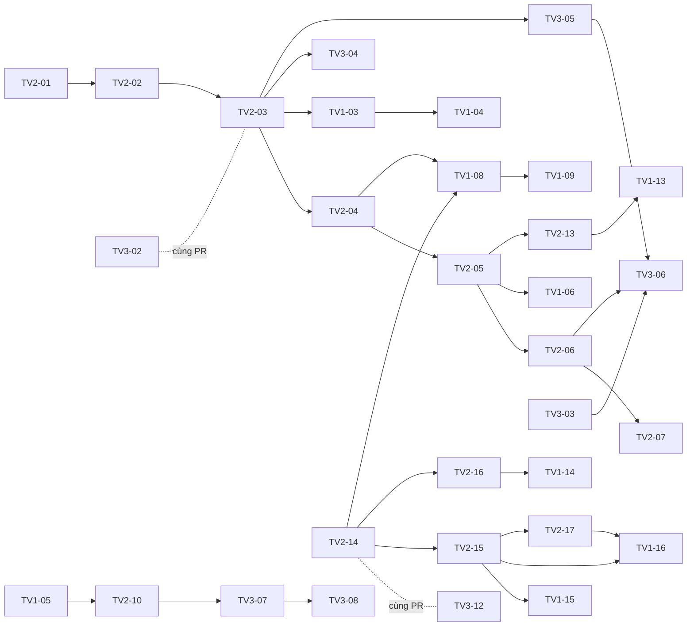

# Kế hoạch theo ticket

Chi tiết hoá [team-plan.md](../team-plan.md) thành các ticket nhỏ (1–3 ngày, diff ≤ ~400 dòng) để làm theo [quy trình vibe coding](../vibe-coding.md). Mỗi ticket ghi: tuần, phụ thuộc, mục spec, file, việc cần làm, tiêu chí xong, test, và **chỗ người phải review kỹ**.

- [Dương (TV1) – Form, PWA, màn hình dự án, staging](tv1-form-pwa.md)
- [Hoàng (TV2) – Đồng bộ, server, multi-tenancy](tv2-sync-server.md)
- [Đại (TV3) – Conflict UX, ảnh, export, kiểm thử](tv3-conflict-media-test.md)

## Nhãn

| Nhãn | Nghĩa |
|---|---|
| **Lõi** | Chạm bất biến trong CLAUDE.md. Viết test trước, hai người duyệt |
| **Người làm** | Không giao AI viết; AI chỉ gợi ý |
| **Cắt được** | Bỏ được nếu trễ (team-plan, thứ tự cắt) |

## Cách đánh dấu tiến độ

Đổi ô trạng thái trong bảng dưới **và** ở đầu ticket trong cùng PR hoàn thành ticket: `—` chưa làm, `⏳` đang làm (ghi tên nhánh), `✅` xong (ghi số PR).

## Bản cũ và bản mới (ADR 0003)

Từ 2026-10-12, [ADR 0003](../adr/0003-accounts-and-owner-role.md) thay một phần ADR 0002: tự tạo tài khoản (tên + mật khẩu), vai trò `owner`, mở tổ chức qua admin duyệt, trang quản trị `/admin/`. Để không nhầm với những gì **đã làm**:

- **Ticket đã xong theo bản cũ** (✅): giữ nguyên nội dung và trạng thái; chỉ thêm dòng `⚠ ADR 0003:` nói phần nào sẽ bị ticket mới thay. Code của chúng vẫn đang chạy cho tới khi ticket mới xong.
- **Ticket chưa làm bị ảnh hưởng** (—): sửa thẳng nội dung, có dòng `🆕 Cập nhật theo ADR 0003` ở đầu.
- **Ticket mới**: đánh số tiếp (TV1-14…, TV2-14…, TV3-12), nằm trong bảng "Theo ADR 0003" dưới đây.
- Trong design.md và ui.md: 🆕 = bản mới chưa có code, 🕘 = bản đang chạy.

## Bảng tổng

| Tuần | Dương | Hoàng | Đại | Mốc |
|---|---|---|---|---|
| 1 | TV1-01 | TV2-01 | TV3-01 | Cả nhóm chạy được dự án, CI xanh |
| 2 | TV1-02, TV1-03 | TV2-02, TV2-03 | TV3-02, TV3-03 | Điền phiếu trong một dự án trên điện thoại thật |
| 3 | TV1-04, TV1-05 | TV2-04, TV2-05, TV2-06, 🆕 TV2-14, TV2-15 | TV3-04, TV3-05, 🆕 TV3-12 (cùng PR TV2-14) | Cách ly dự án có test xanh |
| 4 | TV1-06, TV1-07, 🆕 TV1-14, TV1-15 | TV2-07, TV2-08, 🆕 TV2-16 | TV3-06 | **Giữa kỳ:** hai dự án tách biệt, offline có ảnh; 🆕 tự tạo tài khoản, mở tổ chức |
| 5 | TV1-08, ~~TV1-09~~ 🆕 TV1-16, TV1-10, TV1-13 | TV2-09, TV2-10, TV2-13 | TV3-07 | 🆕 Trang quản trị chạy trên staging |
| 6 | TV1-11 | TV2-11, 🆕 TV2-17 (cắt được) | TV3-08 | Mọi ca conflict và cách ly có test |
| 7 | TV1-12 | TV2-12 | TV3-09, TV3-10 | Đóng băng giữa tuần |
| 8 | TV1-12 | TV2-12 | TV3-11 | **Cuối kỳ** |

## Trạng thái

| Ticket | Tên | Trạng thái |
|---|---|---|
| TV1-01 | Staging HTTPS | ✅ PR #12 |
| TV1-02 | Màn hình nhập mã đăng nhập | ✅ PR #6 · ⚠ bản cũ, sẽ thay bởi TV1-14 |
| TV1-03 | Validate form + `POST P/forms` | ✅ PR #19 |
| TV1-04 | Form builder | ✅ `feat/tv1-04-form-builder` |
| TV1-05 | Validate phiếu + nháp | ✅ PR #7 (`validateRecord`), PR #17 (client) |
| TV1-06 | Bộ chọn dự án | ✅ PR #23 · 🆕 Owner, "Tổ chức khác…" sau TV2-16, TV1-15 |
| TV1-07 | Cập nhật SW, Cài đặt, kiểm tra trình duyệt | ⏳ PR #20 (phần 1: Cài đặt + Đăng xuất) · 🆕 cập nhật theo ADR 0003 |
| TV1-08 | Thành viên dự án (API + màn hình) | — · 🆕 cập nhật theo ADR 0003 |
| TV1-09 | ~~Màn hình Dự án cho admin~~ | ❌ Bỏ, thay bởi TV1-16 |
| TV1-10 | `formVersion`, `hidden`, xuất/nhập form | — |
| TV1-11 | E2E O2, O4, T6, T10 | — |
| TV1-12 | Hoàn thiện UI, tài liệu người dùng | — |
| TV1-13 | Nút xoá phiếu + hộp xác nhận | — |
| TV2-01 | Migration + schema multi-tenancy | ✅ `feat/tv2-multi-tenancy-core` |
| TV2-02 | Xác thực, `requireMember`, lớp `ctx` | ✅ `feat/tv2-multi-tenancy-core` · ⚠ `requireAuth` đọc `users.token_hash` là bản cũ, TV2-14 đổi sang `sessions` |
| TV2-03 | Route theo dự án + phạm vi pull | ✅ `feat/tv2-multi-tenancy-core` |
| TV2-04 | `/api/me`, `/api/admin/projects` | ✅ PR #9 · ⚠ `POST /admin/projects`, `PUT …/members/:userId` là bản cũ, TV2-15 thay |
| TV2-05 | CSDL account + CSDL theo dự án, `api.ts` | ✅ PR #10 |
| TV2-06 | Sync nhiều dự án + Web Locks | ✅ PR #13 |
| TV2-07 | Cursor theo scope + thay đổi thành viên | ✅ PR #14 |
| TV2-08 | Idempotency hash, dọn key, fault `drop` | ✅ `feat/tv2-08-idempotency` |
| TV2-09 | Op `failed`, thử lại, cảnh báo tồn lâu | ✅ `feat/tv2-09-failed-ops` |
| TV2-10 | Engine: khoá khi conflict, 409 lặp, bỏ qua nháp | — |
| TV2-11 | Hiệu năng pull | — |
| TV2-12 | Sửa lỗi, tài liệu kỹ thuật | — |
| TV2-13 | Xoá phiếu: logic client + đồng bộ | — |
| TV3-01 | CI, `ENABLE_TEST_ROUTES`, unit test client | ⏳ `feat/tv3-01-ci-test-routes` |
| TV3-02 | CLI quản trị, fixture, sửa test theo API mới | ⏳ `feat/tv3-02-cli-fixtures` (đủ CLI, fixture, helper E2E; chờ PR chung với TV2-03) · ⚠ CLI token và helper `login(token)` là bản cũ, TV3-12 thay |
| TV3-03 | Nén ảnh | — |
| TV3-04 | Test cách ly T1–T5 | — |
| TV3-05 | Upload ảnh theo chunk (server) | — |
| TV3-06 | Hàng đợi upload ảnh (client) | — |
| TV3-07 | Màn hình conflict đầy đủ + chỉ đọc | — |
| TV3-08 | Xoá vs sửa | — |
| TV3-09 | Export CSV/JSON | — |
| TV3-10 | E2E O3, R4 | — |
| TV3-11 | Báo cáo kiểm thử | — |

### Theo ADR 0003 (bản mới)

| Ticket | Tên | Thay cho / ảnh hưởng | Trạng thái |
|---|---|---|---|
| TV2-14 | Migration 3, tài khoản + phiên, vai trò `owner` (server) · **Lõi** | Phần token của TV2-02 | — |
| TV2-15 | Yêu cầu mở tổ chức, danh bạ công khai, API admin mới (server) · **Lõi** | Phần `/admin/projects` của TV2-04 | — |
| TV2-16 | Client: đăng nhập bằng phiên, vai trò `owner`, chặn tài khoản admin · **Lõi** | `auth.ts`, `api.ts` | — |
| TV2-17 | API quản lý tài khoản cho màn hình A3 · **Cắt được** | CLI `user:*` | — |
| TV1-14 | Màn hình Đăng nhập / Tạo tài khoản | TV1-02 | — |
| TV1-15 | Màn hình Tổ chức (danh bạ, mở tổ chức mới) | – | — |
| TV1-16 | Trang quản trị `/admin/` (A1, A2; A3 cắt được) | TV1-09 | — |
| TV3-12 | CLI, fixture, helper E2E theo tài khoản mới | Phần CLI/helper của TV3-02 | — |

## Phụ thuộc quan trọng

**ADR 0003 cũng là một điểm nghẽn:** TV2-14 đổi cách đăng nhập nên mọi integration test và E2E đang đăng nhập bằng token sẽ vỡ. Giống tuần 2, TV2-14 và TV3-12 làm chung **một PR**; trong lúc đó không merge PR nào khác chạm `server/src/auth.ts`, `server/src/db.ts`, `server/test/fixtures.ts`, `client/e2e/helpers.ts`.

**Tuần 2 là điểm nghẽn:** TV2-03 + TV3-02 đổi toàn bộ đường dẫn API và thêm token. Trước khi PR đó merge, không merge PR nào khác chạm `server/src/routes/`. Dương tuần 2 làm phần UI không phụ thuộc server (TV1-02 dùng stub, TV1-03 phần validate thuần).
