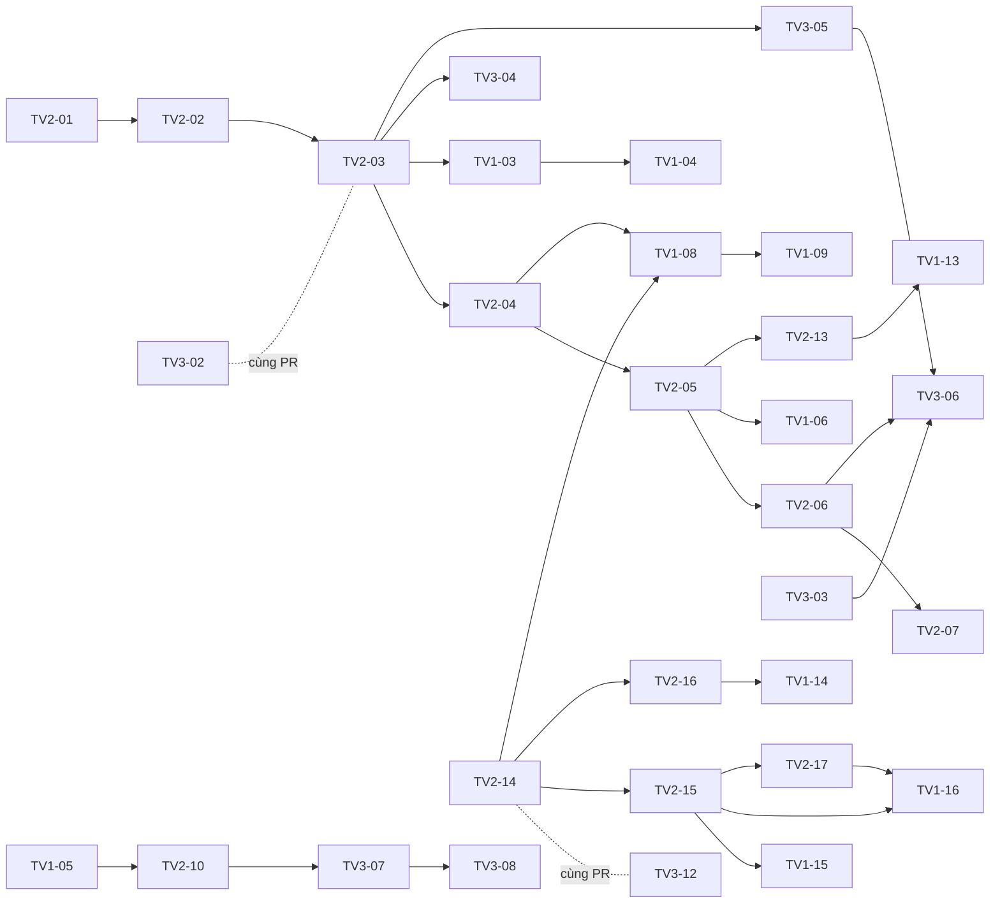

# Kế hoạch theo ticket

Chi tiết hoá [team-plan.md](../team-plan.md) thành các ticket nhỏ (1–3 ngày, diff ≤ ~400 dòng) để làm theo [quy trình vibe coding](../vibe-coding.md). Mỗi ticket ghi: tuần, phụ thuộc, mục spec, file, việc cần làm, tiêu chí xong, test, và **chỗ người phải review kỹ**.

- [Dương (TV1) – Form, PWA, màn hình dự án, staging](tv1-form-pwa.md)
- [Hoàng (TV2) – Đồng bộ, server, multi-tenancy](tv2-sync-server.md)
- [Đại (TV3) – Conflict UX, ảnh, export, kiểm thử](tv3-conflict-media-test.md)

## Nhãn

| Nhãn | Nghĩa |
|---|---|
| **Lõi** | Chạm bất biến trong CLAUDE.md. Viết test trước, ghi rõ trong PR (team-plan "Quy trình làm việc") |
| **Người làm** | Không giao AI viết; AI chỉ gợi ý |
| **Cắt được** | Bỏ được nếu trễ (team-plan, thứ tự cắt) |
| **Mức** | Dòng trong ticket: Must / Should / Could theo bảng MoSCoW ở [design §1](../design.md#1-mục-tiêu-và-phạm-vi). Ticket Could có thêm nhãn **Cắt được** |

## Cách đánh dấu tiến độ

Đổi ô trạng thái trong bảng dưới **và** ở đầu ticket trong cùng PR hoàn thành ticket: `—` chưa làm, `⏳` đang làm (ghi tên nhánh), `✅` xong (ghi số PR).

## Bản cũ và bản mới (ADR 0003)

Từ 2026-10-12, [ADR 0003](../adr/0003-accounts-and-owner-role.md) thay một phần ADR 0002: tự tạo tài khoản (tên + mật khẩu), vai trò `owner`, mở tổ chức qua admin duyệt, trang quản trị `/admin/`. Để không nhầm với những gì **đã làm**:

- **Ticket đã xong theo bản cũ** (✅): giữ nguyên nội dung và trạng thái; chỉ thêm dòng `⚠ ADR 0003:` nói phần nào sẽ bị ticket mới thay. Code của chúng vẫn đang chạy cho tới khi ticket mới xong.
- **Ticket chưa làm bị ảnh hưởng** (—): sửa thẳng nội dung, có dòng `🆕 Cập nhật theo ADR 0003` ở đầu.
- **Ticket mới**: đánh số tiếp (TV1-14…, TV2-14…, TV3-12), nằm trong bảng "Theo ADR 0003" dưới đây.
- Trong design.md và ui.md: 🆕 = bản mới chưa có code, 🕘 = bản đang chạy.

## Bảng tổng

| Tuần | Dương | Hoàng | Đại | Mốc |
|---|---|---|---|---|
| 1 | TV1-01 | TV2-01 | TV3-01 | Cả nhóm chạy được dự án, CI xanh |
| 2 | TV1-02, TV1-03 | TV2-02, TV2-03 | TV3-02, TV3-03 | Điền phiếu trong một dự án trên điện thoại thật |
| 3 | TV1-04, TV1-05 | TV2-04, TV2-05, TV2-06, 🆕 TV2-14, TV2-15 | TV3-04, TV3-05, 🆕 TV3-12 (cùng PR TV2-14) | Cách ly dự án có test xanh |
| 4 | TV1-06, TV1-07, 🆕 TV1-14, TV1-15, ➕ TV1-19 (gỡ IP) | TV2-07, TV2-08, 🆕 TV2-16, ➕ TV2-19 (`invalid_body`) | TV3-06, ➕ TV3-13, TV3-14 | **Giữa kỳ:** hai dự án tách biệt, offline có ảnh; 🆕 tự tạo tài khoản, mở tổ chức |
| 5 | TV1-08, ~~TV1-09~~ 🆕 TV1-16, TV1-10, TV1-13, ➕ TV1-19 (N3, QS5) | TV2-09, TV2-10, TV2-13, ➕ TV2-19 (`invalid_body`, log), TV2-18 | TV3-07, ➕ TV3-14, TV3-15 | 🆕 Trang quản trị chạy trên staging |
| 6 | TV1-11, ➕ TV1-19 (N3, QS5) | TV2-11, 🆕 TV2-17 (cắt được), ➕ TV2-18, TV2-19 (log) | TV3-08, ➕ TV3-15 | Mọi ca conflict và cách ly có test |
| 7 | TV1-12 | TV2-12 | TV3-09, TV3-10 | Đóng băng giữa tuần |
| 8 | TV1-12 | TV2-12 | TV3-11, ➕ TV3-16 | **Cuối kỳ** |

➕ = chia thêm sau PR #59 (bảng "Chia thêm" dưới đây). Ticket Could (TV2-18, TV3-15, phần log của TV2-19) trễ thì cắt, không làm qua đóng băng giữa tuần 7.

## Trạng thái

| Ticket | Tên | Trạng thái |
|---|---|---|
| TV1-01 | Staging HTTPS | ✅ PR #12 |
| TV1-02 | Màn hình nhập mã đăng nhập | ✅ PR #6 · ⚠ bản cũ, TV1-14 thay |
| TV1-03 | Validate form + `POST P/forms` | ✅ PR #19 |
| TV1-04 | Form builder | ✅ PR #24; sửa lỗi đổi form giữa hai builder ✅ PR #84 |
| TV1-05 | Validate phiếu + nháp | ✅ PR #7 (`validateRecord`), PR #17 (client) |
| TV1-06 | Bộ chọn dự án | ✅ PR #23 · 🆕 Owner sau TV2-16; "Tổ chức khác…" ở TV1-15 (✅ PR #54) |
| TV1-07 | Cập nhật SW, Cài đặt, kiểm tra trình duyệt | ✅ phần 1 PR #20 (Cài đặt + Đăng xuất) · ✅ phần 2a PR #27 (cập nhật SW, icon PNG) · ✅ phần 2b PR #28 (kiểm tra trình duyệt, `persist()`, hướng dẫn cài, Đăng xuất xoá cache SW) · ✅ 🆕 cập nhật theo ADR 0003 PR #57 (tên đăng nhập ở Cài đặt) |
| TV1-08 | Thành viên dự án (API + màn hình) | ✅ PR #38 (phần 1: API), PR #39 (phần 2: màn hình) · theo ADR 0003 |
| TV1-09 | ~~Màn hình Dự án cho admin~~ | ❌ Bỏ, thay bởi TV1-16 |
| TV1-10 | `formVersion`, `hidden`, xuất/nhập form | ✅ PR #32 (phần 1), PR #33 (phần 2) |
| TV1-11 | E2E O2, O4, T6, T10 | ✅ PR #43 |
| TV1-12 | Hoàn thiện UI (tài liệu người dùng → TV3-16, rà khả năng tiếp cận → TV3-15) | ⏳ a1 ✅ PR #58 (hộp xác nhận trong app, lỗi nhỏ); a2 ✅ PR #62 (lỗi API, hết phiên); a3 ✅ PR #68 (lỗi lẻ); (b) chia: b1 ✅ PR #69 (trạng thái, chữ còn thiếu); b2 giao diện theo thiết kế, chia p1–p8: p1 ✅ PR #70 (nền, khung chung); p2 ✅ PR #71 (trang chủ); p3 ✅ PR #72 (điền phiếu, xung đột); p4 ✅ PR #73 (builder); p5 ✅ PR #74 (thành viên, tổ chức); p6 ✅ PR #75 (đăng nhập, cài đặt); p7 ✅ PR #76 (trang quản trị); p8 ✅ PR #77 (kéo thả trường); sửa ▲▼ giữ dòng chọn ✅ PR #78; kiểm cuối (2 dải vàng Đăng nhập, focus admin) ✅ PR #79; nhánh gom → main ✅ PR #80; vùng status Xem trước ✅ PR #81; sửa UI sau audit/critique: màn 6 ✅ PR #85 (ô chọn + [Đổi], ← Quay lại đầu trang); màn 9 ✅ PR #87 (gửi xong có "Đã gửi yêu cầu", yêu cầu lên trên form, ← Quay lại đầu trang); màn 5 ✅ PR #89 (chọn trường cuộn tới Thuộc tính, ← Quay lại khi không mở được, "Nhập mã biểu mẫu", câu danh sách rỗng); nền trang trắng ⏳ PR #91 (ô chìm màu riêng, theme-color trắng, gộp C11); còn: sửa UI theo rà TV3-15 |
| TV1-13 | Nút xoá phiếu + hộp xác nhận | ✅ PR #42 · chưa ẩn nút theo người tạo (thiếu `createdBy`) |
| TV2-01 | Migration + schema multi-tenancy | ✅ PR #8 (chung với TV2-02, TV2-03, TV3-02) |
| TV2-02 | Xác thực, `requireMember`, lớp `ctx` | ✅ PR #8 · `requireAuth` đã đổi sang `sessions` ở TV2-14 |
| TV2-03 | Route theo dự án + phạm vi pull | ✅ PR #8 |
| TV2-04 | `/api/me`, `/api/admin/projects` | ✅ PR #9 · `POST /admin/projects`, `PUT …/members/:userId` đã bỏ ở TV2-15 |
| TV2-05 | CSDL account + CSDL theo dự án, `api.ts` | ✅ PR #10 |
| TV2-06 | Sync nhiều dự án + Web Locks | ✅ PR #13 |
| TV2-07 | Cursor theo scope + thay đổi thành viên | ✅ PR #14 |
| TV2-08 | Idempotency hash, dọn key, fault `drop` | ✅ PR #15 |
| TV2-09 | Op `failed`, thử lại, cảnh báo tồn lâu | ✅ PR #16 |
| TV2-10 | Engine: khoá khi conflict, 409 lặp, bỏ qua nháp | ✅ PR #34 |
| TV2-11 | Hiệu năng pull | ✅ `feat/tv2-11-perf` |
| TV2-12 | Sửa lỗi, tài liệu kỹ thuật | — |
| TV2-13 | Xoá phiếu: logic client + đồng bộ | ✅ PR #35 |
| TV3-01 | CI, `ENABLE_TEST_ROUTES`, unit test client | ✅ PR #2 |
| TV3-02 | CLI quản trị, fixture, sửa test theo API mới | ✅ PR #8 · ⚠ CLI token và helper `login(token)` là bản cũ, TV3-12 thay |
| TV3-03 | Nén ảnh | ✅ PR #31 |
| TV3-04 | Test cách ly T1–T5 | ✅ PR #29 |
| TV3-05 | Upload ảnh theo chunk (server) | ✅ PR #30 |
| TV3-06 | Hàng đợi upload ảnh (client) | ✅ PR #37 |
| TV3-07 | Màn hình conflict đầy đủ + chỉ đọc | ✅ PR #41 |
| TV3-08 | Xoá vs sửa | ✅ PR #47 |
| TV3-09 | Export CSV/JSON | ✅ PR #48 |
| TV3-10 | E2E O3, R4 | ✅ PR #40 |
| TV3-11 | Báo cáo kiểm thử | ⏳ bản 0.2; chờ TV2-11 và thử trên điện thoại thật |

### Theo ADR 0003 (bản mới)

| Ticket | Tên | Thay cho / ảnh hưởng | Trạng thái |
|---|---|---|---|
| TV2-14 | Migration 3, tài khoản + phiên, vai trò `owner` (server) · **Lõi** | Phần token của TV2-02 | ✅ PR #36 (chung với TV3-12) · thành **migration 4** vì số 3 đã là `attachments` (TV3-05) |
| TV2-15 | Yêu cầu mở tổ chức, danh bạ công khai, API admin mới (server) · **Lõi** | Phần `/admin/projects` của TV2-04 | ✅ PR #49 |
| TV2-16 | Client: đăng nhập bằng phiên, vai trò `owner`, chặn tài khoản admin · **Lõi** | `auth.ts`, `api.ts` | ✅ `feat/tv2-16-client-session` |
| TV2-17 | API quản lý tài khoản cho màn hình A3 · **Cắt được** | CLI `user:*` | ⏳ PR #51 |
| TV1-14 | Màn hình Đăng nhập / Tạo tài khoản | TV1-02 | ✅ PR #53 |
| TV1-15 | Màn hình Tổ chức (danh bạ, mở tổ chức mới) | – | ✅ PR #54 |
| TV1-16 | Trang quản trị `/admin/` (A1, A2; A3 cắt được) | TV1-09 | ✅ PR #55 (khung), PR #56 (A1, A2); sửa E2E chập chờn ✅ PR #82; A3 Tài khoản (Could) ✅ PR #88; sửa tải lần đầu lỗi kẹt "Đang tải…" ⏳ PR #90 |
| TV1-17 | Tên người tạo/sửa trong `ServerRecord`; ẩn Xoá với surveyor theo người tạo | Phần bỏ của TV1-13 | ✅ PR #44 (phần 1: shared + server), PR #45 (phần 2: client) |
| TV3-12 | CLI, fixture, helper E2E theo tài khoản mới | Phần CLI/helper của TV3-02 | ✅ PR #36 |

### Chia thêm sau PR #59 (nhóm chốt 2026-10-22)

Việc chưa ai nhận, chia theo mức MoSCoW ([design §1](../design.md#1-mục-tiêu-và-phạm-vi)) và nợ ở [tech-debt.md](../tech-debt.md). Không dùng số TV1-18.

| Ticket | Tên | Mức | Nợ trả | Trạng thái |
|---|---|---|---|---|
| TV1-19 | Vận hành staging: gỡ IP, diễn tập quay lại bản trước (QS5), bật sao lưu hằng ngày | Should | N3 (cùng TV3-13: N2) | ✅ phần 1 PR #63 (gỡ IP); phần 2 PR #64 (N3 + QS5); phần 3 PR #67 (sao lưu hằng ngày) |
| TV2-18 | Danh sách phiếu: tìm kiếm, lọc theo người tạo, 2.000 phiếu · **Cắt được** | Could | N6 | — |
| TV2-19 | Thân JSON hỏng trả `invalid_body`; log request | Should; log: Could | N1 | — |
| TV3-13 | Sao lưu hằng ngày, `UPLOAD_DIR` ngoài repo | Must | N2 | ✅ PR #66 |
| TV3-14 | E2E lấy GPS (US-03), điều tra viên thấy form sau đồng bộ (US-07) | Must | – | ⏳ chờ PR |
| TV3-15 | Rà khả năng tiếp cận · **Cắt được** | Could | N8 | — |
| TV3-16 | Tài liệu người dùng (chuyển từ TV1-12) | Must | – | — |

## Phụ thuộc quan trọng

**ADR 0003 cũng là một điểm nghẽn:** TV2-14 đổi cách đăng nhập nên mọi integration test và E2E đang đăng nhập bằng token sẽ vỡ. Giống tuần 2, TV2-14 và TV3-12 làm chung **một PR**; trong lúc đó không merge PR nào khác chạm `server/src/auth.ts`, `server/src/db.ts`, `server/test/fixtures.ts`, `client/e2e/helpers.ts`.

**Tuần 2 là điểm nghẽn:** TV2-03 + TV3-02 đổi toàn bộ đường dẫn API và thêm token. Trước khi PR đó merge, không merge PR nào khác chạm `server/src/routes/`. Dương tuần 2 làm phần UI không phụ thuộc server (TV1-02 dùng stub, TV1-03 phần validate thuần).
