# Hướng dẫn sử dụng Khảo sát thực địa

Khảo sát thực địa là ứng dụng điền phiếu khảo sát trên điện thoại, **dùng được cả khi không có mạng**. Phiếu lưu ngay trên máy, có mạng thì tự gửi lên máy chủ. Mỗi tổ chức (trạm y tế, hợp tác xã, nhóm nghiên cứu…) có biểu mẫu, phiếu và thành viên riêng, không ai ngoài tổ chức xem được.

Địa chỉ bản thử: https://se2026-t21.koreacentral.cloudapp.azure.com (trang quản trị: thêm `/admin/`).

**Bạn là ai?**

| Vai trò | Làm gì | Đọc phần |
|---|---|---|
| Điều tra viên | Đi thực địa, điền phiếu | [1](#1-điều-tra-viên) |
| Giám sát viên | Như điều tra viên, thêm: soạn biểu mẫu, thêm điều tra viên, xuất dữ liệu | [1](#1-điều-tra-viên), [2](#2-giám-sát-viên-và-owner) |
| Owner | Chủ tổ chức: như giám sát viên, thêm: đổi vai trò mọi người, đặt tên và công khai tổ chức | [1](#1-điều-tra-viên), [2](#2-giám-sát-viên-và-owner) |
| Quản trị hệ thống | Duyệt yêu cầu mở tổ chức, khoá tổ chức, hỗ trợ tài khoản | [3](#3-quản-trị-hệ-thống) |

Một người có thể thuộc nhiều tổ chức, mỗi tổ chức một vai trò.

> Ảnh trong tài liệu chụp từ bản build của nhánh `main` (cùng mã nguồn với bản thử) bằng dữ liệu mẫu, trên khổ điện thoại 360 px. Máy của bạn có thể khác chút về phông chữ và cách hiện ô ngày.

---

## 1. Điều tra viên

### 1.1 Cài ứng dụng lên điện thoại

Mở địa chỉ ứng dụng **khi có mạng** rồi cài lên màn hình chính:

- **Android:** mở bằng Chrome, bấm menu ⋮ rồi chọn "Cài đặt ứng dụng" hoặc "Thêm vào màn hình chính".
- **iPhone:** mở bằng **Safari**, bấm nút Chia sẻ rồi chọn "Thêm vào màn hình chính".

Từ đó mở ứng dụng bằng biểu tượng trên màn hình chính, kể cả khi không có mạng. Hướng dẫn này cũng có ở trang **Cài đặt** trong ứng dụng.

> **iPhone bắt buộc phải cài.** Nếu chỉ mở trong Safari, iPhone có thể xoá dữ liệu chưa gửi sau 7 ngày không mở trang.

Cần Chrome 120 trở lên (Android, máy tính) hoặc Safari 16.4 trở lên (iPhone). Trình duyệt cũ hơn sẽ hiện "Trình duyệt không được hỗ trợ" kèm tên chức năng còn thiếu; chụp màn hình đó gửi cho nhóm hỗ trợ.

### 1.2 Tạo tài khoản và đăng nhập

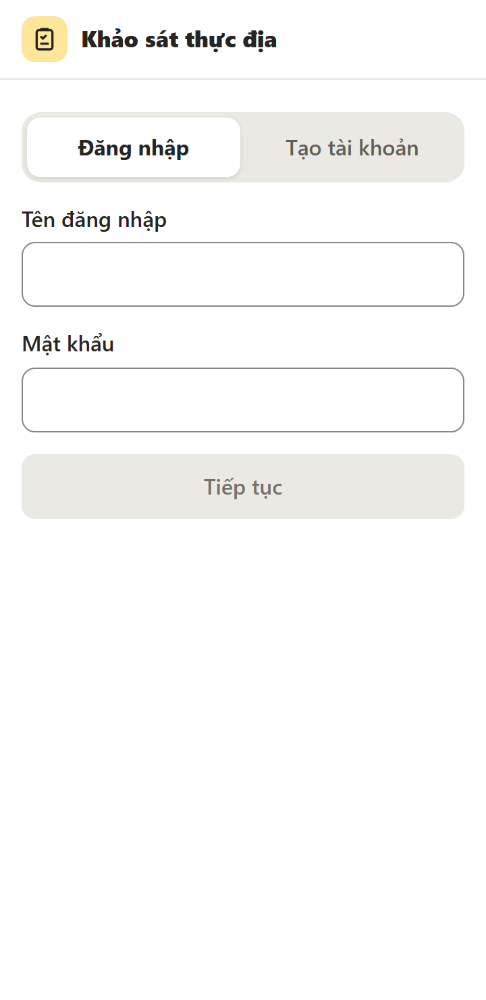 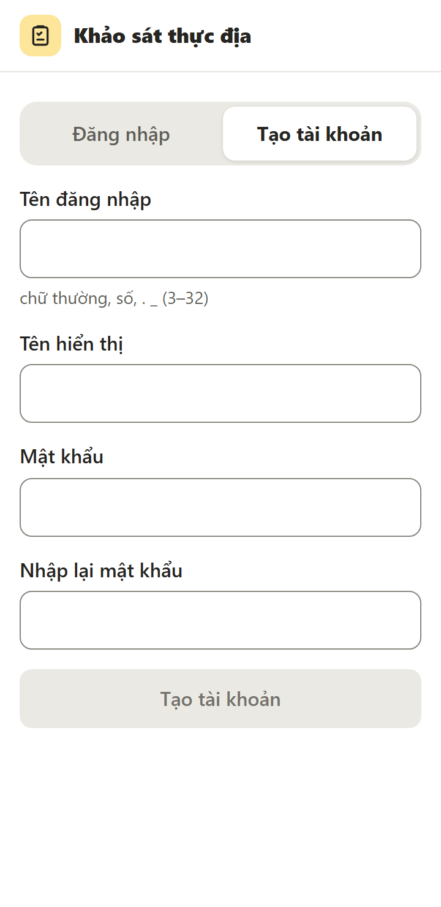

Lần đầu cần có mạng.

1. Bấm **Tạo tài khoản**.
2. **Tên đăng nhập:** chữ thường không dấu, số, dấu `.` và `_`, từ 3 đến 32 ký tự, ví dụ `minh.tran`. **Không đổi được sau này**, nên chọn tên dễ nhớ.
3. **Tên hiển thị:** tên thật của bạn, người khác sẽ thấy tên này (ví dụ ở màn hình xung đột).
4. **Mật khẩu:** 8 đến 128 ký tự, nhập lại lần hai cho khớp.
5. Bấm **Tạo tài khoản**. Tạo xong là đăng nhập luôn.

Lần sau: tab **Đăng nhập**, nhập tên đăng nhập và mật khẩu, bấm **Tiếp tục**. Mỗi máy đăng nhập một lần là dùng mãi, không tự hết hạn.

| Thấy câu | Nghĩa là |
|---|---|
| Sai tên đăng nhập hoặc mật khẩu | Gõ lại. Quên mật khẩu thì nhờ quản trị cấp mật khẩu tạm ([3.4](#34-tài-khoản)) |
| Tên đăng nhập đã có người dùng | Chọn tên khác |
| Thử lại sau ít phút | Nhập sai nhiều lần (10 lần trong 15 phút), hoặc một mạng tạo quá 5 tài khoản trong một giờ; chờ rồi thử lại |
| Cần kết nối mạng | Đăng nhập, tạo tài khoản cần mạng |
| Phiên đăng nhập hết hạn, đăng nhập lại | Mật khẩu vừa được đổi ở máy khác, hoặc quản trị đã thu hồi phiên. Đăng nhập lại; **phiếu trên máy vẫn còn nguyên** |

### 1.3 Vào tổ chức

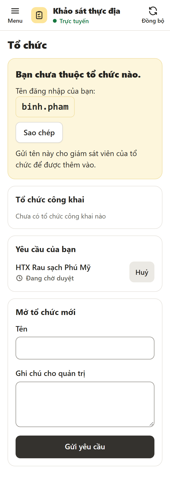

Tài khoản mới chưa thuộc tổ chức nào, nên ứng dụng mở màn hình **Tổ chức**. Bạn **không tự xin vào được**: gửi **tên đăng nhập** của mình cho giám sát viên hoặc Owner của tổ chức để họ thêm vào. Bấm **Sao chép** để chép tên, hoặc **Chia sẻ** để gửi qua Zalo, tin nhắn… (nút Chia sẻ chỉ có trên trình duyệt hỗ trợ, thường là điện thoại).

Được thêm xong, lần đồng bộ kế tiếp (tối đa khoảng 30 giây khi có mạng, hoặc bấm **Đồng bộ**) ứng dụng tự chuyển vào tổ chức đó.

Muốn mở tổ chức của riêng mình: xem [2.5](#25-mở-tổ-chức-mới).

### 1.4 Màn hình chính

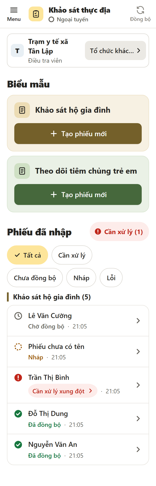 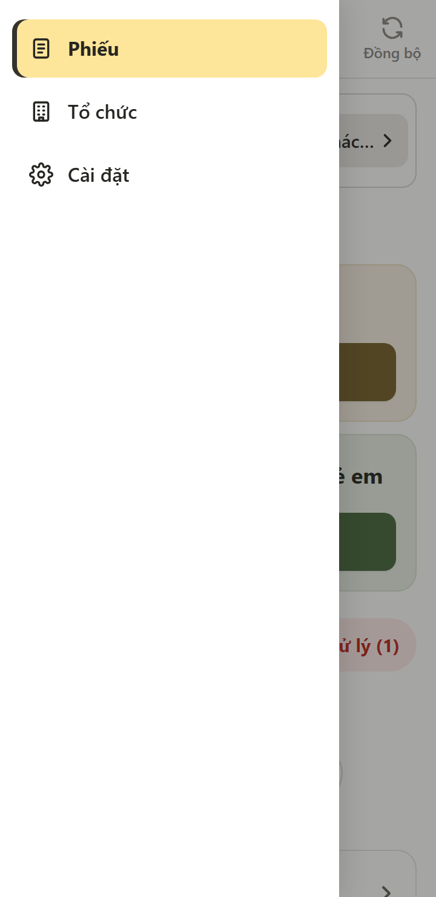

Từ trên xuống:

- **Thanh trên:** **Menu** (☰), tên ứng dụng, trạng thái mạng (● Trực tuyến / ○ Ngoại tuyến), nút **Đồng bộ** để gửi và nhận ngay.
- **Tổ chức đang chọn** và vai trò của bạn. Thuộc nhiều tổ chức thì bấm vào để chuyển (chuyển được cả khi ngoại tuyến). **Tổ chức khác…** mở màn hình Tổ chức.
- **Biểu mẫu:** mỗi biểu mẫu một thẻ có nút **Tạo phiếu mới**.
- **Phiếu đã nhập:** nhóm theo biểu mẫu, mới sửa nhất ở trên. Bộ lọc **Tất cả / Cần xử lý / Chưa đồng bộ / Nháp / Lỗi**; nút đỏ **Cần xử lý (n)** bật nhanh bộ lọc phiếu cần bạn làm gì đó.

**Menu** gồm Phiếu, Tổ chức, Thành viên (chỉ giám sát viên, Owner), Cài đặt. Trên máy tính menu luôn hiện ở bên trái.

Điều tra viên chỉ thấy **phiếu do mình tạo**. Giám sát viên và Owner thấy mọi phiếu của tổ chức.

### 1.5 Điền phiếu

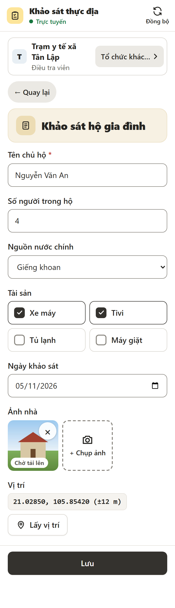 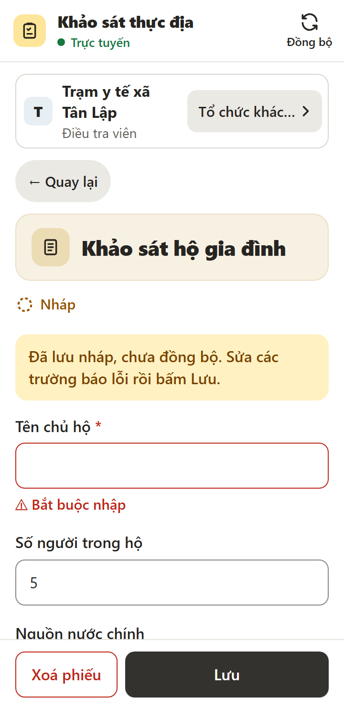

1. Bấm **Tạo phiếu mới** ở thẻ biểu mẫu.
2. Điền các trường. Trường có dấu <span>*</span> đỏ là bắt buộc.
   - **Ảnh:** bấm **+ Chụp ảnh** để chụp hoặc chọn ảnh có sẵn. Ảnh được nén còn khoảng 300–600 KB trước khi lưu. Bấm × để bỏ ảnh.
   - **Vị trí:** bấm **Lấy vị trí**, chờ tối đa 30 giây. Lấy được cả khi không có mạng (dùng GPS của máy). Lần đầu trình duyệt hỏi quyền vị trí: chọn Cho phép.
3. Bấm **Lưu**. Phiếu nằm trên máy ngay, có mạng thì tự gửi.

**Thiếu trường bắt buộc hoặc nhập sai định dạng?** Phiếu vẫn được lưu nhưng thành **Nháp**: ô lỗi viền đỏ kèm câu lỗi, đầu trang ghi "Đã lưu nháp, chưa đồng bộ. Sửa các trường báo lỗi rồi bấm Lưu." Phiếu nháp **không gửi đi** cho tới khi bạn sửa đủ và bấm Lưu lại.

**Lỡ thoát giữa chừng?** Chữ đang gõ được tự giữ trên máy kể cả khi chưa bấm Lưu (tắt ứng dụng, hết pin, bấm Quay lại). Mở lại phiếu đó sẽ thấy "Có nội dung đang nhập chưa lưu" với hai nút **Khôi phục** / **Bỏ**. Phiếu mới gõ dở mà chưa Lưu lần nào hiện ở dải **Phiếu đang nhập dở, chưa lưu** trên trang chủ.

**Nhân bản phiếu:** cần điền nhiều phiếu gần giống nhau (cùng thôn, cùng đợt)? Mở một phiếu đã lưu, bấm **Nhân bản phiếu** ở dưới form. Ứng dụng mở một phiếu mới điền sẵn các giá trị đang hiện, kèm dải "Đây là bản sao, chưa lưu. Ảnh và vị trí không được chép." Sửa những chỗ khác rồi bấm **Lưu**. Chưa bấm Lưu thì bản sao chưa thành phiếu; rời trang thì nó nằm ở dải "Phiếu đang nhập dở, chưa lưu" trên trang chủ. Phiếu gốc không đổi. Không nhân bản được phiếu đang xung đột hay đã xoá; điều tra viên chỉ nhân bản phiếu mình tạo.

**Xoá phiếu:** mở phiếu, bấm **Xoá phiếu**, xác nhận **Xoá**. Điều tra viên chỉ xoá được phiếu mình tạo.

| Câu báo khi lấy vị trí | Làm gì |
|---|---|
| Chưa được phép lấy vị trí… | Vào cài đặt trình duyệt, cho phép vị trí với trang này, rồi bấm lại |
| Không lấy được vị trí. Ra chỗ thoáng rồi bấm lại. | Ra khỏi nhà, tránh mái che, bấm lại |
| Trình duyệt này không lấy được vị trí. | Dùng Chrome hoặc Safari bản mới |

### 1.6 Trạng thái phiếu và đồng bộ

Mỗi phiếu có một nhãn (có cả chữ và biểu tượng):

| Nhãn | Nghĩa | Bạn cần làm |
|---|---|---|
| **Nháp** | Còn trường thiếu hoặc sai, chưa gửi | Mở phiếu, sửa các trường báo lỗi, bấm Lưu |
| **Chờ đồng bộ** | Đã lưu trên máy, chờ gửi | Không cần làm gì; có mạng là tự gửi |
| **Đang tải ảnh (n)** | Phiếu đã lên, còn n ảnh đang gửi | Giữ mạng, chờ |
| **Đã đồng bộ** | Phiếu và ảnh đã lên máy chủ | Không |
| **Cần xử lý xung đột** | Người khác cũng sửa phiếu này | Bấm vào nhãn, chọn giá trị giữ lại ([1.7](#17-xử-lý-xung-đột)) |
| **Lỗi** | Máy chủ từ chối phiếu (kèm lý do) | Bấm **Thử lại**; vẫn lỗi thì **Xuất JSON phiếu này** và gửi cho giám sát viên |
| **Lỗi ảnh** | Một ảnh không gửi được | Bấm **Thử lại**, hoặc **Bỏ ảnh này** |

Ứng dụng tự đồng bộ khoảng 30 giây một lần và ngay khi có mạng trở lại. Muốn gửi ngay thì bấm **Đồng bộ** trên thanh trên. Đầu trang có thể hiện:

- "Có n phiếu chưa đồng bộ hơn 1 ngày": tìm chỗ có mạng để gửi.
- "Máy chủ đang lỗi, sẽ thử lại": không cần làm gì, ứng dụng tự gửi lại.

Phiếu do người khác tạo (giám sát viên mở phiếu của điều tra viên) có ảnh thì lúc mở phiếu, ảnh mới được tải về; lần sau xem được cả khi ngoại tuyến. Chưa tải được thì ô ảnh ghi "Cần kết nối để xem ảnh này".

### 1.7 Xử lý xung đột

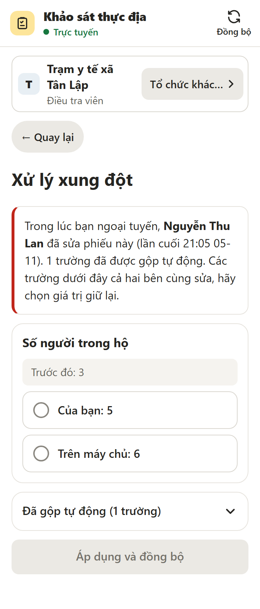 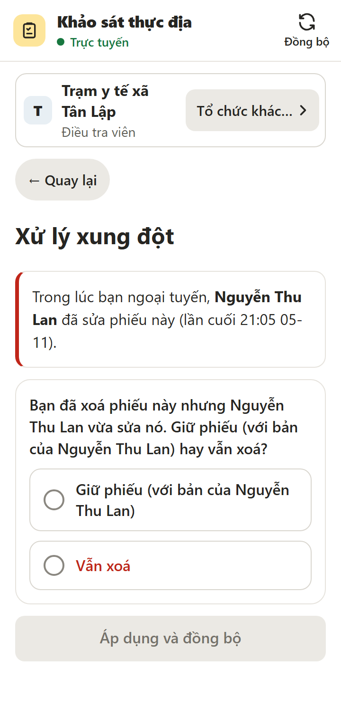

Xung đột xảy ra khi bạn sửa phiếu lúc ngoại tuyến, trong khi người khác (thường là giám sát viên) cũng sửa phiếu đó trên máy chủ.

- Hai bên sửa **trường khác nhau**: ứng dụng **tự gộp**, bạn không thấy gì.
- Hai bên sửa **cùng một trường**: phiếu thành **Cần xử lý xung đột**. Trong lúc đó phiếu chỉ đọc, không sửa hay xoá được.

Cách xử lý:

1. Bấm nhãn **Cần xử lý xung đột** (hoặc nút **Xử lý** khi mở phiếu).
2. Đọc câu giải thích: ai sửa, lúc nào, bao nhiêu trường đã tự gộp.
3. Mỗi trường hai bên cùng sửa có một thẻ: **Trước đó** (giá trị gốc), **Của bạn**, **Trên máy chủ**. Chọn một. Trường chọn nhiều và ảnh có thêm **Gộp cả hai**. Ứng dụng **không bao giờ chọn sẵn**.
4. Mở **Đã gộp tự động** nếu muốn xem trường nào lấy từ đâu.
5. Chọn hết thì nút **Áp dụng và đồng bộ** mới bấm được.

**Một bên xoá, một bên sửa:** ứng dụng hỏi thẳng, ví dụ "Bạn đã xoá phiếu này nhưng Lan vừa sửa nó. Giữ phiếu (với bản của Lan) hay vẫn xoá?" (hoặc chiều ngược lại: "Khôi phục với bản của bạn hay bỏ?"). Chọn một rồi bấm **Áp dụng và đồng bộ**.

### 1.8 Tài khoản, đổi mật khẩu, đăng xuất

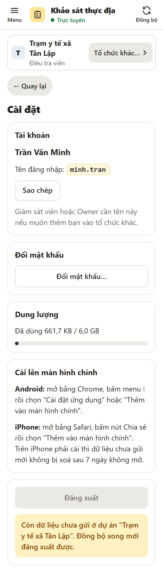

Trang **Cài đặt** (từ Menu) có:

- **Tài khoản:** tên hiển thị, tên đăng nhập, nút **Sao chép** / **Chia sẻ** tên đăng nhập.
- **Đổi mật khẩu** (cần mạng): bấm **Đổi mật khẩu…**, nhập mật khẩu hiện tại và mật khẩu mới hai lần. Đổi xong, **các máy khác của bạn phải đăng nhập lại** (phiếu trên các máy đó vẫn còn); máy đang dùng không bị đăng xuất.
- **Dung lượng** đã dùng trên máy.
- **Cài lên màn hình chính** (như [1.1](#11-cài-ứng-dụng-lên-điện-thoại)).
- **Đăng xuất.**

### 1.9 Khi nào an toàn để đổi máy hoặc đăng xuất

**Phiếu chưa gửi chỉ nằm trên máy này.** Mất máy, xoá dữ liệu trình duyệt hay gỡ ứng dụng trước khi gửi là mất phiếu. Vì vậy:

- **An toàn** khi mọi phiếu đều **Đã đồng bộ** ở **mọi tổ chức** của bạn (không còn Nháp, Chờ đồng bộ, Đang tải ảnh, Lỗi, Cần xử lý xung đột). Cách kiểm nhanh: vào **Cài đặt**, nếu nút **Đăng xuất** bấm được là đã an toàn.
- Nút Đăng xuất **bị khoá** kèm câu "Còn dữ liệu chưa gửi ở dự án … Đồng bộ xong mới đăng xuất được.": tìm chỗ có mạng, bấm Đồng bộ, xử lý phiếu Nháp / Lỗi / xung đột, rồi kiểm lại. **Nhớ kiểm cả phiếu Nháp**: nháp không tự gửi.
- Đăng xuất xoá mọi phiếu và ảnh của bạn khỏi máy này (đã có trên máy chủ). Đăng nhập lại cần có mạng.
- **Sang máy mới:** đăng nhập tài khoản cũ, bấm Đồng bộ là thấy lại phiếu của mình (điều tra viên thấy phiếu mình tạo; ảnh tải về khi mở phiếu).
- **Máy dùng chung, người khác muốn đăng nhập** trong khi máy còn phiếu chưa gửi của bạn: ứng dụng từ chối và ghi "Máy này còn N phiếu chưa gửi của <tên bạn>…". Đăng nhập lại bằng tài khoản của bạn để gửi cho xong; hoặc bấm **Xuất JSON** để giữ bản sao rồi gửi file cho giám sát viên.
- **Bị rút khỏi tổ chức** khi còn phiếu chưa gửi: trang chủ hiện "Bạn không còn thuộc dự án X. N phiếu chưa gửi được" với **Xuất JSON** (giữ bản sao) và **Xoá khỏi máy** (mất hẳn, có hỏi lại).
- **Mất máy:** đăng nhập ở máy khác rồi **đổi mật khẩu** ([1.8](#18-tài-khoản-đổi-mật-khẩu-đăng-xuất)): máy bị mất bị đăng xuất khỏi máy chủ, không đồng bộ được nữa. Không còn máy nào thì nhờ quản trị **thu hồi phiên** ([3.4](#34-tài-khoản)). Phiếu chưa gửi trên máy bị mất thì không lấy lại được.

---

## 2. Giám sát viên và Owner

Giám sát viên và Owner dùng cùng ứng dụng như điều tra viên ([phần 1](#1-điều-tra-viên)), có thêm nút **Sửa form**, **Xuất** ở mỗi thẻ biểu mẫu, dòng **+ Biểu mẫu mới**, mục **Thành viên** trong Menu, và thấy mọi phiếu của tổ chức. Các việc ở phần này **cần mạng**.

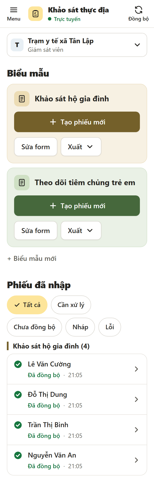

### 2.1 Soạn biểu mẫu

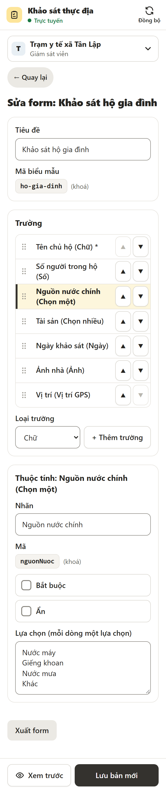

Tạo mới: **+ Biểu mẫu mới** dưới các thẻ. Sửa: **Sửa form** ở thẻ biểu mẫu.

1. **Tiêu đề** và **Mã biểu mẫu** (chữ, số, `-`, `_`, bắt đầu bằng chữ; mã tự gợi ý từ tiêu đề). Mã **khoá sau khi lưu**.
2. Thêm trường: chọn **Loại trường** (Chữ, Số, Chọn một, Chọn nhiều, Ngày, Ảnh, Vị trí GPS) rồi bấm **+ Thêm trường**.
3. Bấm vào một trường để sửa ở khối **Thuộc tính**: Nhãn, **Bắt buộc**, **Ẩn**, các lựa chọn (mỗi dòng một lựa chọn) với trường Chọn một / Chọn nhiều.
4. Đổi thứ tự: kéo tay nắm ⠿ ở đầu dòng, hoặc bấm ▲ ▼.
5. **Xem trước** để xem điều tra viên sẽ thấy gì; bấm lại để sửa tiếp.
6. **Lưu bản mới.**

Những điều cần biết khi **sửa biểu mẫu đã dùng**:

- Mỗi lần lưu tạo **phiên bản mới**. Phiếu cũ vẫn mở bằng phiên bản của nó, dữ liệu không mất. Điều tra viên nhận bản mới ở lần đồng bộ kế tiếp.
- **Không đổi được loại trường** và mã trường đã lưu. **Không xoá được trường đã lưu**: bỏ trường thì tích **Ẩn** (phiếu mới không có trường đó; phiếu cũ vẫn giữ giá trị, hiện kèm "(đã ẩn)").
- Hai người cùng sửa một biểu mẫu thì bản lưu sau thành phiên bản mới hơn, nên báo nhau trước khi sửa.

**Dùng lại biểu mẫu ở tổ chức khác:** mở biểu mẫu, bấm **Xuất form** (tải file `.json`). Ở tổ chức kia: **+ Biểu mẫu mới** → **Nhập form**, chọn file, kiểm lại rồi **Lưu bản mới**. Trùng mã biểu mẫu đã có thì đổi mã trước khi lưu.

### 2.2 Thành viên

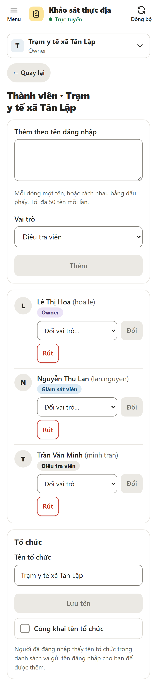

Menu → **Thành viên**.

- **Thêm người:** dán **tên đăng nhập** họ gửi cho bạn vào ô **Thêm theo tên đăng nhập**, chọn **Vai trò**, bấm **Thêm**. Thêm nhiều người một lần: mỗi dòng một tên, hoặc cách nhau bằng dấu phẩy, tối đa 50 tên. Ứng dụng báo từng tên: Đã thêm, "Không có tên đăng nhập này", "Người này đã là thành viên"… Tên lỗi được giữ lại trong ô để sửa và thêm lại.
- **Đổi vai trò** (chỉ Owner): chọn vai trò mới ở ô **Đổi vai trò…** rồi bấm **Đổi**.
- **Rút khỏi tổ chức:** bấm **Rút**, xác nhận. Người bị rút không gửi được phiếu chưa gửi nữa (họ được nhắc xuất JSON), nên nhắc họ đồng bộ trước.

| | Thêm / rút điều tra viên | Thêm / rút / đổi giám sát viên, Owner |
|---|---|---|
| Giám sát viên | Được | Không |
| Owner | Được | Được |

Tổ chức phải luôn còn **ít nhất một Owner** ("Tổ chức phải còn ít nhất một Owner"). Không thêm được tài khoản quản trị hệ thống.

### 2.3 Tên tổ chức và công khai (Owner)

Cuối màn hình Thành viên, khối **Tổ chức**:

- **Tên tổ chức** → **Lưu tên**. Mọi người thấy tên mới sau lần đồng bộ kế tiếp.
- **Công khai tên tổ chức** (mặc định tắt): bật thì **tên** tổ chức hiện trong danh sách "Tổ chức công khai" ở màn hình Tổ chức của mọi người dùng, để người mới biết mà gửi tên đăng nhập xin vào. Chỉ lộ tên, không lộ biểu mẫu, phiếu hay thành viên. Người khác vẫn không tự vào được.

### 2.4 Xuất dữ liệu

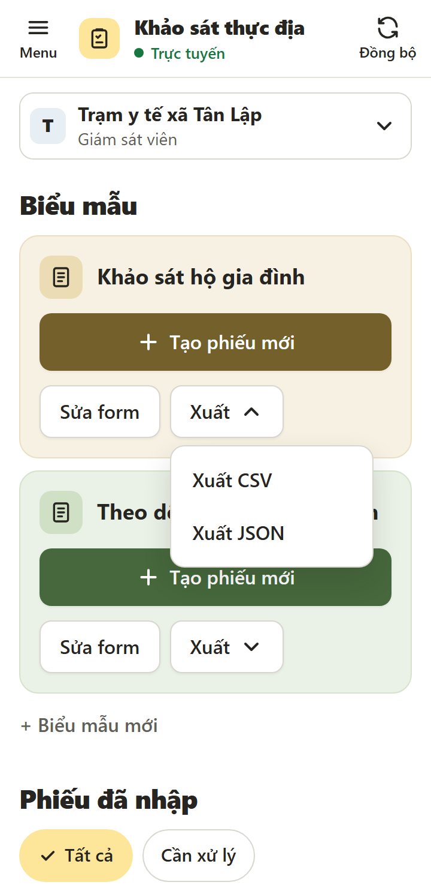

Ở thẻ biểu mẫu, bấm **Xuất** rồi chọn:

- **Xuất CSV:** mở bằng Excel (đúng tiếng Việt). Mỗi phiếu một dòng, mỗi trường một cột; vị trí tách thành ba cột vĩ độ, kinh độ, độ chính xác; ảnh là đường dẫn (phải đăng nhập mới mở được). Phiếu tạo bằng các phiên bản biểu mẫu khác nhau nằm chung một file.
- **Xuất JSON:** đủ dữ liệu và mọi phiên bản biểu mẫu, dùng để lưu trữ hoặc xử lý bằng phần mềm.

File chỉ gồm phiếu **đã lên máy chủ**; phiếu còn trên điện thoại điều tra viên chưa có trong file. Không có mạng thì nút Xuất khoá.

### 2.5 Mở tổ chức mới

Bất kỳ ai có tài khoản đều xin mở tổ chức được (xem ảnh ở [1.3](#13-vào-tổ-chức)):

1. Menu → **Tổ chức** (hoặc **Tổ chức khác…**).
2. Khối **Mở tổ chức mới**: nhập **Tên** và **Ghi chú cho quản trị** (mục đích, quy mô), bấm **Gửi yêu cầu**.
3. Khối **Yêu cầu của bạn** hiện "Đang chờ duyệt" (có nút **Huỷ**). Quản trị duyệt xong thì bạn thành **Owner** của tổ chức mới, tổ chức hiện trong bộ chọn sau lần đồng bộ kế tiếp. Bị từ chối thì thấy "Bị từ chối: <lý do>".

Mỗi người chỉ có **một yêu cầu đang chờ** và là Owner của **tối đa 3 tổ chức**. Tổ chức mới chưa có biểu mẫu: soạn biểu mẫu ([2.1](#21-soạn-biểu-mẫu)) rồi thêm thành viên ([2.2](#22-thành-viên)).

---

## 3. Quản trị hệ thống

Quản trị dùng trang riêng **`/admin/`** trên máy tính (điện thoại vẫn mở được). Trang này luôn cần mạng, không lưu gì trên máy; đóng tab là phải đăng nhập lại. Tài khoản quản trị **không dùng được ứng dụng khảo sát** (đăng nhập ở đó sẽ thấy "Tài khoản quản trị dùng trang /admin"), và **không xem được** biểu mẫu, phiếu, ảnh hay danh sách thành viên của tổ chức nào.

Thanh trên có ba mục: **Yêu cầu (n)** (số yêu cầu đang chờ), **Tổ chức**, **Tài khoản**. Kết quả mỗi thao tác hiện ở một dòng ngay trên bảng.

### 3.1 Tạo tài khoản quản trị

Không tạo được trên trang web. Người giữ máy chủ chạy lệnh (cùng `DB_PATH` với server, chạy được khi server đang chạy):

```bash
npm run user:add -w server -- --username quantri --name "Quản trị" --admin
```

Lệnh in **mật khẩu tạm một lần**. Đăng nhập `/admin/` bằng mật khẩu đó. Đổi mật khẩu quản trị cũng bằng lệnh (`user:reset-password`, mục [3.5](#35-lệnh-trên-máy-chủ)), vì trang quản trị không có chỗ đổi mật khẩu.

### 3.2 Duyệt yêu cầu mở tổ chức

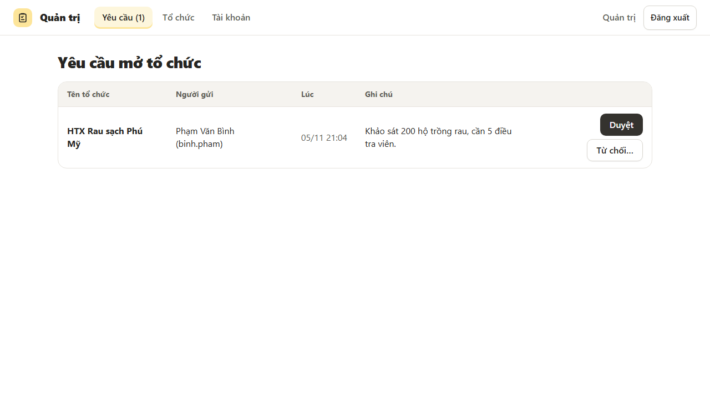

Mục **Yêu cầu** (trang mặc định) liệt kê yêu cầu đang chờ, cũ nhất trước: tên tổ chức, người gửi, lúc gửi, ghi chú.

- **Duyệt:** không hỏi lại. Tổ chức được tạo, người gửi thành Owner. Dòng kết quả ghi "Đã duyệt: <tên> (mã p-…)".
- **Từ chối…:** nhập **lý do** (bắt buộc, người gửi sẽ thấy) rồi **Xác nhận từ chối**.
- "Người gửi đã sở hữu 3 tổ chức, chưa duyệt được": yêu cầu vẫn chờ; người gửi cần bỏ bớt tổ chức hoặc huỷ yêu cầu.

### 3.3 Tổ chức

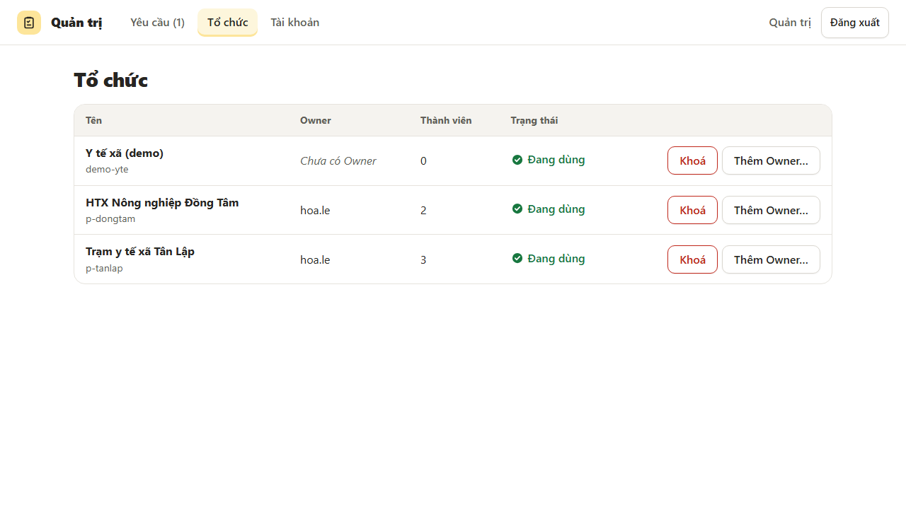

Mọi tổ chức, kể cả đã khoá: tên, mã, Owner, số thành viên, trạng thái.

- **Khoá:** hỏi lại "Khoá "<tên>"? Mọi thành viên sẽ không đồng bộ được với tổ chức này." Thành viên thấy tổ chức như bị rút (phiếu chưa gửi chỉ còn Xuất JSON hoặc Xoá khỏi máy), nên chỉ khoá khi thật cần. **Mở** không hỏi lại.
- **Thêm Owner…:** khi tổ chức mất Owner (Owner nghỉ việc, mất tài khoản). Nhập tên đăng nhập, bấm **Thêm làm Owner**. Owner cũ vẫn giữ quyền; muốn bỏ thì Owner rút ở màn hình Thành viên.

### 3.4 Tài khoản

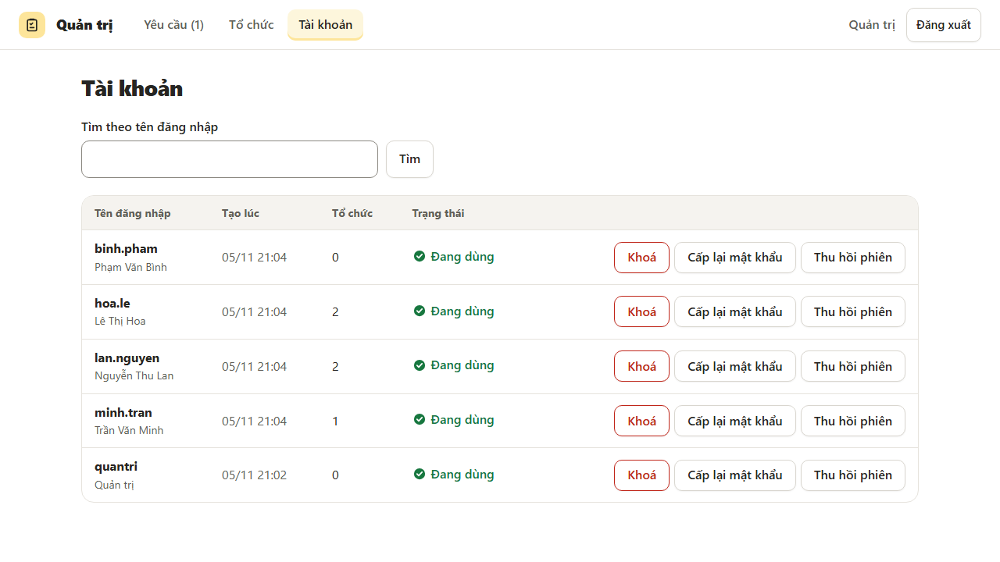

Mở là thấy tối đa 50 tài khoản; gõ một phần tên đăng nhập rồi **Tìm** để lọc.

| Nút | Dùng khi | Hậu quả |
|---|---|---|
| **Cấp lại mật khẩu** | Người dùng quên mật khẩu | Có hỏi lại. Mật khẩu tạm hiện **một lần** ngay dưới dòng, gửi riêng cho người đó và dặn họ đổi ở Cài đặt. Các máy đang đăng nhập vẫn dùng tiếp |
| **Thu hồi phiên** | Người dùng mất máy, lộ mật khẩu | Không hỏi lại. Mọi máy phải đăng nhập lại; phiếu trên các máy đó không mất |
| **Khoá** | Tài khoản bị lạm dụng, người đã nghỉ | Có hỏi lại. Thu hồi mọi phiên, không đăng nhập được nữa. **Trang này không mở khoá được** |

Không tự khoá hay tự thu hồi phiên của chính mình được.

### 3.5 Lệnh trên máy chủ

Làm được cùng việc với mục Tài khoản, dùng khi trang quản trị không vào được hoặc cho chính tài khoản quản trị:

```bash
npm run user:add -w server -- --username dang --name "Đăng" [--admin]  # tạo tài khoản, in mật khẩu tạm
npm run user:reset-password -w server -- --user dang                   # quên mật khẩu: mật khẩu tạm mới
npm run user:revoke-sessions -w server -- --user dang                  # mất máy: thu hồi mọi phiên
npm run user:disable -w server -- --user dang                          # khoá tài khoản và thu hồi mọi phiên
```

Vận hành máy chủ (deploy, sao lưu, khôi phục) ở [deploy.md](deploy.md).

---

## Phụ lục: câu báo thường gặp

| Câu báo | Ở đâu | Làm gì |
|---|---|---|
| Ngoại tuyến | Thanh trên | Vẫn điền và lưu phiếu bình thường; có mạng sẽ tự gửi |
| Cần kết nối mạng… | Đăng nhập, Tổ chức, Thành viên, Xuất, lưu biểu mẫu, Đổi mật khẩu | Các việc này cần mạng; thử lại khi có mạng |
| Máy chủ đang lỗi, thử lại sau | Màn hình cần mạng | Chờ vài phút rồi bấm lại; kéo dài thì báo nhóm hỗ trợ |
| Máy chủ đang lỗi, sẽ thử lại | Trang chủ | Không cần làm gì, ứng dụng tự gửi lại |
| Phiên đăng nhập hết hạn, đăng nhập lại | Đăng nhập | Đăng nhập lại; phiếu trên máy vẫn còn |
| Bạn không còn thuộc dự án X… | Trang chủ | Bạn bị rút hoặc tổ chức bị khoá; Xuất JSON gửi giám sát viên, hoặc nhờ họ thêm lại |
| Cần kết nối để mở phiếu này | Điền phiếu | Máy chưa có phiên bản biểu mẫu của phiếu; có mạng sẽ tự tải |
| Cần kết nối để xem ảnh này | Điền phiếu | Ảnh của máy khác chưa tải về; có mạng sẽ tự tải |
| Bộ nhớ đầy: đồng bộ rồi dọn ảnh đã tải lên | Điền phiếu | Đồng bộ, xoá bớt dữ liệu khác trên máy |
| Không đọc được ảnh này. Hãy chụp lại hoặc chọn ảnh JPEG/PNG | Điền phiếu | Ảnh HEIC trên Android không đọc được; chụp thẳng bằng nút + Chụp ảnh |
| Phiếu này đã bị xoá nên không sửa được nữa. | Điền phiếu | Phiếu đã xoá ở nơi khác; quay lại danh sách |
| Không nhân bản được phiếu. Thử lại sau. | Điền phiếu | Thường do bộ nhớ máy đầy; đồng bộ, dọn bớt rồi bấm lại |
| Có phiên bản mới [Tải lại] | Trên cùng | Bấm Tải lại khi tiện; chữ đang gõ được giữ, mở lại phiếu để khôi phục |
